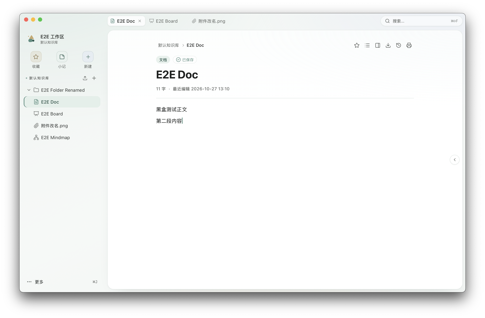
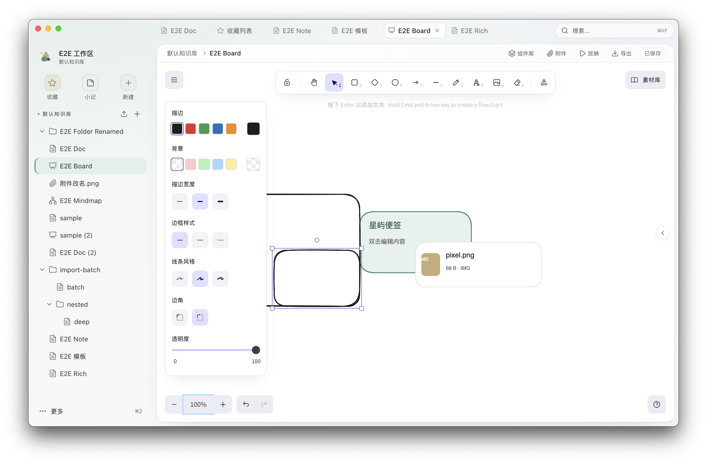
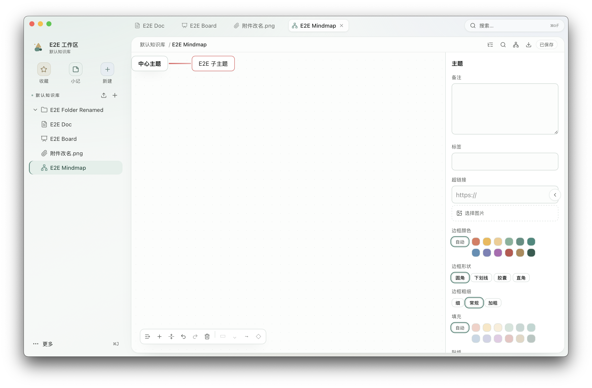

<div align="center">
  
  <h1>星屿 Starris</h1>
  <p><strong>本地优先的一体化知识工作台</strong></p>
  <p>文档 · 画板 · 思维导图 · 表格/流程图 · 附件 · 检索 · 可选 AI 协作</p>
</div>

---

## 星屿是什么

星屿是一款运行在本机的桌面知识库：所有内容保存在你自己的磁盘上，不需要账号，也不依赖云端。它把平时散落在多个工具里的东西——写文档、画草图、做思维导图、整理附件、跨内容检索——收进同一个工作区，并用一套统一的文件树管理。

> 适合：个人知识管理、产品/设计资料整理、会议与项目记录、需要本地留存且愿意让 AI 辅助整理的人。

## 商标与品牌

- 「星屿」「Starris」名称与上方图形标识用于标识本项目及其官方构建。
- 未经项目维护者书面许可，请勿将上述名称或标识用于衍生分发，或暗示与本项目存在官方关联。
- 本文档中的界面截图来自真机测试环境，仅用于功能展示，不包含真实用户数据。

## 功能一览

### 写作与文档
- 块级富文本编辑器：标题、列表、待办、引用、代码块、表格、图片、Emoji、折叠块、目录。
- 斜杠菜单插入内容，块手柄拖拽排序，自动保存，标题/正文检索与文档内查找。
- 收藏、信息面板、反向链接与「知识网络」，历史版本可回看与恢复。
- 旧版本检测：内容在别处被改动时提示，不会静默覆盖。

### 画板
- 常用图形、文本、连线、便签与图片；支持自由绘制与缩放平移。
- 组件库：导入/管理常用组件，一键插入；支持放映模式。
- 导出 PNG / SVG / Excalidraw 文件。

### 思维导图
- 8 种结构：左右平衡、逻辑图（左/右）、组织架构（上/下）、树状图、时间轴、鱼骨图。
- 分支彩虹配色、多套画布主题；主题边框支持 12 色、四种形状、三档粗细与填充。
- 标注能力：备注、标签、超链接、图片、优先级/进度/旗标等标记、贴纸。
- 自由主题、关系线（自动绕行、可加标签）、外框、概要、自动编号、点阵/网格/纯色背景。
- 大纲视图、搜索定位、拖拽换父/排序/手动摆放，撤销重做。
- 导入导出：XMind、FreeMind、OPML、Markdown、原生无损文件；图片导出 PNG/SVG。

### 附件与检索
- 附件节点上传、预览、下载、重命名；相同文件自动去重，回收站与容量统计。
- 全局搜索（标题 + 正文）、快速跳转、最近使用、收藏页。
- 文档、画板、表格/流程图、思维导图、附件统一在同一棵文件树中。

### 导入导出与协作格式
- 文档导出 Markdown / HTML / Word / PDF；整库连同附件打包导出。
- 导入 Markdown、Word、XMind 与 Excalidraw 文件；支持批量导入。
- 模板库：文档另存为模板、从模板创建。

### 个性化与数据安全
- 多套主题配色 + 浅色/深色；中文 / English 即时切换。
- 快捷键可开关、可改键、冲突提示；侧栏、标签页、单实例窗口。
- 删除进回收站可恢复；文档历史版本；工作区备份与恢复。
- 数据默认保存在 `~/.starris/rust`（可用 `STARRIS_HOME` 指定其他目录）。

### AI 协作（可选）
- 客户端自带 MCP 服务：打开星屿即可被 AI 工具连接，关闭即停止；只监听本机。
- 三档写入权限（只读 / 需人工确认 / 可编辑）+ 高风险操作强制待审；所有写入可审计。
- 待审区：AI 提出的修改先进入草稿，你确认后才真正落库。

## 程序特点

- **全本地**：无账号、无云同步；断网也能用，资料不离开本机。
- **一个窗口装下全部**：写作、画图、导图、附件与检索共用一个工作区，不再来回导出导入。
- **AI 可控**：默认需要你确认，高风险操作必须人工复核；随时可关闭 MCP 服务。
- **快**：本地数据库与 Rust 后端处理保存、检索与导出，大文档与复杂导图依然跟手。
- **数据有退路**：自动保存、回收站、历史版本、版本冲突保护、工作区备份四条防线。
- **细节完整**：中文界面、深浅主题、动效、快捷键、无障碍标签，按桌面应用习惯打磨。

<div align="center">
  
  
  <br />
  
</div>

## 下载与安装

### 方式一：安装包（推荐普通用户）

1. 从项目维护者提供的渠道获取 macOS 安装包（`.dmg`）。
2. 打开后将「星屿」拖入「应用程序」。
3. 首次启动若系统提示「无法验证开发者」，前往「系统设置 → 隐私与安全性」允许打开即可。
4. 首次启动会引导你创建一个本地工作区（选择一个空文件夹）。

> 当前主要在 macOS（Apple Silicon）真机验证；Windows/Linux 可自行从源码构建，尚未做发布级验收。

### 方式二：从源码构建

适合开发者或需要自行分发的情况，见下一节。

## 编译

### 环境要求

| 依赖 | 版本 / 说明 |
|---|---|
| macOS | 12 及以上（Apple Silicon 或 Intel） |
| Node.js | 22 LTS 及以上（开发机以 v24 验证） |
| npm | 随 Node 安装（本仓库当前使用 npm 运行脚本） |
| Rust | stable，需支持 edition 2024（建议 1.85+） |
| Xcode Command Line Tools | 构建 macOS 应用与原生依赖所需 |

### 开发运行

```bash
npm install
npm run tauri dev
```

### 构建安装包

```bash
# 当前架构的 DMG
npm run package:dmg

# Intel + Apple Silicon 通用包（首次需：rustup target add x86_64-apple-darwin）
npm run package:dmg:universal
```

构建产物在 `src-tauri/target/release/bundle/` 下。

### 质量检查（可选）

```bash
npm run check          # 前端静态检查
npm run typecheck      # 类型检查
npm run test:backend   # 后端测试
npm run check:licenses # 第三方许可证门禁
```

## 使用入门

1. **创建工作区**：首次启动点「新建工作区」，选择一个空文件夹；之后可在侧栏「更多 ⌘J」中切换或管理。
2. **建知识库与内容**：在侧栏新建知识库，点「+」或按 `⌘N` 新建文件夹、文档、画板、表格、流程图、思维导图或附件。
3. **写作**：进入文档直接输入；输入 `/` 打开插入菜单；内容自动保存，页头显示「已保存」。
4. **画板**：选择画板节点，使用顶部工具与「组件库」；`⌘P` 或页头「放映」可全屏展示。
5. **思维导图**：`Tab` 新建子主题、`Enter` 新建同级；页头「结构与主题」切换结构/配色/连线；右侧检查器调边框、填充、标记与贴纸。
6. **检索**：`⌘⇧F` 全局搜索，`⌘K` 快速跳转；文档内用 `⌘F` 查找。
7. **备份与迁移**：整个工作区目录可直接复制备份；应用内「更多 ⌘J → 备份与恢复」可导出/恢复。
8. **连接 AI（可选）**：设置 → AI 协作 → MCP 服务，确认「运行中」，复制地址与令牌，填入 AI 工具：

```jsonc
{
  "mcpServers": {
    "starris": {
      "type": "http",
      "url": "http://127.0.0.1:47821/mcp",
      "headers": { "Authorization": "Bearer <在设置中复制的令牌>" }
    }
  }
}
```

### 常用快捷键

| 快捷键 | 作用 |
|---|---|
| `⌘N` | 新建内容 |
| `⌘J` | 打开「更多」菜单 |
| `⌘,` | 设置 |
| `⌘⇧F` / `⌘K` | 全局搜索 / 快速跳转 |
| `⌘D` | 收藏 / 取消收藏当前文档 |
| `⌘S` | 立即保存 |
| `⌘\` | 收起 / 展开侧栏 |
| `⌘W` | 关闭当前标签 |
| `⌘P` | 放映当前画板 |

> 快捷键均可在「设置 → 快捷键」查看、改键或整体关闭。

## 开源软件

星屿建立在这些优秀的开源项目之上，感谢它们的作者与社区：

| 项目 | 用途 | 许可证 |
|---|---|---|
| [Tauri 2](https://tauri.app/) | 桌面应用框架 | MIT / Apache-2.0 |
| [React 19](https://react.dev/) | 界面框架 | MIT |
| [TypeScript](https://www.typescriptlang.org/) | 类型系统 | Apache-2.0 |
| [Vite](https://vite.dev/) | 前端构建 | MIT |
| [Tailwind CSS 4](https://tailwindcss.com/) | 样式系统 | MIT |
| [Radix UI](https://www.radix-ui.com/) | 无障碍基础组件 | MIT |
| [Tiptap](https://tiptap.dev/) / [ProseMirror](https://prosemirror.net/) | 文档编辑器 | MIT |
| [Excalidraw](https://excalidraw.com/) | 画板引擎 | MIT |
| [React Flow (@xyflow/react)](https://reactflow.dev/) | 思维导图画布 | MIT |
| [Motion](https://motion.dev/) | 动效 | MIT |
| [Lucide](https://lucide.dev/) | 图标 | ISC |
| [lowlight](https://github.com/wooorm/lowlight) | 代码高亮 | MIT |
| [SQLite](https://sqlite.org/) / [rusqlite](https://github.com/rusqlite/rusqlite) | 本地数据库 | Public Domain / MIT |
| [axum](https://github.com/tokio-rs/axum) / [Tokio](https://tokio.rs/) | 客户端 AI 服务的本机 HTTP | MIT |
| [serde](https://serde.rs/) | 序列化 | MIT / Apache-2.0 |
| [zip](https://github.com/zip-rs/zip2) / [quick-xml](https://github.com/tafia/quick-xml) | XMind/Office 包解析 | MIT |
| [printpdf](https://github.com/fschutt/printpdf) / [docx-rs](https://github.com/cstkingkey/docx-rs) / [office_oxide](https://crates.io/crates/office_oxide) | PDF / Word 导出与 Word 导入 | MIT / MIT / MIT OR Apache-2.0 |
| [pulldown-cmark](https://github.com/pulldown-cmark/pulldown-cmark) | Markdown 解析 | MIT |
| [image](https://github.com/image-rs/image) | 图片处理 | MIT / Apache-2.0 |
| [blake3](https://github.com/BLAKE3-team/BLAKE3) / [xxhash-rust](https://github.com/Cyan4973/xxHash) | 附件去重与索引哈希 | CC0-1.0 / Apache-2.0 · BSL-1.0 |
| [Assistant 字体](https://fonts.google.com/specimen/Assistant) | 界面字体（随包） | OFL-1.1 |

- 全量依赖清单与许可证审查结论：`docs/开发/第三方依赖许可证审查.md`；构建时执行 `npm run check:licenses` 门禁。
- 仓库内未包含 GPL/AGPL/SSPL/BUSL 或非商业授权依赖；少数经 Tauri 传输链引入的 MPL-2.0 组件未做修改。
- 本项目自身暂未附带开源许可证；如需再分发或商业使用，请先与项目维护者确认。第三方组件仍遵循各自许可证。

## 文档与反馈

- 用户向说明与设计规范：`docs/需求文档/`、`docs/UX_SPEC.md`、`docs/ui设计规范/`
- 开发指南：`docs/开发/`（架构、数据库、测试、前端规范）
- 更新日志：`docs/更新日志/`
- 真机测试报告：`docs/功能测试/`

遇到问题请附上：系统版本、复现步骤、`~/.starris/rust/logs/starris.log` 中的相关片段（日志不含文档正文与令牌）。
