# 星屿 Starris · 架构与流程图表总览

> 更新日期：2026-10-31（Windows 适配、思维导图、MCP 与当前模块结构）
>
> 本文件是项目图表的主索引：架构、工作流程、时序、数据流、生命周期、ERD、模块树、时间线与平台交互图集中在这里维护。需求文档中的局部图可以保留，但**跨模块或长期有效的图以本文件为准**。
>
> 绘图约定：全部使用 Mermaid 文本图，随代码一起版本管理；图中节点名与源码目录/命令保持一致，改代码时同步更新本文件。
>
> 时效约定：本文件与当前代码同步；`docs/需求文档/` 中的图是需求制定时的快照，按 AGENTS.md 保留历史事实，不强行改写。已下线能力（如云同步）只出现在历史更新日志，不作为现行图的一部分。

## 1. 系统架构

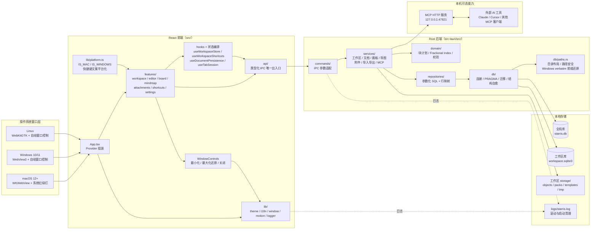

**不变量**

- 组件不直接 `import @tauri-apps/api`，窗口与 IPC 能力统一从 `lib/window.ts`、`api/*` 进入。
- 复杂业务、批量数据处理、权威校验与持久化全部在 Rust；前端负责展示、交互编排与轻量格式化。
- 同一业务规则只有一个权威实现：工作区切换 `workspace_service::switch_workspace`、文档保存 `document_service`、附件引用 `node_attachment`。

## 2. 前端模块树

```mermaid
flowchart TB
  SRC["src/"]
  SRC --> APP["App.tsx<br/>Provider + 页面骨架"]
  SRC --> FEATURES["features/"]
  SRC --> COMPONENTS["components/"]
  SRC --> APIDIR["api/"]
  SRC --> HOOKSDIR["hooks/"]
  SRC --> LIBDIR["lib/"]
  SRC --> TYPES["types/"]
  SRC --> STYLES["styles/<br/>tokens.css / app.css"]
  SRC --> MOCKS["mocks/<br/>仅 mock 常量"]

  FEATURES --> WORKSPACE["workspace/<br/>侧栏 / 文件树 / 标签 / 顶栏<br/>WindowBar / WindowControls"]
  FEATURES --> EDITOR["editor/<br/>Tiptap 编辑器 / 页头 / 查找 / 历史"]
  FEATURES --> BOARD["board/<br/>Excalidraw 画板 / 组件库 / 放映"]
  FEATURES --> MINDMAP["mindmap/<br/>8 种结构 / 检查器 / 大纲"]
  FEATURES --> ATTACH["attachments/<br/>节点页 / 管理 / 生命周期"]
  FEATURES --> SHORTCUT["shortcuts/<br/>动作表 / 录制 / 冲突检测"]
  FEATURES --> SETTINGS["settings/<br/>外观 / 存储 / AI / 快捷键"]

  COMPONENTS --> UI["ui/<br/>shadcn 基础组件"]
  COMPONENTS --> COMMON["common/<br/>BrandLogo / TrafficLightSlot<br/>NodeKindIcon 等共用件"]
  LIBDIR --> PLATFORM["platform.ts<br/>平台判定与键帽文案"]
  LIBDIR --> WINDOWLIB["window.ts<br/>窗口动作 / 最大化订阅 / 双击标题栏"]
  LIBDIR --> I18N["i18n.tsx<br/>中文键 + 英文词典"]
  LIBDIR --> THEME["theme.tsx<br/>主题 × 深浅"]
```

## 3. 启动时序

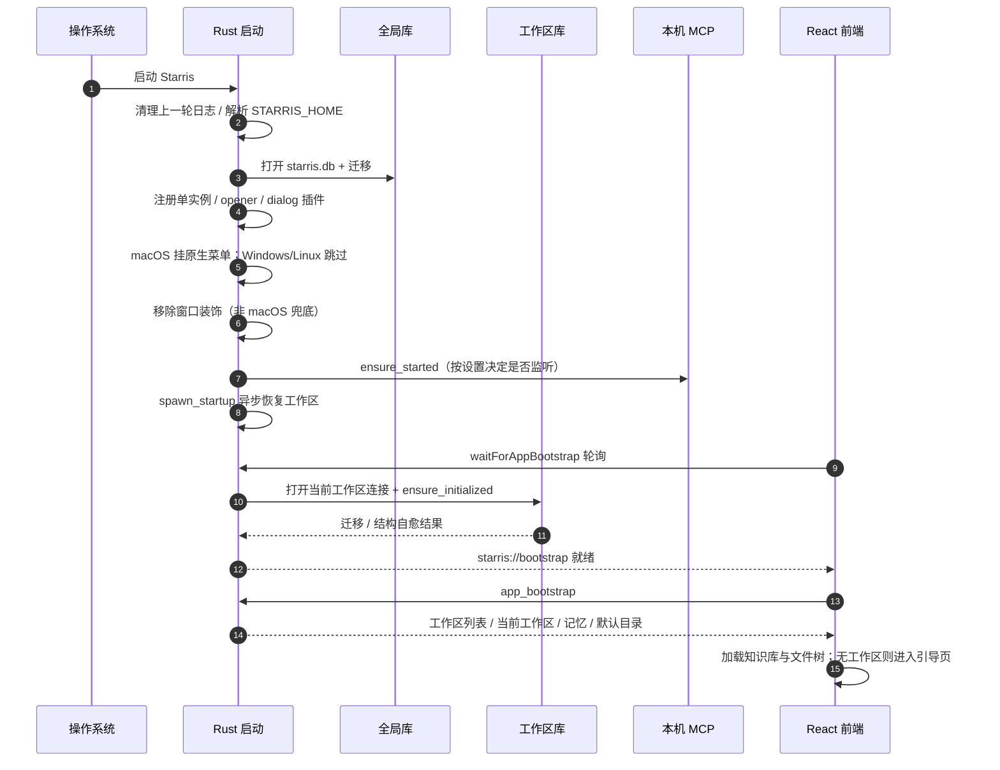

> Windows 差异：`tauri.windows.conf.json` 在窗口创建时就使用 `decorations:false`，`lib.rs` 启动后再次调用 `set_decorations(false)` 兜底；macOS 通过 `tauri.macos.conf.json` 保留 Overlay 红绿灯。

## 4. 工作区切换与安全删除

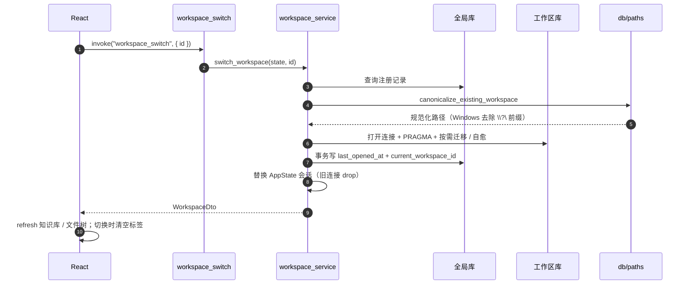

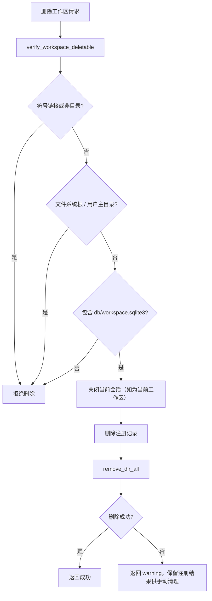

## 5. 文档保存数据流

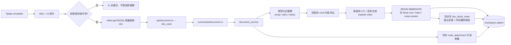

**前端守卫**：切换标签 / 文档 / 工作区 / 知识库前先 `flush`，失败阻止切换；保存期间新编辑结束后再排一次保存；加载期间关闭可编辑，避免旧文档被误标脏。

## 6. 附件生命周期

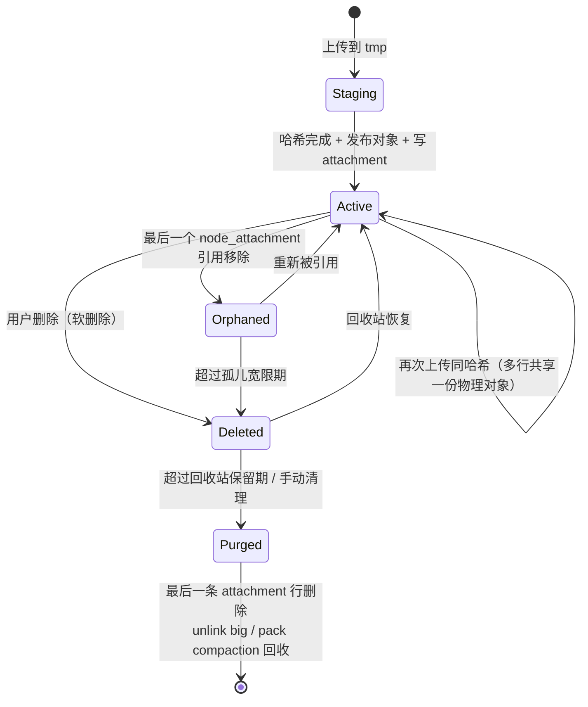

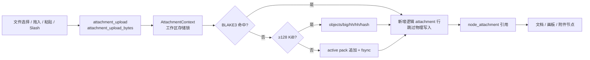

## 7. 工作区数据库 ERD

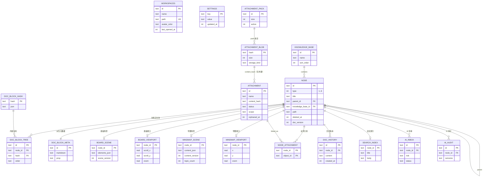

> 全局库与工作区库是**两个独立 SQLite 文件**，没有数据库级外键；由服务层用路径与 id 关联。完整列定义和迁移顺序见 [数据库设计与迁移](./数据库设计与迁移.md)。

## 8. 导入与导出

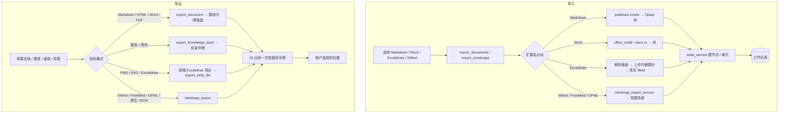

**Windows 适配**：保存对话框的默认文件名统一经 `safeFileName()` 清理 `\ / : * ? " < > |`、结尾点/空格与 CON/PRN/NUL/COM1… 等保留名，避免 Windows 拒绝写入。

## 9. 思维导图数据流

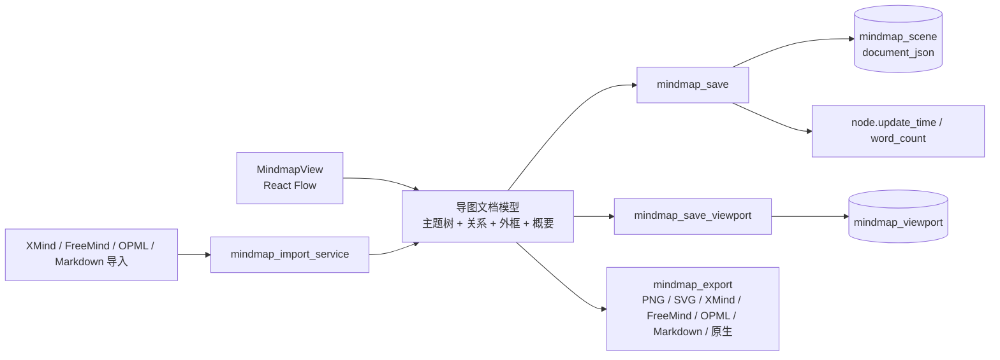

结构支持：左右平衡、逻辑图（左 / 右）、组织架构（上 / 下）、树状图、时间轴、鱼骨图；布局、配色、边框与标记写入同一份文档 JSON，切换结构不丢内容。

## 10. 平台窗口与快捷键适配

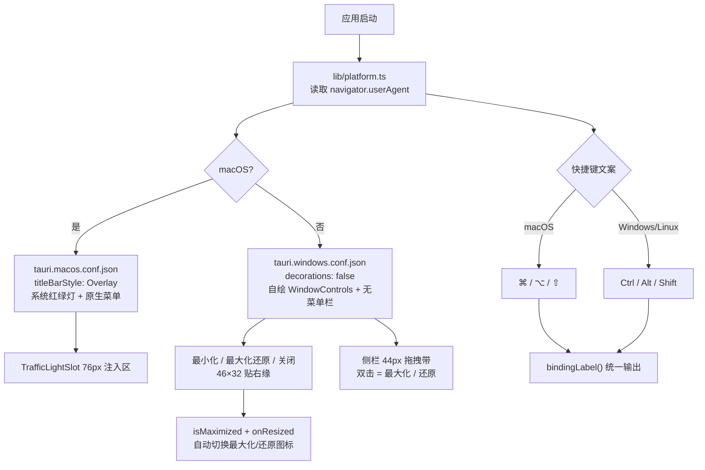

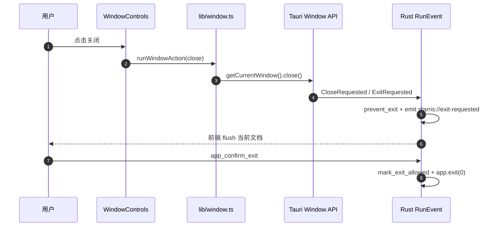

## 11. 快捷键事件分发

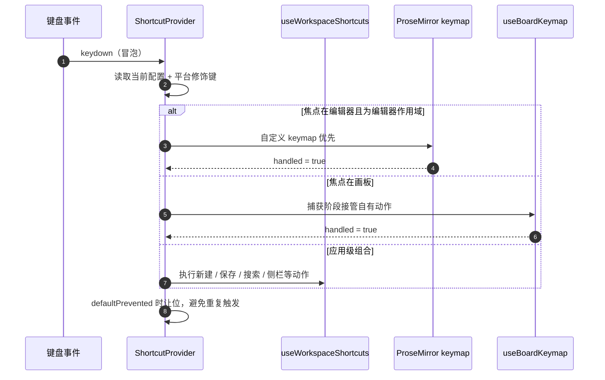

## 12. 质量门禁与发布

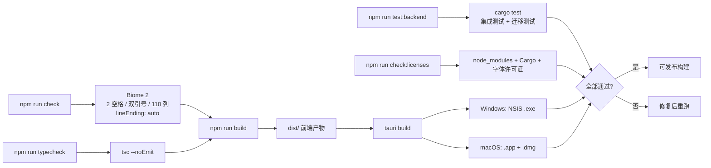

## 13. MCP 与 AI 协作

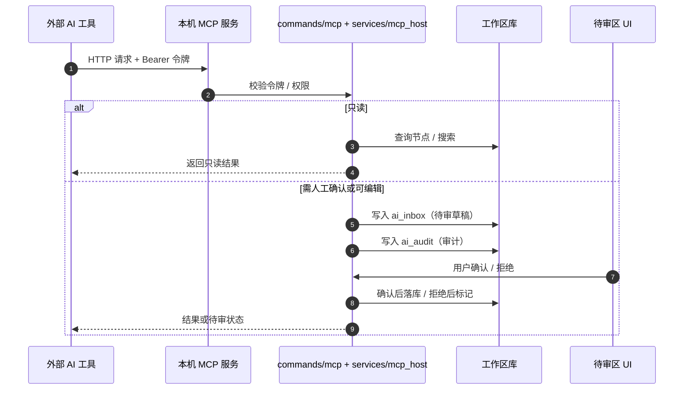

## 14. 关键目录时间线

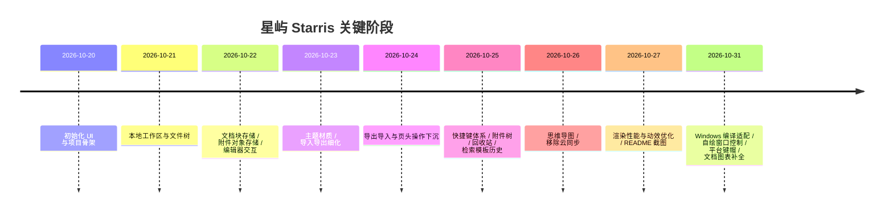

## 15. 图表维护清单

| 图表 | 对应源码 | 何时更新 |
|---|---|---|
| 系统架构 | `src/`、`src-tauri/src/` 顶层目录 | 新增模块、IPC 域或外部能力 |
| 前端模块树 | `src/features/*` | 新增 feature 或组件分层变化 |
| 启动时序 | `bootstrap.rs`、`lib.rs`、`db/init_registry.rs` | 启动顺序、插件、迁移策略变化 |
| 工作区切换 / 删除 | `workspace_service.rs`、`db/paths.rs` | 切换入口、安全规则变化 |
| 文档保存 | `document_service.rs`、`useDocumentPersistence.ts` | 保存协议、块存储、元数据变化 |
| 附件生命周期 | `attachment_service.rs`、`attachment_maintenance_service.rs` | 生命周期、保留策略、存储格式变化 |
| ERD | `db/workspace.rs`、`repositories/*` | 表、索引、迁移版本变化 |
| 导入导出 | `import_service.rs`、`export_service.rs`、`mindmap_*` | 新格式、令牌规则变化 |
| 平台窗口 / 快捷键 | `tauri.*.conf.json`、`lib/platform.ts`、`WindowControls.tsx` | 新增平台或窗口行为变化 |
| 质量门禁 | `package.json`、`scripts/check-*.mjs` | 脚本、CI、打包目标变化 |
