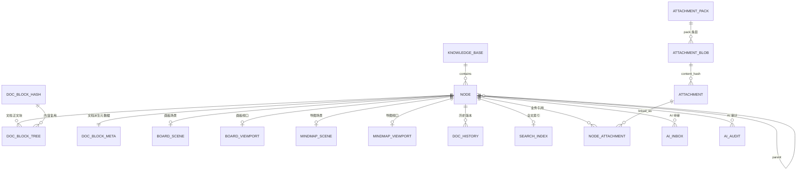

# 数据库设计与迁移

> 状态：2026-10-23 已落地，2026-10-30 收敛为单一 schema（全局库 + 每工作区独立库，无版本迁移链）；2026-10-31 补充 Windows 路径行为。当前表集合覆盖文档块、附件对象存储、软删除回收站、思维导图、搜索索引、文档历史与 AI 待审/审计。实现见 `src-tauri/src/db/`、`repositories/`、`services/`。跨表关系与整体数据流见 [图表总览](./图表总览.md)。

## 1. 两类数据库

| 数据库 | 路径 | 内容 | 连接时机 |
|---|---|---|---|
| 全局库 | `${STARRIS_HOME:-~/.starris/rust}/db/starris.db` | 工作区注册表、记忆配置 | 应用启动，长期持有 |
| 工作区库 | `<工作区目录>/db/workspace.sqlite3` | 知识库、文件树节点、文档块、附件元数据 | 切换工作区时打开，同一时刻最多一个 |

连接 PRAGMA：`foreign_keys=ON`、`journal_mode=WAL`、`synchronous=NORMAL`、`busy_timeout=5000`。

## 2. 全局库表

### workspaces

| 列 | 类型 | 约束 | 说明 |
|---|---|---|---|
| id | TEXT | PK | UUID v7 |
| name | TEXT | NOT NULL | 显示名，只存在全局库 |
| path | TEXT | NOT NULL UNIQUE | 工作区目录绝对路径（创建时 canonicalize） |
| avatar_color | TEXT | NOT NULL | 设计令牌（`var(--primary)` 等白名单） |
| created_at | INTEGER | NOT NULL | Unix 毫秒 |
| updated_at | INTEGER | NOT NULL | Unix 毫秒 |
| last_opened_at | INTEGER | NOT NULL | 列表排序、删除当前后选择替代工作区 |

索引：`idx_workspaces_last_opened(last_opened_at DESC)`。

### settings

| 列 | 类型 | 约束 | 说明 |
|---|---|---|---|
| key | TEXT | PK | 仅字母数字与 `._-`，1~80 |
| value | TEXT | NOT NULL | ≤4096 字节 |
| updated_at | INTEGER | NOT NULL | Unix 毫秒 |

保留键：
- `current_workspace_id`：只由 `workspace_service::switch_workspace` / `clear_current_workspace` 写入，`memory_save` 拒绝覆盖。
- `appearance.theme`：9 套主题名之一（mist 为默认）。
- `appearance.mode`：`light | dark`。
- `kb.current.<workspaceId>`：该工作区当前知识库 id；由前端在知识库切换/回退时写入，按工作区隔离。

## 3. 工作区库表

### knowledge_base

| 列 | 类型 | 约束 | 说明 |
|---|---|---|---|
| id | TEXT | PK | UUID v7 |
| name | TEXT | NOT NULL | 1~80 字符 |
| description | TEXT | NOT NULL DEFAULT '' | ≤500 字符 |
| sort_order | INTEGER | NOT NULL | 末尾追加 |
| created_at / updated_at | INTEGER | NOT NULL | Unix 毫秒 |

索引：`idx_knowledge_base_sort(sort_order, created_at)`。

### node

| 列 | 类型 | 约束 | 说明 |
|---|---|---|---|
| id | TEXT | PK | UUID v7 |
| type | INTEGER | CHECK 1..7 | 1 文件夹 / 2 文档 / 3 画板 / 4 表格 / 5 流程图 / 6 附件 / 7 思维导图 |
| title | TEXT | NOT NULL | 1~200 字符，禁止 `/`、`\`、控制字符 |
| knowledge_base_id | TEXT | FK → knowledge_base ON DELETE CASCADE | 所属知识库 |
| parent_id | TEXT | FK → node ON DELETE CASCADE, NULL | 根节点为 NULL |
| level | INTEGER | CHECK ≥1 | 根 = 1 |
| path | TEXT | NOT NULL | 从一级到当前的标题路径，`/` 拼接 |
| sort_order | INTEGER | NOT NULL | 同级连续序号 |
| starred | INTEGER | NOT NULL | 0/1 |
| word_count | INTEGER | NOT NULL DEFAULT 0 | 文档正文字数（忽略空白） |
| content | TEXT | NOT NULL DEFAULT '' | 文档完整 Tiptap JSON 缓存；与块表同事务更新 |
| create_time | INTEGER | NOT NULL | Unix 毫秒（需求字段名） |
| update_time | INTEGER | NOT NULL | Unix 毫秒（需求字段名） |
| doc_version | INTEGER | NOT NULL DEFAULT 0 | 文档版本号，用于历史与冲突检测（v11） |
| deleted_at | INTEGER | NULL | 软删除时间；NULL 表示活跃（v14） |

索引：`idx_node_kb_parent_sort(knowledge_base_id, parent_id, sort_order)`、`idx_node_parent(parent_id)`、`idx_node_kb(knowledge_base_id)`、部分索引 `idx_node_deleted(deleted_at) WHERE deleted_at IS NOT NULL`。

> 活跃查询统一过滤 `deleted_at IS NULL`；回收站列表反向查询。永久删除/清空/到期清理才级联释放子树与附件引用。

### board_scene / board_viewport
| 表 | 列 | 说明 |
|---|---|---|
| board_scene | node_id PK, elements_json, app_state_json, scene_version, element_count, updated_at | 每个画板一行；elements 只存未删除图元；图片 `fileId` 直接是全局 object_id |
| board_viewport | node_id PK, scroll_x, scroll_y, zoom, updated_at | 视口独立小表，保存不递增场景版本 |

两表均以 `node_id` 外键级联删除；画板不建文件映射表。

### board_library / board_library_item
| 表 | 列 | 说明 |
|---|---|---|
| board_library | id PK, preset_key UNIQUE, name, author, license, source_url, source_type(preset/import), enabled, item_count, created_at, updated_at | 预设用 preset_key 幂等 seed；导入库可删除 |
| board_library_item | id PK, library_id FK CASCADE, name, elements_json, sort_order, created_at | 库内组件；elements 直接对应 Excalidraw LibraryItem |

组件库只存矢量元素；抽样预设未含 image 元素或外部文件。

### doc_block_hash
| 列 | 类型 | 约束 | 说明 |
|---|---|---|---|
| hash | TEXT | PK | `xxh3_128` 小写 hex（32 字符） |
| json | TEXT | NOT NULL | 规范化块 JSON（serde_json 序列化） |

### doc_block_tree
| 列 | 类型 | 约束 | 说明 |
|---|---|---|---|
| id | TEXT | PK | 块实例 UUID v7（重复内容也各自独立） |
| node_id | TEXT | NOT NULL, FK → node ON DELETE CASCADE | 所属文档 |
| hash | TEXT | NOT NULL, FK → doc_block_hash(hash) | 内容寻址 |
| order | TEXT | NOT NULL | base62 Fractional Index，≤32 字符 |

索引：`idx_doc_block_tree_node_order(node_id, order)`、`idx_doc_block_tree_hash(hash)`。

一个文档的顶层块 = `editor.getJSON().content[]`；删除 tree 行后，只有 hash 引用数归零才删除 `doc_block_hash` 行。

### doc_block_meta
| 列 | 类型 | 约束 | 说明 |
|---|---|---|---|
| id | TEXT | PK, FK → node ON DELETE CASCADE | 与 `node.id` **完全相同**（每篇文档一行） |
| markdown | TEXT | NOT NULL DEFAULT '' | 由 Tiptap JSON 派生的 Markdown 文本（图片 base64 不复制） |
| prop | TEXT | NOT NULL DEFAULT '{}' | JSON 对象：version/wordCount/blockCount/headingCount/listCount/tableCount/codeBlockCount/imageCount/attachmentCount（imageCount 含旧 image 与 attachmentImage；attachmentCount 为附件块 items 总数） |
| update_time | INTEGER | NOT NULL | 派生数据对应的正文时间，用于阻止较旧后台任务覆盖新结果 |

保存正文提交后由后台线程用独立连接 upsert；`ON CONFLICT` 仅在 `excluded.update_time >= 当前 update_time` 时更新。加载旧文档且元数据缺失/不一致时惰性补写。删除节点级联删除元数据。

### attachment_preview
| 列 | 类型 | 约束 | 说明 |
|---|---|---|---|
| attachment_id | TEXT | PK, FK → attachment ON DELETE CASCADE | 一个附件一行 |
| kind | TEXT | NOT NULL | 预览类型：`text` / `blocks` / `unsupported` |
| payload_json | TEXT | NOT NULL | 预览结果（与 IPC 返回结构一致） |
| source_updated_at | INTEGER | NOT NULL | 生成时的 `attachment.updated_at`；与当前值不一致即视为过期 |

写入时预转换：附件落库后由单工作线程（有界队列 16）把文本/Markdown/Word 预览转换成块 JSON 写入本表；打开附件页只读现成结果，过期或缺失时现算并回填。单条缓存上限 2 MiB，超过只算不存。

### attachment
逻辑附件：用户看到的一行。物理文件与名称/目录解耦，重命名/移动只改这张表。

| 列 | 类型 | 约束 | 说明 |
|---|---|---|---|
| id | TEXT | PK | UUID v7 |
| name | TEXT | NOT NULL | 用户可见文件名；无 `/`、`\`、控制字符 |
| logical_path | TEXT | NOT NULL DEFAULT '' | 相对逻辑目录，空串为根；`/` 分隔 |
| content_hash | TEXT | NOT NULL | BLAKE3 64 位小写十六进制；**故意不建外键**，软删除后保留审计 |
| size | INTEGER | CHECK ≥0 | 字节数 |
| mime | TEXT | NOT NULL | 调用方提供或按扩展名推断 |
| status | TEXT | CHECK active/deleted | active；deleted 表示回收站 |
| created_at / updated_at | INTEGER | NOT NULL | Unix 毫秒 |
| deleted_at | INTEGER | NULL | 进入回收站时间 |
| scope | TEXT | CHECK library/node, NOT NULL DEFAULT 'library' | library 主动保留；node 失去引用后进入孤儿流程 |
| expires_at | INTEGER | NULL | 未关联时的 TTL 到期时间；关联期间不执行 |
| orphaned_at | INTEGER | NULL | 最后一个引用移除时间 |

索引：`idx_attachment_active_path(logical_path, name) WHERE status='active'`（目录检索用的**非唯一**索引）、`idx_attachment_hash(content_hash)`、`idx_attachment_status(status, updated_at DESC)`、`idx_attachment_lifecycle(scope, status, orphaned_at, expires_at)`。

> v6 起同目录同名附件允许并存：文件名只是展示元数据，附件身份是 `id`、内容去重靠 BLAKE3。两张都叫 `image.png` 的截图各自成行、共享同一物理对象（v5 的 `uq_attachment_active_path` 部分唯一索引已撤下）。

### attachment_blob
一份物理内容一行；**不存引用计数**。

> 物理对象该不该存在，唯一判据是"还有没有任何 `attachment` 行（含回收站）引用这个哈希"：`SELECT COUNT(*) FROM attachment WHERE content_hash = ?`（走 `idx_attachment_hash`）。软删除不再立即删 blob，以支持回收站恢复；只有维护任务 purge 掉最后一条 attachment 行后才删 blob 行，big 随后 unlink、pack 字节由 compaction 回收。

| 列 | 类型 | 约束 | 说明 |
|---|---|---|---|
| hash | TEXT | PK | BLAKE3 64 位小写十六进制 |
| size | INTEGER | CHECK ≥0 | 物理对象字节数 |
| storage_kind | TEXT | CHECK big/pack | big 或 pack |
| pack_id | TEXT | FK → attachment_pack ON DELETE RESTRICT, NULL | 仅 pack |
| pack_offset | INTEGER | NULL；pack 时 CHECK ≥0 | pack 内偏移 |
| created_at | INTEGER | NOT NULL | Unix 毫秒 |

CHECK：big 必须无 pack 字段；pack 必须有 `pack_id + pack_offset`。索引：`idx_attachment_blob_pack(pack_id, pack_offset)`。

### attachment_pack
| 列 | 类型 | 约束 | 说明 |
|---|---|---|---|
| id | TEXT | PK | UUID v7；物理文件 `<id>.pack` |
| file_name | TEXT | NOT NULL UNIQUE | 物理文件名（当前固定 `<id>.pack`） |
| size | INTEGER | CHECK ≥0 | 已写入长度 |
| active | INTEGER | CHECK 0/1 | 最多一个 active，接收新追加 |
| created_at / retired_at | INTEGER | NOT NULL / NULL | 创建/停止追加时间 |

索引：`uq_attachment_pack_active(active) WHERE active=1`。

物理布局：`storage/objects/big/<hash[0..2]>/<hash[2..4]>/<hash>`；`storage/objects/small/packs/<pack-id>.pack`；临时文件 `storage/tmp/*.part`。pack 文件只存原始字节，偏移/长度存 `attachment_blob`；purge 才移除 blob 行，pack 字节由 compaction 回收。

### node_attachment
业务节点对 object_id 的引用表；文档/画板保存时差量同步，附件节点创建时登记，删除节点由外键级联。

| 列 | 类型 | 约束 | 说明 |
|---|---|---|---|
| node_id | TEXT | FK → node ON DELETE CASCADE | 文档 / 画板 / 附件节点 |
| object_id | TEXT | FK → attachment ON DELETE CASCADE | 逻辑附件 id，即前端 object_id |
| created_at / updated_at | INTEGER | NOT NULL | Unix 毫秒 |

主键 `(node_id, object_id)`；索引 `idx_node_attachment_object(object_id)`。附件名称/大小/MIME 仍只在 `attachment` 表，关联表不复制元数据。

### workspace_meta
| key | value | 说明 |
|---|---|---|
| attachment.last_maintenance_at | Unix 毫秒字符串 | 最近一轮看门狗/手动清理时间 |

### mindmap_scene / mindmap_viewport（v13 结构自愈登记）

| 表 | 列 | 说明 |
|---|---|---|
| mindmap_scene | node_id PK, content_json, content_version, topic_count, updated_at | 每张导图一行；主题树、关系线、外框、概要、结构/配色统一存 `content_json` |
| mindmap_viewport | node_id PK, x, y, zoom, updated_at | 视口独立小表，缩放必须 > 0；保存导图内容不递增视口 |

两表均以 `node_id` 外键级联删除，索引 `idx_mindmap_scene_updated(updated_at DESC)`。

### search_index（v12）

| 列 | 类型 | 说明 |
|---|---|---|
| node_id | TEXT PK | 节点 id |
| title / body | TEXT | 标题与正文纯文本 |
| kb_id / node_type | TEXT / INTEGER | 过滤与结果展示 |
| updated_at | INTEGER | 索引更新时间 |

另有 FTS5 虚表 `node_search` 与触发器/回填；1–2 字查询走 LIKE，≥3 字走 MATCH。

### doc_history（v13）

| 列 | 类型 | 说明 |
|---|---|---|
| id | TEXT PK | UUID v7 |
| node_id | TEXT FK → node ON DELETE CASCADE | 所属文档 |
| content | TEXT | 完整 Tiptap JSON 快照 |
| word_count | INTEGER | 快照字数 |
| created_at | INTEGER | Unix 毫秒；索引 `(node_id, created_at DESC)` |

每 10 分钟最多一份，单篇最多 50 份；恢复走正常文档保存与版本校验。

### ai_inbox / ai_audit（AI 协作）

| 表 | 关键列 | 说明 |
|---|---|---|
| ai_inbox | id, tool, node_id, payload_json, summary, risk, status(pending/approved/rejected/failed), error, created_at, decided_at | AI 写入待审区；确认后才落库 |
| ai_audit | id, tool, node_id, summary, risk, outcome(direct/inbox/approved/rejected/failed/denied), created_at | 所有写入审计；只读操作不写审计 |

索引：`idx_ai_inbox_status_created(status, created_at DESC)`、`idx_ai_audit_created(created_at DESC)`。

## 4. 关系

工作区注册表与工作区库没有数据库级外键（跨文件），由服务层路径/ID 关联。

## 5. 结构与版本（无迁移）

**本项目是全新程序，不保留历史数据、不做迁移与兼容适配（AGENTS.md §9）。**

- 工作区库：`db/workspace.rs`，当前 `SCHEMA_VERSION = 2`。`SCHEMA` 是**唯一**结构定义（一次建全，全部 `CREATE ... IF NOT EXISTS`）。`node.type` 只允许当前节点类型（1/2/3/6/7），已下线的表格/流程图类型不再入库。
  - 空库（`user_version = 0` 且没有任何表）→ 在一个事务里执行 `SCHEMA` 并把 `user_version` 写成当前版本。
  - 版本一致 → 直接放行，不跑任何 DDL。
  - 版本不一致、或版本为 0 却已有表 → 记录日志并返回可读错误（“该工作区由旧版本创建…请删除后重新创建”），**不迁移、不自愈、不猜测旧结构**。
- 全局库：`db/global.rs`，`SCHEMA_VERSION = 1`，规则与工作区库一致：空库一次性建表；版本一致直接放行；版本不一致返回可读错误（删除 `db/starris.db` 后重启）。
- 持久化 JSON（文档正文、导图内容、画板场景）：写入时统一规范化；加载时若规范化会改动内容，视为旧格式脏数据直接报错，不修复、不回写。
- 改表结构时：直接改 `SCHEMA` 并把 `SCHEMA_VERSION + 1`；旧库一律拒绝打开（用户删除旧工作区即可）。

### 5.1 初始化登记

- 库表结构初始化只允许在 `db/init_registry.rs` 登记为 `InitTask { id, priority, run }`；业务代码不写 DDL。
- 登记项只有全局库 `global-init`；工作区库由 `workspace::ensure_initialized` 在打开会话时按当前 schema 初始化（`WorkspaceSession::open` 与创建/打开工作区都走这一条路径）。
- 启动：`bootstrap::spawn_startup` 在 `spawn_blocking` 里恢复工作区与清理回收站，不阻塞窗口首帧；就绪/失败写 `BootstrapGate` 并广播 `starris://bootstrap`。
- MCP 服务运行在客户端进程内，复用当前工作区会话；没有第二个写库进程。
- 不再有迁移前备份与“迁移后外键检查”逻辑；删除工作区前的安全校验见 §7。

## 6. 一致性与事务

- 知识库删除：外键级联删除全部节点；服务层先统计数量用于提示。
- 节点删除：默认写 `deleted_at` 进入回收站（子树一起标记），保留正文、画板/导图场景、历史与附件引用；恢复时按当前父级重算 `level/path` 并重建搜索索引；永久删除/清空/到期清理才级联删除子树。
- 文件夹改名：一个事务内更新自身与所有后代 `path`。
- 节点移动：一个事务内更新节点、后代 `level/path`、新同级组序号与旧同级组序号。
- 工作区切换：全局事务写 `last_opened_at` + `current_workspace_id`；失败不替换旧连接。
- 记忆批量写：单事务 upsert。
- 文档保存：使用 `BEGIN IMMEDIATE` 单事务，插入/更新 `doc_block_hash`、增删/重排 `doc_block_tree`、更新 `node.content/word_count/update_time`；删除 hash 前用 `COUNT(*)` 检查全工作区引用。前端另有单飞互斥，后端以工作区 Mutex + SQLite 事务兜底。
- 文档元数据：正文事务提交后异步写 `doc_block_meta`，不阻塞保存结果；后台连接不创建文件、不切 journal_mode，失败只记日志。较旧任务晚到不会覆盖新结果。
- 文档加载：后端统一规范化历史脏数据（空 `name` 的 emoji、null attrs、空 marks），返回 `normalized=true` 时前端自动补一次保存，使块树哈希与正文一致。
- 附件上传：独立连接 + `BEGIN IMMEDIATE`；哈希去重、逻辑附件插入同事务；新 big 在事务提交前原子 rename，新 small 在索引提交前 append + fsync。是否保留物理对象由 `COUNT(attachment WHERE content_hash=?)` 现场判断，不再维护 ref_count 列。后台 compaction 用条件 UPDATE 只迁移仍指向旧位置的 blob。
- 附件删除：逻辑行软删除即进入回收站，物理对象保留；purge 掉最后一条 attachment 行后删除 blob 行，big 文件在提交后 unlink，pack 失效字节由 compaction 回收。

## 7. 删除工作区文件夹的安全规则

`db/paths.rs::verify_workspace_deletable`：

1. 路径本身不能是符号链接；必须是目录。
2. 不能是文件系统根、用户主目录。
3. 必须含 `db/workspace.sqlite3`（有效工作区结构）。
4. 必须先关闭当前连接（删除当前工作区时由切换/清空会话保证）。
5. 删除失败不回滚“注册表已删除”，通过 `DeleteWorkspaceResult.warning` 告知用户手动清理。

## 8. 备份与恢复

- 工作区备份：退出应用后复制整个工作区目录即可（含 `db/workspace.sqlite3`、`storage/`）。
- 全局配置备份：复制全局库 `starris.db`；WAL 模式下建议先退出应用。默认位置：
  - macOS/Linux：`~/.starris/rust/db/starris.db`
  - Windows：`%USERPROFILE%\.starris\rust\db\starris.db`
- 恢复：把目录放回任意路径，通过「打开工作区」选择该目录；未登记会自动登记。
- 不要只复制 `workspace.sqlite3` 而遗漏 `-wal/-shm`（运行中）；退出后复制即可。
- Windows 路径：程序展示与持久化前会去掉 `\\?\` verbatim 前缀；网络盘（UNC）还原为 `\\server\share`。工作区路径建议不超过 240 字符，避免旧工具链的长路径限制。

## 9. 常见排查

| 现象 | 原因/处理 |
|---|---|
| 打开目录提示不是有效工作区 | 缺少 `db/workspace.sqlite3`；确认选择的是工作区根目录 |
| 启动后回到引导页 | 记忆的工作区目录被移动/删除；日志会记录恢复失败并清理记忆 |
| 数据库操作失败 | 查看 `~/.starris/rust/logs/starris.log`；常见为权限/磁盘/文件被占用 |
| 删除文件夹失败 | `DeleteWorkspaceResult.warning` 显示原因；目录可能被其他进程占用或未通过安全校验 |
| 附件下载提示目标已存在 | 传入 `overwrite: true`（保存对话框已确认覆盖）；API 默认不覆盖 |
| 附件打包后仍有死字节 | 未达到 30% / 4 MiB 阈值，或压缩期间发生并发删除；后续删除会再次触发 |
