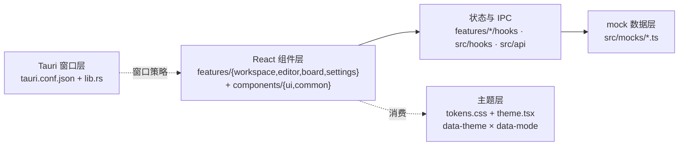

# 架构说明

## 1. 总体分层（当前：mock 阶段）



- **React 组件层**：按业务域分包（2026-10-21 规范改造后）——`features/workspace`（侧栏/窗口栏/工具栏/信息面板 + 工作区与知识库管理 + 收藏）、`features/editor`（DocEditor/SlashMenu/分享导出）、`features/board`（Excalidraw 画板）、`features/settings`（设置弹窗）；跨域展示原语在 `components/common`（品牌 Logo/节点图标/红绿灯槽位/动效/Toast），shadcn 原子在 `components/ui`。`App.tsx` 只做骨架组装（≤200 行）：Provider + 布局 + 全局弹窗挂载，不承载业务规则。
- **状态与 Hooks 层**：领域状态在 `features/workspace/hooks`（`useWorkspaceStore` 工作空间/知识库/树、`useTabSession` 标签页、`useWorkspaceShortcuts` 快捷键规则）；全局机制在 `src/hooks`（`useToast`、`useKeyboardShortcuts`）；窗口操作经 `lib/window.ts` 封装（组件禁止直连 `@tauri-apps/api`）。
- **mock 数据层**：`src/mocks/workspace.ts` 只导出数据常量；领域类型已解耦至 `src/types/notebook.ts`，字段即未来 Rust 命令的返回契约（迁移时由 `src/api/` 封装层替换 import 来源，组件零改动）。
- **主题层**：`tokens.css` 定义 8 主题 × 深浅变量与 `@theme inline` 映射；`lib/theme.tsx` 仅写 `data-theme`/`data-mode` 两个属性完成全局换肤。
- **Tauri 窗口层**：macOS `titleBarStyle:"Overlay"` 保留系统红绿灯（`macOSPrivateApi:true`）；Windows/Linux 由 `lib.rs` 在 setup 中 `set_decorations(false)`，前端 `WindowBar` 自绘窗口控制。前端窗口操作统一经 `lib/window.ts`（`windowActions` + `runWindowAction`）调 minimize/toggleMaximize/close，浏览器 dev 环境降级为 toast。

## 2. 关键机制

### 2.1 切肤（唯一正确方式）

任何组件不得硬编码颜色。运行时：

```ts
document.documentElement.setAttribute("data-theme", "sunset"); // 8 预设
document.documentElement.setAttribute("data-mode", "dark");    // 浅/深
```

### 2.2 红绿灯策略（平台差异集中收敛）

- macOS：侧栏顶部 44px 拖拽带由 `TrafficLightSlot` 渲染（76px 注入区 + `bg-accent/70` 胶囊底座）；侧栏折叠时 `WindowBar` 通过 `trafficInset` 回补同款槽位。红绿灯坐标 `trafficLightPosition {x:12, y:16}` 与槽位高度绑定（改动槽位高度必须同步 y 值，y+12/2 = 槽位高/2）。
- Windows：无红绿灯，`TrafficLightSlot` 返回 null；窗口控制按钮在 `WindowBar` 右上（关闭 hover 红）。

### 2.3 信息浮窗（文档附加层）

浮窗挂载于内容区 `relative` 容器内（不占主布局），左缘骑缝把手开合；容器组件为 `features/workspace/components/InfoFloat.tsx`（弹簧出入场 + 把手），开合状态 `infoOpen` 在 `App.tsx`，工具栏按钮与把手经 `onToggle` 共享。

## 3. IPC 约定（预留）

未来 Rust 命令统一经 `src/api/` 封装（AGENTS.md §3.3）：`api/client.ts` 已建立 `invokeCommand` 统一出入口（错误转 `ApiError`）；每封装函数须中文注释入参/出参/示例。当前 mock 阶段无 IPC 调用，组件直接从 `src/mocks/` 取数。

## 4. 后端分层规划

按 AGENTS.md §1.1：`commands/`（参数校验与转发）→ `services/`（用例编排）→ `domain/`（规则算法）→ `repositories/`（SQLite 访问）→ `db/`（连接与迁移）。启动时机：文档编辑持久化功能进入开发时建立。
