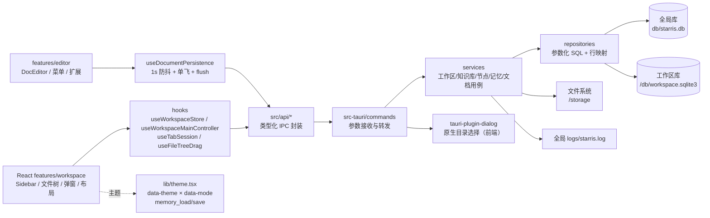
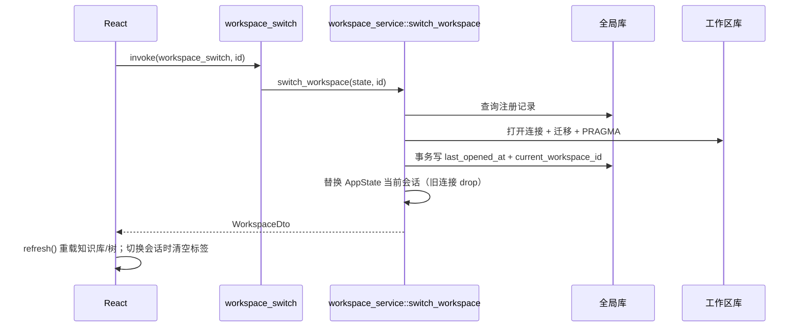
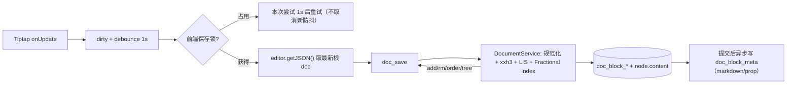

# 架构说明（2026-10-22 本地工作区 + 文档块版）

## 1. 总体分层



- **前端展示层**：`features/workspace` 负责侧栏、窗口栏、工具栏、信息面板、工作区/知识库管理与文件树；`features/editor` 负责文档编辑器、扩展与气泡/右键/Slash 菜单；`features/board` 负责画板；`features/settings` 负责设置。`App.tsx` 只挂载 `ThemeProvider` 与 `WorkspaceRoot`。
- **前端状态层**：`useWorkspaceStore` 是工作区/知识库/节点的唯一状态与写操作入口；`useWorkspaceMainController` 聚合 UI 状态、标签会话、切换前 flush 与快捷键；`useDocumentPersistence` 负责正文防抖保存与互斥；`WorkspaceMain` 只组合布局与弹窗。
- **API 层**：`src/api/client.ts` 封装 `invoke` 并把 Rust 字符串错误转为 `ApiError`；按域拆分为 `workspace/knowledgeBase/node/memory/directory/document`。组件禁止直接 `import @tauri-apps/api`。
- **Rust 命令层**：`commands/*` 只接收参数、调用服务、返回 DTO；全部标注 `#[tauri::command(async)]`，避免同步数据库操作阻塞主线程。
- **Rust 服务层**：`services/*` 编排用例与事务；`workspace_service::switch_workspace` 是**唯一工作区连接切换入口**。
- **Rust 数据层**：`repositories/*` 只写 SQL；`db/{global,workspace}.rs` 负责连接/PRAGMA/迁移；`db/paths.rs` 负责目录布局与删除安全。
- **状态**：`state::AppState { global: Mutex<Connection>, workspace: Mutex<Option<WorkspaceSession>> }`。同一函数内不嵌套持锁；切换时先完成 IO，再分别短暂加锁。

## 2. 目录布局

### 2.1 全局工作区

```text
${STARRIS_HOME:-~/.starris/rust}/
├── db/starris.db       # workspaces 注册表 + settings 记忆
└── logs/starris.log    # 本轮运行日志（启动清空上一轮，10MiB 滚动）
```

### 2.2 本地工作区

```text
<用户选择的绝对目录>/
├── db/workspace.sqlite3
└── storage/            # 附件预留
```

## 3. IPC 契约

所有 DTO 使用 camelCase；节点 `type` 在 IPC 中保持数字 1~5，前端 `api/node.ts` 映射为 `folder/doc/board/table/flow`。

| 域 | 命令 |
|---|---|
| 启动/工作区 | `app_bootstrap`、`workspace_list`、`workspace_create`、`workspace_open`、`workspace_switch`、`workspace_rename`、`workspace_delete` |
| 知识库 | `kb_list`、`kb_get`、`kb_create`、`kb_update`、`kb_delete` |
| 文件树 | `node_list`、`node_create`、`node_update`、`node_delete`、`node_move` |
| 文档块 | `doc_load`、`doc_save` |
| 记忆 | `memory_load`、`memory_save` |

- 原生目录选择由前端调用 `tauri-plugin-dialog` 的 `open({ directory: true })`，权限 `dialog:default`。
- 所有命令返回 `Result<T, AppError>`；`AppError` 只序列化可读中文，详细原因写全局日志。

## 4. 启动与切换流程

### 4.1 启动恢复

1. `bootstrap::initialize` 解析全局目录、初始化日志、打开并迁移全局库。
2. 读取 `settings.current_workspace_id`；记录存在且目录/DB 有效 → 打开工作区库并装入 `AppState`。
3. 记录失效 → 清理记忆，当前会话为空。
4. 前端 `app_bootstrap` 读取工作区列表、当前工作区、记忆；有当前工作区则加载知识库与节点，否则展示首次引导。

### 4.2 统一切换入口



`workspace_create`、`workspace_open`、`workspace_switch`、删除当前工作区后的自动切换全部复用该函数；删除最后一个工作区使用 `clear_current_workspace` 清空会话与记忆。

## 5. 文件树规则

- 节点类型：1 文件夹、2 文档、3 画板、4 表格、5 流程图；根级任意类型。
- `level` 根为 1；`path` 为标题路径（`设计/原型/首页`）；`sort_order` 同级连续。
- 只有 type=1 可作为父级；文件夹改名事务内同步后代 `path`。
- 删除节点依赖 SQLite 外键级联删除整棵子树。
- 移动：目标父级必须同知识库文件夹；禁止移入自身/后代；移动后重算子树 `level/path` 并重排新旧同级组。
- 拖放落点由 `useFileTreeDrag` 计算：文件夹中部 = 子级，节点上/下缘 = 同级前后，列表底部 = 根级末尾；Rust 仍做最终校验。

## 6. 文档块保存



- 前端 `useDocumentPersistence`：1s 防抖、单飞互斥、锁冲突本次延长 1s、保存期间新编辑结束后再排一次；取快照前必须已拿到锁；切换标签/文档/工作区/知识库前 `flush`，失败阻止切换。加载/切换期间调用 `setEditable(..., false)`，避免 `setEditable` 默认 emit update 把旧文档误标脏。
- 数据契约：`editor.getJSON()` 返回完整根对象 `{"type":"doc","content":[...]}`；Rust 只对 `content` 数组切顶层块，保存与回显均使用完整根 doc。
- Rust `document_service`：校验 type=2；先规范化历史脏数据（空 `name` 的 emoji、null attrs、空 marks/空 text）；顶层块内容寻址；按最终顺序贪心复用同 hash 实例；保留块对旧顺序求 LIS，其余分段生成 base62 order；无解/超长整篇 8 位等距重排；`BEGIN IMMEDIATE` 单事务写块树、hash、`node.content`、字数与时间。
- `doc_load` 返回 `document/wordCount/updatedAt/tree/normalized`；`normalized=true` 表示旧脏数据已被后端修复，前端自动补一次保存。`doc_save` 返回 `add/rm/order/tree/wordCount/updatedAt`；`rm` 只含引用归零的 hash。
- 文档元数据：正文提交后由后台线程用独立连接写 `doc_block_meta`（`id = node.id`、Markdown、prop JSON、update_time）；后台连接不创建文件、不切 journal_mode，旧任务晚到不会覆盖新结果。加载时缺失/不一致会惰性补写。
- 编辑器交互：`ClearMarksOnEnter`（官方 `Extension.create` + `addKeyboardShortcuts`）在回车后清空 storedMarks；列表用 `splitListItem`，标题尾部显式插入正文段落。Emoji 关闭空 `enableEmoticons` 规则并由后端规范化历史 `name:null` 节点。
- 编辑器外观：自绘块手柄（`useBlockHandle` 定位/显隐 + `useBlockPointerDrag` 指针拖拽 + `BlockDragHighlight` 源块淡化）；“+”插入与六点拖拽都由项目代码控制；StarterKit 官方 Dropcursor（`class="starris-drop-cursor"`）保留给图片/文件原生拖放；图片使用官方 ResizableNodeView；所有块样式通过 `.doc-content` 作用域消费设计令牌。
- 编辑器扩展全部为 MIT：StarterKit + TextStyle/Color/Highlight/TextAlign/Sub/Sup/Task/Table/Image/CodeBlockLowlight/Emoji/Details/TOC/FileHandler/Placeholder/CharacterCount，以及自研 `ClearMarksOnEnter`/`BlockDragHighlight`。不再依赖官方 DragHandle：其定位与 HTML5 DnD 绑定，在 WKWebView 下无法可靠搬运正文。

## 7. 记忆配置

- 统一 KV 接口：`memory_load()` 一次读取全部；`memory_save(entries)` 批量 upsert。
- 保留键：`current_workspace_id`（仅切换入口写）、`appearance.theme`、`appearance.mode`；工作区级键 `kb.current.<workspaceId>` 记录当前知识库，按工作区隔离。
- 前端 `ThemeProvider` 启动读取主题、去抖保存；`useWorkspaceStore` 在知识库切换/回退时写入 `kb.current.<workspaceId>`，启动与切换工作区时优先恢复该值。

## 8. 错误、日志与安全

- 日志：`logging` 模块统一落盘，只写事实/错误类别，不写文档正文与敏感数据。
- 路径：新建/打开要求绝对路径；打开要求 `db/workspace.sqlite3`；删除目录前校验符号链接、根目录、用户主目录与工作区结构。
- SQL：全部参数化；写操作用事务；外键级联维护一致性。
- 迁移：两边均用 `PRAGMA user_version`，版本高于程序支持值时拒绝打开。

## 9. 测试

- Rust：39 项测试；`integration_tests.rs` 使用临时目录 + 真实 SQLite，覆盖工作区生命周期、打开校验、重启恢复、知识库级联、树层级/路径/改名/递归删除、移动约束、记忆校验，以及文档块差量/重复 hash/引用清理/重启恢复/历史脏数据修复/异步元数据（含乱序写入）。
- 前端：Biome + tsc + Vite build + 许可证门禁；编辑器以 Chromium 真实 DOM + 可控 IPC 冒烟（空格/回车样式/标题与列表拆分、防抖、互斥、右键/Slash/气泡菜单、颜色/表格/任务/折叠/Emoji/图片缩放、拖拽与落点线、旧数据修复、重载回显），不作为真实 Tauri IPC 黑盒测试。
- 真实 Tauri 窗口冒烟：2026-10-22 WebView 已渲染引导与创建空间弹窗，但系统级自动化无法可靠填写表单，文档保存冒烟未完成，已在功能测试文档如实标注；2026-10-21 记录见 `docs/功能测试/2026-10-21-功能测试-本地工作区与文件树-001.md`。
