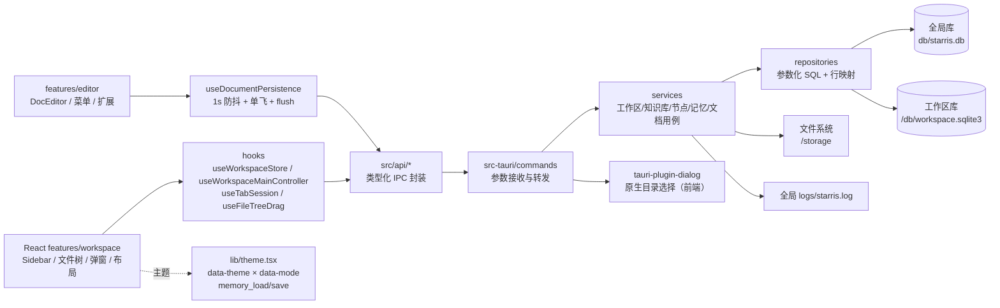
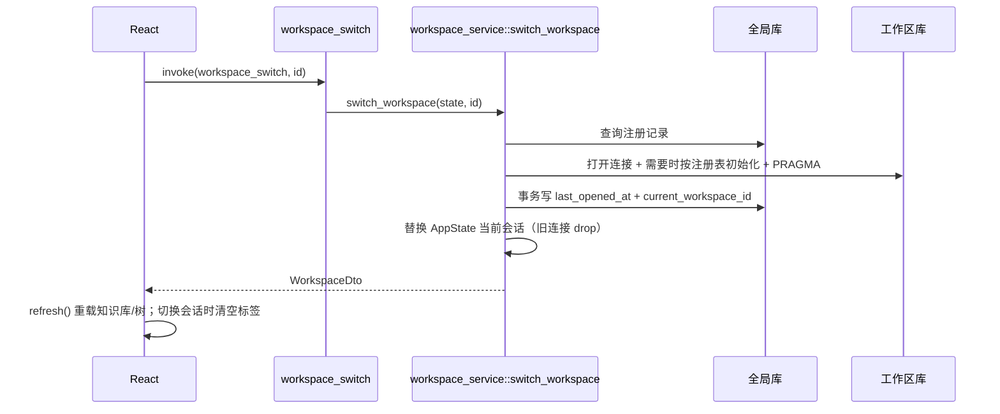
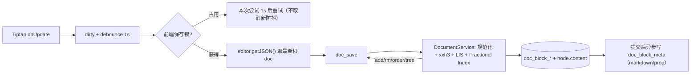
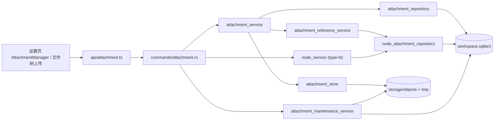

# 架构说明（2026-10-31 平台适配版）

> 跨模块的完整架构、时序、数据流、生命周期与 ERD 已集中维护在 [图表总览](./图表总览.md)；本文保留分层说明与关键不变量，图与文冲突时以代码与图表总览为准。

## 1. 总体分层



- **前端展示层**：`features/workspace` 负责侧栏、窗口栏、工具栏、信息面板、工作区/知识库管理与文件树；`features/editor` 负责文档编辑器、扩展与气泡/右键/Slash 菜单；`features/board` 负责画板；`features/settings` 负责设置。`App.tsx` 只挂载 `ThemeProvider` 与 `WorkspaceRoot`。
- **前端状态层**：`useWorkspaceStore` 是工作区/知识库/节点的唯一状态与写操作入口；`useWorkspaceMainController` 聚合 UI 状态、标签会话、切换前 flush 与快捷键；`useDocumentPersistence` 负责正文防抖保存与互斥；`WorkspaceMain` 只组合布局与弹窗。
- **API 层**：`src/api/client.ts` 封装 `invoke` 并把 Rust 字符串错误转为 `ApiError`；按域拆分为 `workspace/knowledgeBase/node/memory/directory/document`。组件禁止直接 `import @tauri-apps/api`。
- **Rust 命令层**：`commands/*` 只接收参数、调用服务、返回 DTO；全部标注 `#[tauri::command(async)]`，避免同步数据库操作阻塞主线程。
- **Rust 服务层**：`services/*` 编排用例与事务；`workspace_service::switch_workspace` 是**唯一工作区连接切换入口**。
- **Rust 数据层**：`repositories/*` 只写 SQL；`db/{global,workspace}.rs` 负责连接/PRAGMA/迁移；`db/paths.rs` 负责目录布局与删除安全。
- **状态**：`state::AppState { global: Mutex<Connection>, workspace: Mutex<Option<WorkspaceSession>> }`。同一函数内不嵌套持锁；切换时先完成 IO，再分别短暂加锁。

## 2. 目录布局

### 2.1 全局工作区

```text
${STARRIS_HOME:-~/.starris/rust}/
├── db/starris.db       # workspaces 注册表 + settings 记忆
└── logs/starris.log    # 本轮运行日志（启动清空上一轮，10MiB 滚动）
```

### 2.2 本地工作区

```text
<用户选择的绝对目录>/
├── db/workspace.sqlite3
└── storage/
    ├── objects/big/<hh>/<hh>/<hash>   # ≥128 KiB，内容寻址
    ├── objects/small/packs/<id>.pack  # <128 KiB，pack 追加
    └── tmp/<uuid>.part                # 上传临时文件
```

## 3. IPC 契约

所有 DTO 使用 camelCase；节点 `type` 在 IPC 中保持数字 1~5，前端 `api/node.ts` 映射为 `folder/doc/board/table/flow`。

| 域 | 命令 |
|---|---|
| 启动/工作区 | `app_bootstrap`、`workspace_list`、`workspace_create`、`workspace_open`、`workspace_switch`、`workspace_rename`、`workspace_delete` |
| 知识库 | `kb_list`、`kb_get`、`kb_create`、`kb_update`、`kb_delete` |
| 文件树 | `node_list`、`node_create`、`node_update`、`node_delete`、`node_move` |
| 文档块 | `doc_load`、`doc_save` |
| 画板 | `board_load`、`board_save`、`board_save_viewport` |
| 组件库 | `library_list`、`library_items`、`library_import`、`library_set_enabled`、`library_delete` |
| 导出 / 导入 | `export_document`、`export_knowledge_base`、`export_write_file`、`import_documents` |
| 附件 | `attachment_upload`、`attachment_upload_bytes`、`attachment_list`、`attachment_get`、`attachment_update`、`attachment_delete`、`attachment_download`、`attachment_read_bytes`、`attachment_verify`、`attachment_stats` |
| 记忆 | `memory_load`、`memory_save` |

- 画板 PNG/SVG 由前端 Excalidraw 官方导出工具生成，再经 `export_write_file` 落盘；`.excalidraw` 由后端整库导出写入，单板 `.excalidraw` 由前端 `serializeAsJSON` 生成后落盘。
- `import_documents` 按扩展名分派 Markdown / Word / `.excalidraw`；画板导入会把内嵌图片上传为全局对象并改写 `fileId`。

- 原生目录选择由前端调用 `tauri-plugin-dialog` 的 `open({ directory: true })`，权限 `dialog:default`；附件文件选择/保存同样经 `api/fileDialog.ts` 封装。
- 附件大文件命令通过 `tauri::async_runtime::spawn_blocking` 执行，避免阻塞主线程。
- 所有命令返回 `Result<T, AppError>`；`AppError` 只序列化可读中文，详细原因写全局日志。

## 4. 启动与切换流程

### 4.1 启动恢复

1. `bootstrap::initialize`（同步、轻量）解析全局目录、初始化日志、打开全局库并执行 `GLOBAL_TASKS`（空库一次性建表；版本不一致直接拒绝）。
2. `bootstrap::spawn_startup` 在 `spawn_blocking` 中异步恢复工作区：打开连接 + `ensure_initialized`（空库按当前 `SCHEMA` 一次建好；版本不一致直接拒绝，不做迁移或自愈），并清理回收站；不阻塞窗口首帧。
3. 恢复结果（成功或失败原因）写入 `BootstrapGate`，并广播 `starris://bootstrap`。
4. 就绪后由 `services::mcp_host::ensure_started` 在进程内启动本机 HTTP MCP（默认开，可设置关闭）；服务复用当前 `AppState`，退出即停止。
5. 读取 `settings.current_workspace_id`；记录存在且目录/DB 有效 → 装入 `AppState`。
6. 记录失效 → 清理记忆，当前会话为空。
7. 前端 `waitForAppBootstrap` 轮询 `app_bootstrap_status` 等到就绪，再由 `app_bootstrap` 读取工作区列表、当前工作区、记忆；有当前工作区则加载知识库与节点，否则展示首次引导。

### 4.2 统一切换入口



`workspace_create`、`workspace_open`、`workspace_switch`、删除当前工作区后的自动切换全部复用该函数；删除最后一个工作区使用 `clear_current_workspace` 清空会话与记忆。

## 5. 文件树规则

- 节点类型：1 文件夹、2 文档、3 画板、4 表格、5 流程图；根级任意类型。
- `level` 根为 1；`path` 为标题路径（`设计/原型/首页`）；`sort_order` 同级连续。
- 只有 type=1 可作为父级；文件夹改名事务内同步后代 `path`。
- 删除节点依赖 SQLite 外键级联删除整棵子树。
- 移动：目标父级必须同知识库文件夹；禁止移入自身/后代；移动后重算子树 `level/path` 并重排新旧同级组。
- 拖放落点由 `useFileTreeDrag` 计算：文件夹中部 = 子级，节点上/下缘 = 同级前后，列表底部 = 根级末尾；Rust 仍做最终校验。

## 6. 文档块保存



- 前端 `useDocumentPersistence`：1s 防抖、单飞互斥、锁冲突本次延长 1s、保存期间新编辑结束后再排一次；取快照前必须已拿到锁；切换标签/文档/工作区/知识库前 `flush`，失败阻止切换。加载/切换期间调用 `setEditable(..., false)`，避免 `setEditable` 默认 emit update 把旧文档误标脏。
- 数据契约：`editor.getJSON()` 返回完整根对象 `{"type":"doc","content":[...]}`；Rust 只对 `content` 数组切顶层块，保存与回显均使用完整根 doc。
- Rust `document_service`：校验 type=2；先规范化历史脏数据（空 `name` 的 emoji、null attrs、空 marks/空 text）；顶层块内容寻址；按最终顺序贪心复用同 hash 实例；保留块对旧顺序求 LIS，其余分段生成 base62 order；无解/超长整篇 8 位等距重排；`BEGIN IMMEDIATE` 单事务写块树、hash、`node.content`、字数与时间。
- `doc_load` 返回 `document/wordCount/updatedAt/tree/normalized`；`normalized=true` 表示旧脏数据已被后端修复，前端自动补一次保存。`doc_save` 返回 `add/rm/order/tree/wordCount/updatedAt`；`rm` 只含引用归零的 hash。
- 文档元数据：正文提交后由后台线程用独立连接写 `doc_block_meta`（`id = node.id`、Markdown、prop JSON、update_time）；后台连接不创建文件、不切 journal_mode，旧任务晚到不会覆盖新结果。加载时缺失/不一致会惰性补写。
- 编辑器交互：`ClearMarksOnEnter`（官方 `Extension.create` + `addKeyboardShortcuts`）在回车后清空 storedMarks；列表用 `splitListItem`，标题尾部显式插入正文段落。Emoji 关闭空 `enableEmoticons` 规则并由后端规范化历史 `name:null` 节点。
- 编辑器外观：自绘块手柄（`useBlockHandle` 定位/显隐 + `useBlockPointerDrag` 指针拖拽 + `BlockDragHighlight` 源块淡化）；“+”插入与六点拖拽都由项目代码控制；StarterKit 官方 Dropcursor（`class="starris-drop-cursor"`）只在应用内块拖拽时给出落点线（真机下外部文件拖放不经过网页 drop，见下一条）；图片使用官方 ResizableNodeView；所有块样式通过 `.doc-content` 作用域消费设计令牌。
- 编辑器扩展全部为 MIT：StarterKit + TextStyle/Color/Highlight/TextAlign/Sub/Sup/Task/Table/Image/CodeBlockLowlight/Emoji/Details/TOC/FileHandler/Placeholder/CharacterCount，以及自研 `ClearMarksOnEnter`/`BlockDragHighlight`。不再依赖官方 DragHandle：其定位与 HTML5 DnD 绑定，在 WKWebView 下无法可靠搬运正文。

## 7. 附件对象存储



- 元数据唯一真相：`attachment` 存用户可见名称/逻辑目录/哈希/大小/MIME/状态；物理文件名与用户名称解耦。逻辑目录为相对路径，工作区搬移后仍有效。
- 内容寻址：BLAKE3 32 字节、64 位小写十六进制。`attachment_blob` 每个哈希一行，**不存引用计数**。**每次上传都新建一条逻辑记录**（自己的 id/名称/目录/时间）；命中相同哈希时跳过物理写入，所以同一文件重复上传 = 多条记录 + 一份真实文件。对象是否保留由"还有没有活跃 `attachment` 行引用该哈希"现场 COUNT 决定（`count_active_references`，走 `idx_attachment_hash`），归零才删 blob 行与真实文件。
- 小/大分流：<128 KiB 进入 active pack（`objects/small/packs/<id>.pack`，偏移/长度存 SQLite）；≥128 KiB 原子 rename 到 `objects/big/hh/hh/<hash>`。暂存写入期用唯一临时名 `tmp/.<uuid>.writing`，哈希算完立即改名为 `tmp/<BLAKE3>.part`——磁盘上任何时刻都不出现用户真实文件名，崩溃残留也自描述可回收；命中去重时该文件直接删除。small 追加 fsync 后再提交索引。
- 引用闭环：`node_attachment(node_id, object_id)` 是业务引用唯一权威表。文档保存从最终 JSON 提取 attachmentId，画板保存提取 image fileId/file-card objectId，附件节点创建登记 object_id；引用差量在同一事务完成。节点/知识库删除由外键级联清引用，并对受影响对象标记 `orphaned_at`。
- 生命周期：`scope=library` 主动保留；`scope=node` 失去全部引用后孤儿宽限 7 天 → 回收站 30 天 → purge。`expires_at` 仅对未关联附件生效。恢复转为 library 并清除 TTL/孤儿标记。看门狗启动即跑、之后每 6 小时，清理 staging 残留、TTL、孤儿/回收站、孤儿 blob 并压缩 pack；手动「立即清理」复用同一服务。
- 删除：显式删除只做软删除（回收站），物理对象保留以支持恢复；purge 掉最后一条 attachment 行后才删 blob，big 在锁外 unlink，pack 由 compaction 回收。被节点引用的附件禁止直接删除。active pack 1 GiB 滚动。
- 并发：`services/storage_lock.rs` 按 workspace id 提供进程内锁，只包住物理发布/追加/删除/压缩提交；附件写入用 `open_existing` 独立连接 + `BEGIN IMMEDIATE`，大文件哈希/复制不占主工作区 Mutex 与主线程。
- 流式：上传/下载/校验固定 256 KiB 缓冲；`spawn_blocking` 执行大文件命令。下载先写同目录临时文件再原子替换，并拒绝写入 `storage/` 内部。
- 编辑器接入：`attachmentImage`/`attachmentBlock` 两个 atom 节点只存 attachmentId 与展示元数据；图片通过 `attachment_read_bytes` 读取 ≤20 MiB 原始字节并在前端生成 Blob URL；附件卡片按节点内 name/MIME/size 直接回显。粘贴的 File 没有本地路径，走 raw IPC `attachment_upload_bytes`（hex headers）；从访达拖入的文件走 `src/api/dragDrop.ts` 的 webview 事件拿到**绝对路径**，再走 `attachment_upload` 流式上传；Slash/右键文件选择同样是路径上传。旧 data URL `image` 仍由官方 Image 扩展渲染，不做强制迁移。
- 外部文件拖放为什么不能靠网页事件：`dragDropEnabled` 默认为 true，Tauri 在原生层接管访达拖放，网页 `drop` 的 `dataTransfer.files` 为空，`FileHandler.onDrop` 因此只在浏览器里有效。同一个开关也是官方 DragHandle 在 WKWebView 下拖不动正文的根因。落点解析见 `resolveDropInsertPos`：正文容器外返回 `null`（不写入当前文档），容器内命中不到文字位置时退回文末。
- 附件节点：type=6 叶子节点，上传命令完成「上传附件 → 创建节点 → 登记引用」；节点重命名同步 attachment.name。整库导出把附件节点写到树对应位置，manifest 记录 `attachmentNodes`，并避免与 `_attachments/` 重复。
- 测试：`integration_tests.rs` 覆盖去重/软删/回收站恢复/TTL/孤儿标记/引用同步/级联删除/节点删除/路径复用/pack 尾部恢复/compaction/并发同哈希/损坏校验/下载覆盖与存储目录保护，以及附件块 Markdown/props、字节上传/图片预览读取、raw header hex 解码、附件节点导出。

## 7A. 快捷键

- 动作表 `src/features/shortcuts/actions.ts` 是唯一目录；配置 JSON 存全局 `settings.shortcuts.config`，三作用域 + 总开关。
- 应用：`useWorkspaceShortcuts` 读中心配置，窗口冒泡监听；`defaultPrevented` 时让位给编辑器/画板。
- 编辑器：`UserKeymap` ProseMirror 插件优先拦截；运行时配置由 Provider 写入 `shortcutRuntime`，自定义键位无需重建编辑器；清空/改键会吞掉旧默认键。
- 画板：`useBoardKeymap` 捕获阶段只接管自有动作（附件、组件库、导出、保存、工具切换），通过 Excalidraw 公共 API 执行；撤销/重做/复制粘贴等原生键位保持只读。
- 录制：设置页 `ShortcutRecorder` 捕获阶段监听，Esc 取消、Backspace 清空；同作用域冲突阻止保存，跨作用域仅警告。

## 8. 记忆配置

- 统一 KV 接口：`memory_load()` 一次读取全部；`memory_save(entries)` 批量 upsert。
- 保留键：`current_workspace_id`（仅切换入口写）、`appearance.theme`、`appearance.mode`、`shortcuts.config`（全局快捷键 JSON）；工作区级键 `kb.current.<workspaceId>` 记录当前知识库，按工作区隔离。
- 前端 `ThemeProvider` 启动读取主题、去抖保存；`useWorkspaceStore` 在知识库切换/回退时写入 `kb.current.<workspaceId>`，启动与切换工作区时优先恢复该值。

## 9. 错误、日志与安全

- 日志：`logging` 模块统一落盘，只写事实/错误类别，不写文档正文与敏感数据。
- 路径：新建/打开要求绝对路径；打开要求 `db/workspace.sqlite3`；删除目录前校验符号链接、根目录、用户主目录与工作区结构。Windows 的 `canonicalize` 会返回 `\\?\` verbatim 前缀，`db/paths.rs::path_to_string` 在展示与持久化前统一还原；UNC 路径还原为 `\\server\share`。
- SQL：全部参数化；写操作用事务；外键级联维护一致性。
- 版本：两边均用 `PRAGMA user_version` 做“同一版本”校验；版本不一致（含更高版本）一律拒绝打开，由用户删除旧库/旧工作区重建（AGENTS.md §9 无历史数据原则）。

## 10. 测试

- Rust：77 项测试；`integration_tests.rs` 使用临时目录 + 真实 SQLite，覆盖工作区生命周期、打开校验、重启恢复、知识库级联、树层级/路径/改名/递归删除、移动约束、记忆校验，文档块差量/重复 hash/引用清理/重启恢复/历史脏数据修复/异步元数据（含乱序写入），附件大/小对象、去重、软删/回收站恢复/TTL/孤儿、pack 尾部恢复、compaction、并发同哈希、损坏校验与下载保护，文档/画板/节点引用同步与删除闭环、附件节点创建/重命名/导出，以及 v9→v10 回填与外键检查。
- 前端：Biome + tsc + Vite build + 许可证门禁；真机黑盒 `pnpm run test` 15 个用例覆盖附件树、生命周期 UI、快捷键总开关/录制/冲突/持久化与编辑器/画板作用域。编辑器另有 Chromium DOM 冒烟，不作为真实 Tauri IPC 黑盒测试。
- 真实 Tauri 窗口冒烟：2026-10-22 WebView 已渲染引导与创建空间弹窗，但系统级自动化无法可靠填写表单，文档保存冒烟未完成，已在功能测试文档如实标注；2026-10-21 记录见 `docs/功能测试/2026-10-21-功能测试-本地工作区与文件树-001.md`。

## 11. 检索、模板、历史与体验扩展（2026-10-25）

- 检索：单一 schema 内含 `search_index` 与 FTS5 external content 表；查询服务按 1–2 字 LIKE、≥3 字 MATCH。
- 模板：工作区 `storage/templates/<id>.json`，文件型快照，不进入对象存储 GC；备份包含 templates。
- 历史：`doc_history` 每 10 分钟最多一份、单篇 50 份；恢复走正常文档保存与版本校验。
- 关闭守卫：窗口关闭与应用退出共用 `flushActivePersistence`；macOS Quit 使用自定义菜单项，避免 `terminate:` 绕过保存。
- 打印：`app_print_main_window` 调用 Tauri WebView print；放映使用固定层 + zen mode，`fullscreenchange` 同步退出。
- 测试运行器：临时 `.app` 包装启动，解决裸二进制无法被 AX 激活的问题。

## 2026-10-25 战略能力补全

- `node_service`：删除改为软删除；`trash_list/restore/trash_purge/trash_empty/purge_expired_trash`；恢复时按当前父级重算路径并重建索引。
- `search_service::network`：同知识库内用 `search_index` 的标题/正文字面匹配生成反向链接与相关推荐，过滤回收站。
- `commands/dialog` + `commands/export`：导出保存/目录面板改由 Rust 打开，签发 10 分钟路径令牌；单文件一次即焚，目录令牌只允许后代写入。
- `attachment_maintenance_service`：工作区级保留策略（孤儿/回收站/暂存）读写；看门狗、手动清理与节点回收站共用。
- `tauri-plugin-single-instance`：第二实例聚焦已有窗口；生产 CSP 收紧，开发态 `devCsp` 关闭。
- 测试构建不启动后台维护线程，维护类用例可在并行下稳定断言。
- 当前 Rust 测试 97 项；E2E 用例 26 个（含表格/流程图、知识网络、回收站、云同步）。

## 2026-10-26 移除云同步功能

- 云同步（同步文件夹）整体下线：删除 `cloud_service`、`commands/cloud`、`models/cloud` 与设置页 `CloudSyncSection`，四个 IPC 命令（`cloud_sync_status`/`cloud_set_sync_folder`/`cloud_sync_now`/`cloud_restore_latest`）不再注册。
- 上一节提到的「云同步」与 26 个 E2E 用例中的 `88-cloud-sync` 均属删除前的历史事实，保留不改写。
- `backup_service`（工作区备份与恢复，R07）**保留**，仍是独立功能；本次只摘掉云同步对它的调用方。
- 全局库中遗留的 `cloud.sync_folder` 配置键不做迁移与清理：读它的代码已删除，该键不再有写入方与读取方。
- 当前 Rust 测试 107 项；E2E 用例 27 个。

## 2026-10-31 Windows 平台适配

### 配置与窗口

- Tauri 配置按平台拆分：`tauri.conf.json` 只保留跨平台项；`tauri.macos.conf.json` 声明 `macOSPrivateApi`、`titleBarStyle: Overlay`、红绿灯位置与 DMG；`tauri.windows.conf.json` 声明 `decorations: false`、NSIS 打包与 WebView2 bootstrapper。`tauri.<platform>.conf.json` 由 Tauri CLI 自动叠加，`src-tauri/Cargo.toml` 的 `macos-private-api` 也改为 macOS 目标专属，避免 Windows 构建因 feature/配置不一致而失败。
- 非 macOS 启动时 `lib.rs` 再次调用 `set_decorations(false)` 兜底；原生菜单只在 macOS 挂载，`menu::build` 在 Windows/Linux 返回 `None`，避免菜单栏与自绘顶栏重叠。
- 窗口控制由 `features/workspace/components/WindowControls.tsx` 实现：46×32 贴右缘、Win11 关闭红、`isMaximized + onResized` 同步最大化/还原图标、`role="toolbar"` + 中文 aria-label。侧栏顶部与启动/引导页增加 44px 拖拽带；双击最大化复用 Tauri drag region 的 `internal_toggle_maximize`，不自挂 `onDoubleClick`。
- 平台判定集中在 `lib/platform.ts`（`IS_MAC` / `IS_WINDOWS` / `IS_LINUX`）；`shortcutKeys.bindingLabel` 与 i18n 输出统一把 `⌘/⌥/⇧` 转为 `Ctrl/Alt/Shift`，组件不再手写平台符号。

### 文件与路径

- `db/paths.rs::path_to_string` 还原 Windows `\?\` 与 `\?\UNC\` 前缀，工作区路径展示与全局库持久化不再出现 verbatim 前缀。
- `workspace_service::is_effectively_empty` 忽略 `.DS_Store`、`Thumbs.db`、`desktop.ini`（大小写不敏感），空目录判定跨平台一致。
- `attachment_service::storage_free_bytes` 在 Windows 使用 `GetDiskFreeSpaceExW`，附件统计的磁盘剩余空间与 macOS 行为对齐；`libc` 依赖改为 Unix 目标专属，`windows-sys` 仅启用文件系统子集。
- `api/fileDialog.ts::safeFileName` 统一清理 `\ / : * ? " < > |`、控制字符、结尾点/空格与 CON/PRN/NUL/COM1… 等保留名，覆盖附件、文档、画板、导图四类保存对话框。
- 打开工作区 / 删除工作区仍以 `canonicalize` 后的真实路径做比较；Windows 大小写不敏感与长路径由系统规范化处理。

### 验证边界

- 已在 Windows 11 完成 `cargo check`、`npm run typecheck`、`npm run check`、`npm run build` 与 NSIS 打包；macOS 侧的红绿灯、DMG 与原生菜单未在本次环境中复验。
