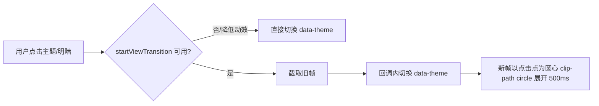

# 需求文档 · UI 动画过渡优化（motion + Magic UI 免费组件）

- 日期：2026-10-20　|　状态：已确认（用户口头批准，本档为记录）
- 关联调研：`docs/产品功能调研/2026-10-20-动画优化-001/002`

## 1. 背景与目标

项目已完成顶栏两行制与二分布局改造，视觉框架稳定。当前动效只有自建 CSS 淡入（anim-fade-in / anim-dialog-in / anim-pop-in），缺少弹簧质感、数字滚动、扫光焦点等"高级感"细节。目标：**在保持暖屿风格与性能的前提下，用 motion（已有）+ Magic UI 免费开源组件（MIT，用户已批准）+ 自建 CSS 补齐，统一提升全部交互 / 弹窗 / 界面的动画过渡质感。**

## 2. 范围

**做**：① 全局入出场弹簧化（弹窗内容、下拉、Toast、信息浮窗、标签内容切换）；② 数字滚动（信息面板字数、KB 文档数）；③ 空状态入场与 CTA 扫光（ShimmerButton）；④ 信息面板「相关」卡片聚光（MagicCard 渐变边）；⑤ 侧栏树展开动画；⑥ 主题切换 View Transitions 圆形揭示（特性检测降级）；⑦ 组件内动效全部令牌化（--dur-*/--ease）。

**不做**：不引入 GSAP / tw-animate-css / 其他动画库；不改动业务逻辑与数据流；不做 WebGL 背景；正文编辑区文字不加动画。

## 3. 依赖与许可

- 运行时仅用已有 `motion@^14`（MIT）；Magic UI 免费开源部分（number-ticker / blur-fade / shimmer-button / magic-card，registry 实测依赖仅 motion）复制源码至 `src/components/common/motion/`，**不装任何新 npm 包**；保留来源注释。
- Magic UI Pro 模板/区块为付费内容，**一律不使用**；仅复制 GitHub 仓库（MIT）registry 内组件。

## 4. 性能与可访问性验收（硬性）

1. 动画只使用 transform / opacity / filter；无布局属性动画（树展开 height 由 motion 合成处理，单次 ≤10 节点可接受）。
2. `prefers-reduced-motion: reduce` 下：CSS 动画全局禁用（已有），motion 组件直接呈现终态（useReducedMotion），View Transitions 特性检测跳过。
3. 弹窗/浮窗开合不阻塞交互；标签切换过渡 ≤300ms 且可中断感知（mode="wait" 总时长 ≤300ms）。
4. 8 主题 × 深浅回归至少覆盖 sunset 明暗两态截图；tsc / biome 零问题。
5. 不新增任何 npm 依赖；构建产物增量仅来自新增组件源码（合计 <8KB min+gzip）。

## 5. 交互流程图（主题切换圆形揭示）

## 6. 验收标准

- 打开任意弹窗：内容缩放+上移入场、轻微回弹，关闭有退场；下拉菜单 pop 有弹性。
- Toast 出现/消失为弹簧动画，连续触发无堆积。
- 信息浮窗开合为右滑弹簧；展开/收起把手状态同步。
- 切换标签：旧内容 140ms 退出、新内容入场，无白屏跳跃。
- 信息面板字数、KB 文档数为滚动数字；空状态元素分层入场、CTA 按钮带暖金扫光。
- 「相关」卡片 hover 出现跟随鼠标的渐变边光；侧栏树展开有高度过渡。
- 设置中切换主题：自点击位置圆形揭示（支持的平台），旧平台直接切换。

## 7. 未决问题

- View Transitions 在 Linux WebKitGTK 的支持情况未实测 → 已有特性检测，失败即直接切换，不阻塞。
- BoardView（excalidraw）在标签切换包裹层内的重挂载行为与现状一致，仅多一层透明度过渡。
