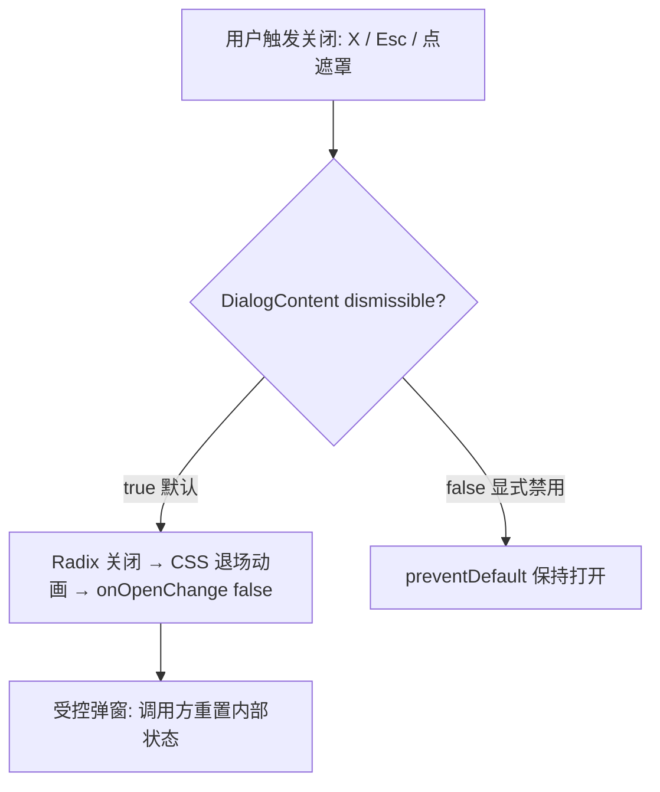

# 需求文档 · 弹窗行为统一化 与 动画场景规范化

- 日期：2026-10-20　|　状态：已确认（用户提出，本档为记录）
- 关联：`docs/需求文档/2026-10-20-需求文档-动画过渡优化.md`、调研 001/002

## 1. 背景与问题

1. **弹窗行为不一致**：`CreateWorkspaceWizard` 显式禁用了关闭按钮与 Esc/遮罩关闭（用户被困在向导中无法退出）；`ConfirmDialog` 无关闭按钮。各弹窗的关闭/遮罩行为散落在各自实现里（三连 `preventDefault`），没有统一契约。
2. **动画散落**：弹簧参数、过渡时长以字面量散落在 App/Sidebar/动效组件中，新组件接入动画没有单一权威来源，容易写错（不符合 AGENTS.md「同一规则只有一个权威实现」）。

## 2. 需求（用户指令）

1. 所有动画效果与场景规范化管理，新组件可按标准正确接入。
2. 修复部分弹窗无关闭按钮、遮罩点击不关闭的问题。
3. 将弹窗、遮罩等通用行为组件统一化。

## 3. 方案

1. **弹窗行为契约收编**：`DialogContent` 新增 `dismissible`（默认 true = X/Esc/遮罩均可关）；`dismissible={false}` 时统一在 DialogContent 内阻止三种关闭途径——调用方禁用必须显式声明。
2. **头部组件化**：新增 `DialogHeader`（标题 + 可选描述 + 右侧动作槽 + 固定避让关闭按钮的 pr-8），迁移结构匹配的弹窗（创建工作空间向导、KB 管理、工作空间管理）。
3. **修复向导**：`CreateWorkspaceWizard` 改回可关闭（dismissible 默认），新增 `onOpenChange`，关闭时重置表单状态。
4. **ConfirmDialog**：恢复默认关闭按钮（X = 取消）。
5. **动画规范化**：新建 `src/lib/motion.ts` 作为 JS 动效预设唯一来源（SPRING_PANEL/SPRING_TOAST/SPRING_TICKER/TRANSITION_VIEW/TRANSITION_COLLAPSE/EASE_STANDARD），替换全部内联字面量；UI-SPEC.md §5 增加「场景 → 预设」映射表与新组件接入指引。

## 4. 验收标准

- 创建工作空间向导：有关闭按钮；Esc/遮罩可关闭；关闭后重新打开表单为初始态。
- 确认弹窗：有关闭按钮（行为 = 取消）。
- 全部弹窗关闭行为一致且代码中无散落的 preventDefault（除 DialogContent 内部统一实现）。
- 代码中不再出现内联弹簧/缓动字面量（均引用 lib/motion.ts 预设）。
- tsc / biome 零问题；浏览器实测弹窗遮罩关闭 + 动画无回归。

## 5. 交互流程图

## 6. 未决问题

- 无。向导「首启强制完成」的原始设定被用户指令覆盖（可随时关闭，关闭即重置）。
