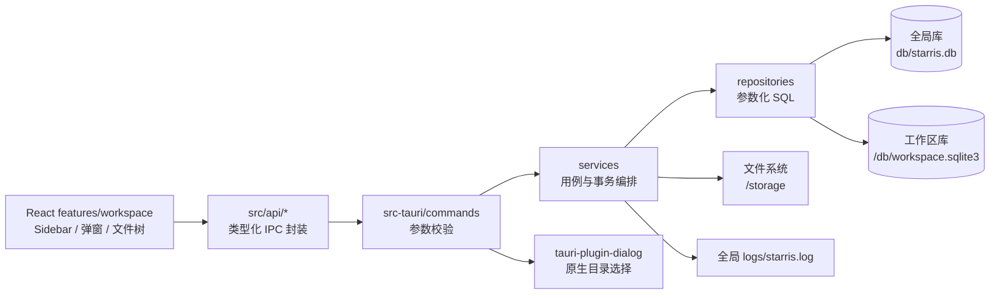
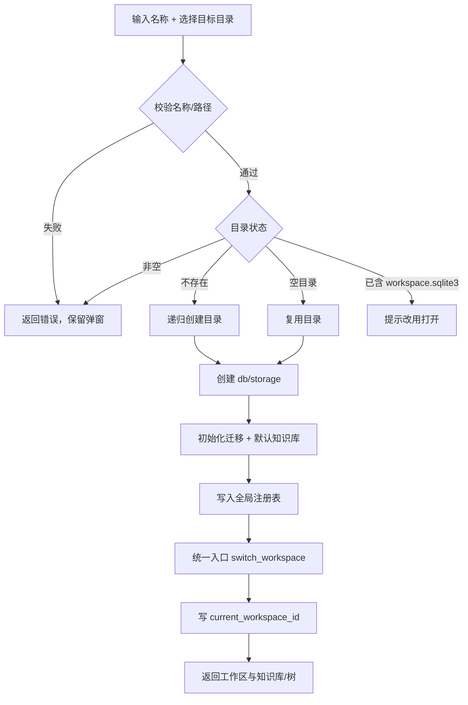
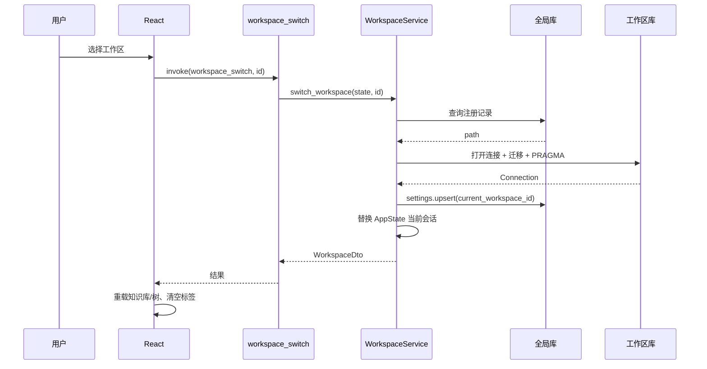
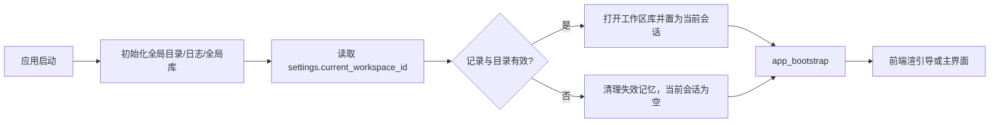
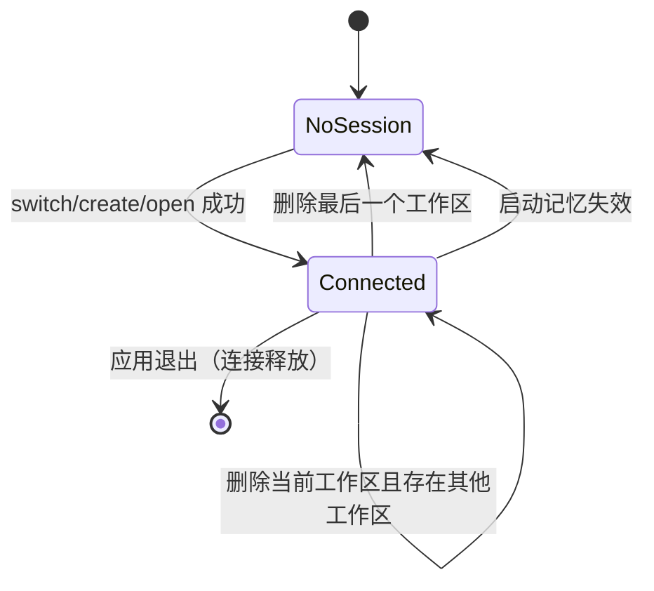
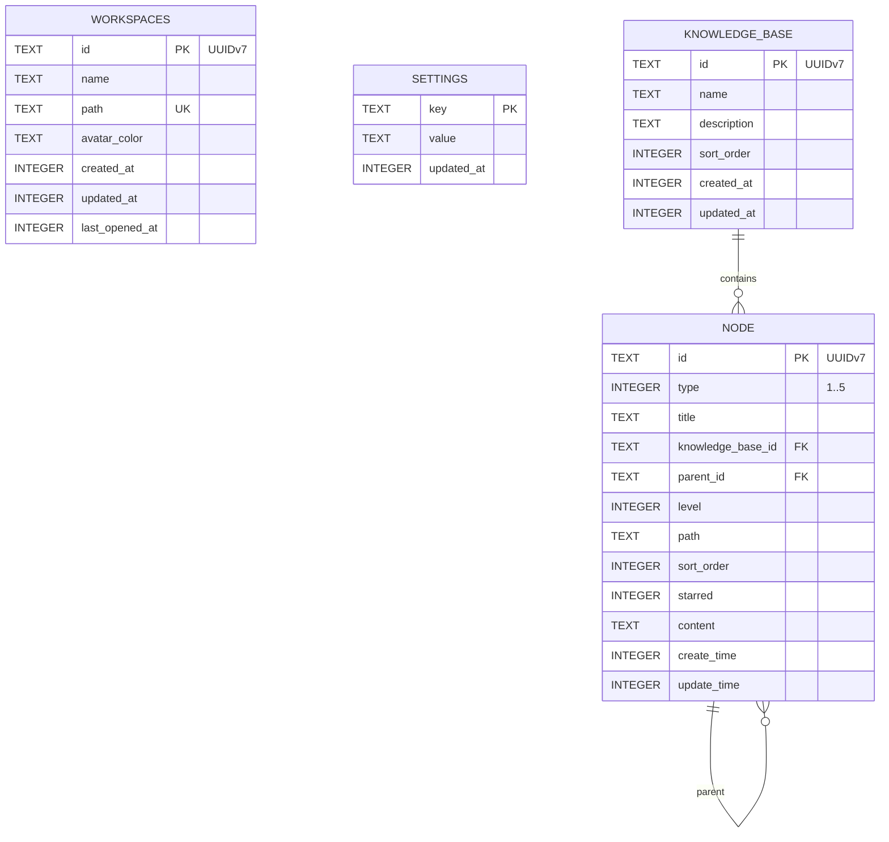
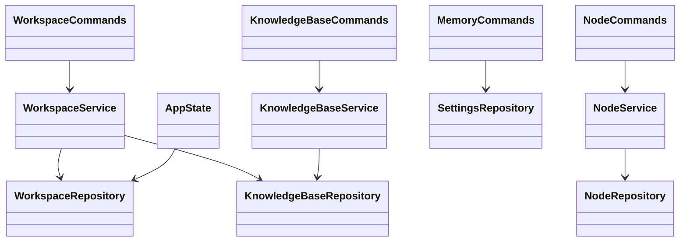
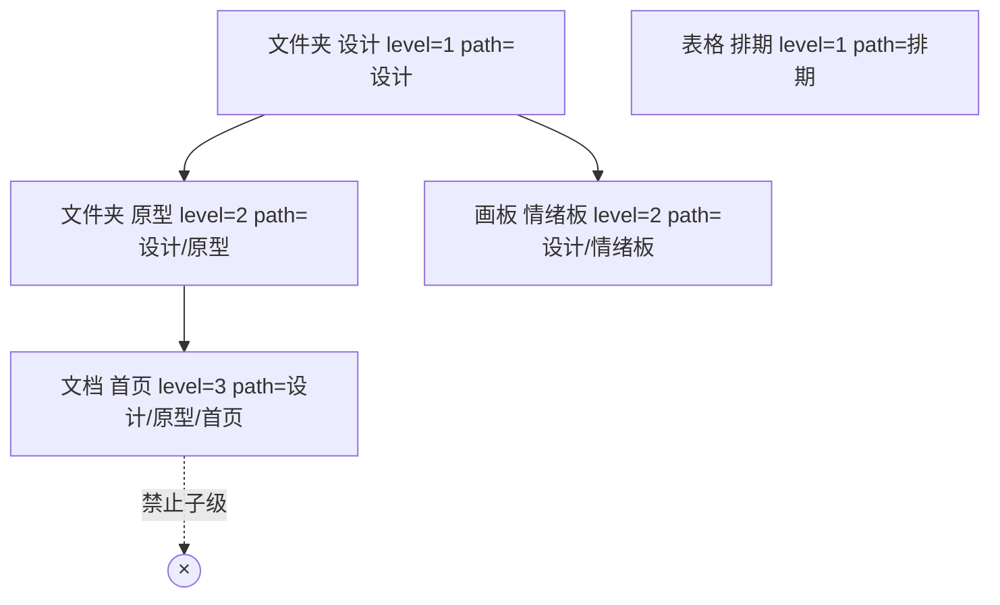
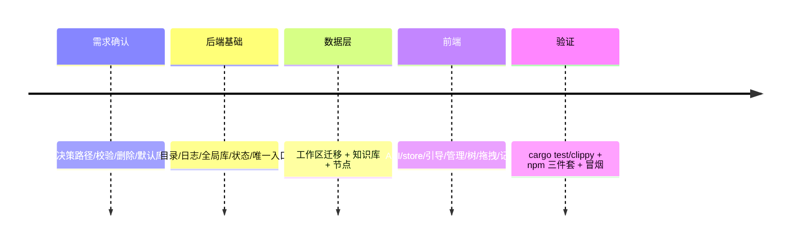
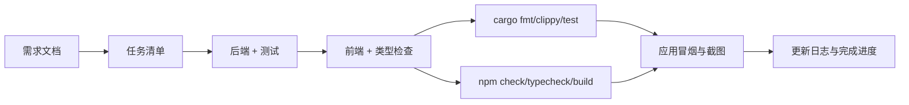

# 需求文档 · 本地工作区、知识库与文件树

- 日期：2026-10-21
- 状态：已确认，可进入开发
- 关联任务：`docs/开发任务清单/2026-10-21-任务-005/`
- 关联基础设施：SQLite（Rust `rusqlite`，bundled）、Tauri 2 IPC、tauri-plugin-dialog

## 1. 背景、目标与术语

### 1.1 背景

当前 Starris 处于纯前端 mock 阶段：工作区、知识库、文件树都由 `src/mocks/workspace.ts` 提供，Rust 端只有模板 `greet` 命令。用户要求把工作区、知识库、文件树与用户记忆真正落盘，形成可重启恢复的本地知识库应用。

### 1.2 目标

1. 定义并实现两类工作区目录：全局工作区（程序数据）与本地工作区（用户数据）。
2. 实现工作区的新建、打开、列表、改名、删除与**唯一入口切换**。
3. 实现知识库 `knowledge_base` 的增删改查与切换。
4. 实现每个工作区左侧文件树的 CRUD、任意层级文件夹与拖拽排序/换层。
5. 提供统一记忆配置 API，持久化主题、当前工作区与每个工作区当前知识库，下次启动直接恢复。

### 1.3 术语

| 术语 | 含义 |
|---|---|
| 全局工作区 | 程序固定数据目录（默认 `~/.starris/rust`，可用 `STARRIS_HOME` 覆盖），只存全局注册表、配置、日志，不存知识库内容 |
| 本地工作区 | 用户选择的独立目录，内含 `db/workspace.sqlite3` 与 `storage/`，所有知识库数据属于该目录 |
| 当前工作区 | 同一时刻唯一处于连接状态的工作区；切换即切换 SQLite 连接 |
| 知识库 | 工作区内的数据分区，文件树按知识库隔离 |
| 节点 | 文件树中的文件夹/文档/画板/表格/流程图，`type` 取 1~5 |
| 记忆配置 | 跨启动保留的用户设置，键值对存储于全局库 |

### 1.4 用户角色与场景

- 单机用户：首次启动创建或打开工作区，之后在左上角切换工作区/知识库。
- 多工作区用户：把不同项目放在不同磁盘目录，通过管理弹窗查询、改名、切换、删除。
- 数据维护者：删除工作区时自主选择是否连同本地文件夹一起删除。

## 2. 范围、非范围、约束与假设

### 2.1 功能范围

- 全局工作区目录与全局 SQLite（工作区注册表 + 记忆配置）。
- 本地工作区目录结构 `db/workspace.sqlite3`、`storage/`。
- 首次启动引导弹窗（新建 / 打开），不可在无工作区时关闭。
- 左上角工作区切换、查询、管理、新建、打开、改名、删除（可选删文件夹）。
- 知识库列表、新建、查询、改名/描述修改、删除、切换。
- 文件树任意层级展示、新建（5 类）、改名、删除、拖拽排序/换层。
- 主题（`appearance.theme`）与明暗（`appearance.mode`）记忆；当前工作区记忆由后端统一写入。
- 启动时自动恢复上次工作区与主题。

### 2.2 非范围（本期不做）

- 文档正文持久化、画板/表格/流程图编辑器数据处理（节点仅存元数据与预留 `content` 字段）。
- 附件上传与 `storage/` 内容管理（仅创建目录）。
- 跨工作区拖拽、跨知识库移动节点。
- 云同步、多窗口、多进程并发写同一工作区。
- 完整日志查看界面（仅按全局规范落盘）。

### 2.3 约束

- 遵循 `AGENTS.md`：Rust 分层为 `commands → services → repositories → db/domain`；SQL 参数化；事务保证一致性；前端经 `src/api/` 调用。
- 所有主键使用 UUID v7（时间有序），由 Rust 生成。
- 文件树仅有 `type=1`（文件夹）可以有子节点；根节点允许任意类型。
- 节点标题不得包含 `/`、`\` 或控制字符，避免 materialized path 歧义。
- 工作区路径必须是绝对路径；删除文件夹必须二次确认并经过安全路径校验。
- 不兼容历史 mock 数据（仓库无持久化旧数据）。

### 2.4 已确认产品决策

| 决策 | 结论 |
|---|---|
| 新建工作区路径 | 用户选择**目标目录本身**；默认建议 `~/Starris/<名称>`，可在弹窗中浏览选择 |
| 打开工作区校验 | 目标目录必须已存在 `db/workspace.sqlite3`，否则拒绝 |
| 删除当前工作区 | 允许；删除后自动切到最近使用的其他工作区，无剩余则清空连接并回到引导页 |
| 默认知识库 | 新建工作区时自动创建「默认知识库」 |
| 打开的工作区无知识库 | 允许进入；文件树显示空状态并引导新建知识库 |

## 3. 用户故事与业务规则

### US-1 首次启动

作为用户，我第一次打开应用时看到“新建工作区 / 打开工作区”引导；选择后建立与该工作区数据库的连接并进入主界面。

规则：
- 启动时后端读取记忆 `current_workspace_id`；记录存在且目录/DB 有效 → 自动连接，主界面直接可用。
- 记录缺失、路径被删除或 DB 损坏 → 不进入主界面，展示引导，并清理失效记忆。
- 引导弹窗无关闭按钮，不可通过 Esc/遮罩关闭。

### US-2 新建工作区

规则：
- 名称为 1~80 字符，去首尾空格后非空，拒绝控制字符。
- 路径为绝对路径；目录不存在则递归创建；目录存在时必须为空，或本身就是含 `db/workspace.sqlite3` 的工作区（此时引导走“打开”）。
- 创建 `db/workspace.sqlite3`、`storage/`；初始化迁移；创建「默认知识库」。
- 注册到全局库（名称只存在全局库），随后经统一入口切换。
- 同一路径不得重复注册。

### US-3 打开工作区

规则：
- 目录必须含 `db/workspace.sqlite3`；文件不存在或打不开 → 返回明确错误。
- 路径已在全局注册表 → 复用原记录（保留名称）；未注册 → 以目录名作为初始名称登记。
- 成功后经统一入口切换并记忆。

### US-4 工作区管理

规则：
- 列表按 `last_opened_at` 倒序展示，可搜索名称/路径。
- 改名只更新全局注册表，不改目录名；空名/超长拒绝。
- 删除需二次确认；可勾选“同时删除本地文件夹”。
- 删除当前工作区：先切换到最近使用的其他工作区；没有其他工作区则清空连接。
- 删除文件夹前校验：路径规范化后不得为根目录/用户主目录；必须是已注册目录；目录本身不得是符号链接；必须包含 `db/workspace.sqlite3`；失败不回滚注册表删除，并给出错误提示。

### US-5 知识库 CRUD 与切换

规则：
- 列表包含节点数量 `docCount`（当前知识库下节点总数）。
- 名称 1~80 字符；描述 ≤500 字符。
- 新建追加到末尾（`sort_order`）。
- 改名/改描述更新 `updated_at`。
- 删除知识库级联删除其全部节点；删除当前知识库后前端切到剩余第一个；无剩余显示空状态。
- 切换只改变前端当前知识库并重载文件树；节点标签页在切换时清空，避免跨库错位。

### US-6 文件树节点

规则：
- 类型：1 文件夹、2 文档、3 画板、4 表格、5 流程图。
- 新建：根节点任意类型；父节点必须是文件夹；非文件夹没有“新建子级”入口。
- `level` 根为 1，子级 = 父 level + 1。
- `path` 为从一级到当前标题的拼接，使用 `/`：根 `设计`，子级 `设计/原型`。
- `sort_order` 在同一父组内连续递增；新建追加末尾。
- 改名：更新自身 `update_time`；若为文件夹，事务内同步所有后代 `path` 前缀。
- 删除：递归删除子树（文件夹及全部后代），返回删除数量。
- 拖拽：
  - 拖到文件夹“内部” → 成为其最后一个子级；
  - 拖到节点“前/后” → 成为同级并插入对应位置；
  - 根节点可被拖回根级排序；
  - 非文件夹不能作为拖放父级；
  - 文件夹不得拖入自身或后代；
  - 不能跨知识库移动。
- 移动后重新计算被移动子树的 `level`/`path`，并重排新旧同级组的 `sort_order`。

### US-7 记忆配置

规则：
- 统一 API：`memory_load()` 一次读取全部键值；`memory_save(entries)` 批量 upsert。
- 键限制 `[a-zA-Z0-9_.-]{1,80}`，值 ≤4096 字节；参数化写入。
- 保留键：`current_workspace_id`（后端在切换时写入）、`appearance.theme`、`appearance.mode`。
- 工作区级键：`kb.current.<workspaceId>`，记录该工作区当前选择的知识库 id；按工作区隔离，切换知识库时写入，启动/切换工作区时优先恢复；知识库被删除或记忆失效时回退到第一个库并回写。
- 主题名只接受 8 套预设，模式只接受 `light|dark`；非法值前端忽略并用默认值。
- 工作区切换/删除切换由 Rust 统一写 `current_workspace_id`，前端不重复写。

## 4. 交互流程与页面状态

### 4.1 首次启动

1. 应用加载 → 调用 `app_bootstrap`（工作区列表 + 记忆 + 当前工作区 + 知识库 + 树）。
2. 无当前工作区 → 全屏引导 `WorkspaceOnboarding`：
   - “新建工作区”打开创建弹窗；
   - “打开工作区”调用原生目录选择；
   - 加载中禁用按钮；失败显示行内错误 + toast。
3. 成功 → 关闭引导，加载知识库与文件树。
4. 已有当前工作区 → 直接进入，后台无闪烁。

页面状态：加载、空（无工作区）、创建表单校验错误、打开失败（非有效工作区）、成功。

### 4.2 工作区切换

1. 点击左上角工作区名 → 下拉浮层显示工作区与知识库。
2. 选择工作区 → 调 `workspace_switch` → 重建连接 → 重载知识库/树 → 清空旧标签页 → toast。
3. 失败保留原工作区，toast 显示原因。

### 4.3 文件树

- 顶部“新建”下拉：文件夹/文档/画板/表格/流程图。
- 节点悬停菜单：文件夹显示“新建子级”；所有节点显示“重命名/删除”。
- 拖拽时显示插入线或“移入文件夹”高亮；后端失败则重新拉取树并提示。
- 空状态：无知识库 → “先新建知识库”；有知识库无节点 → “新建第一个节点”。

## 5. 图形

### 5.1 架构图



### 5.2 工作流程（创建工作区）



### 5.3 序列图（切换工作区）



### 5.4 数据流（启动恢复）



### 5.5 生命周期（工作区会话）



### 5.6 ER 图



### 5.7 类图（后端分层）



### 5.8 树结构示例



### 5.9 时间线（实现顺序）



### 5.10 瀑布式交付门禁



## 6. 数据定义、存储与迁移

### 6.1 全局目录

```text
${STARRIS_HOME:-~/.starris/rust}/
├── db/starris.db
└── logs/starris.log   # 每次启动清空上一轮，仅保留本轮
```

### 6.2 本地工作区目录

```text
<用户选择的目标目录>/
├── db/workspace.sqlite3
└── storage/            # 本期仅创建，附件功能预留
```

### 6.3 表定义

全局库 `workspaces`、`settings` 与工作区库 `knowledge_base`、`node` 见 §5.6。附加约束：

- `workspaces.path` 唯一；`id` UUIDv7。
- `node.type` CHECK 1~5；`node.level >= 1`；`knowledge_base_id` 外键级联；`parent_id` 外键级联。
- 索引：`node(knowledge_base_id, parent_id, sort_order)`、`node(parent_id)`、`knowledge_base(sort_order)`。
- 时间统一为 Unix 毫秒（`INTEGER`）；前端展示时格式化。
- 所有连接开启 `foreign_keys=ON`、`journal_mode=WAL`、`busy_timeout=5000`。

### 6.4 迁移

- 工作区库使用 `PRAGMA user_version`；当前版本 1，从 0 建表后写入 1。
- 全局库同样使用 `user_version=1`。
- 迁移在打开连接时执行，事务包裹；失败关闭连接并报错，不静默重建。
- 不删除既有用户数据；本期无旧版持久化数据。

### 6.5 性能

- 树查询按 `(knowledge_base_id, sort_order)` 一次取平表，前端 O(n) 组树，避免 N+1。
- 移动节点使用单事务 + 递归 CTE 取子树；只重排受影响同级组。
- 全局库只在切换/管理时访问；知识库操作只访问当前工作区库。

### 6.6 安全与隐私

- SQL 全部参数化；路径来自原生目录选择/文本输入，必须绝对路径并规范化。
- 删除文件夹前做根目录/主目录/符号链接/工作区结构校验。
- 日志只写工作区 id、名称、错误类别，不写文档内容或完整用户路径（路径只保留末级标签）。
- 记忆 API 限制键名与值长度，防止滥用。

## 7. 验收标准

| 编号 | 验收标准 | 可观察证据 |
|---|---|---|
| A1 | 首次启动无工作区时展示不可关闭引导，可选择新建或打开 | 应用截图/UI 测试 |
| A2 | 新建工作区生成目标目录、`db/workspace.sqlite3`、`storage/` 与默认知识库，并自动进入 | 目录检查 + `app_bootstrap` 返回 |
| A3 | 打开已有工作区要求 `db/workspace.sqlite3`，无效目录被拒绝且提示 | IPC 返回错误 |
| A4 | 启动自动恢复上次工作区与主题；目录失效时回到引导 | 重启验证 + 日志 |
| A5 | 工作区列表/搜索/改名/删除可用；删除时可选连同文件夹，当前工作区删除后自动切换或回引导 | UI + 文件系统检查 |
| A6 | 所有切换（新建/打开/手动/删除后）都走同一 `switch_workspace` 服务入口 | 代码审查 + 日志 |
| A7 | 知识库增/删/改/查/切换可用，删除级联节点 | IPC 测试 + UI |
| A8 | 文件树按知识库展示任意层级；根任意类型；仅文件夹显示新建子级 | UI 截图 + 测试 |
| A9 | 节点新建/改名/删除可用；文件夹改名同步后代 path；删除递归 | Rust 集成测试 |
| A10 | 拖拽可成为文件夹子级或同级前后排序；非法拖入后代/非文件夹被拒 | Rust 测试 + UI 手动/自动 |
| A11 | 节点 id、知识库 id 均为 UUIDv7；type 为 1~5；level/path/sort_order 正确 | DB 查询 |
| A12 | `memory_load/save` 持久化主题与明暗，重启读取 | 重启验证 |
| A13 | `cargo test`、`cargo clippy`、`npm run check`、`npm run typecheck`、`npm run build` 通过 | 命令输出 |
| A14 | 黑盒交互在真实 Tauri 应用验证；若环境受限须如实标注 | 测试报告 |

## 8. 未决问题与风险

- 文档/画板正文暂不落库：切换标签或重启后内容不保留；已列为非范围，`node.content` 预留。
- 删除文件夹不可恢复：依赖二次确认与安全校验；不做回收站。
- 当前知识库不写记忆（需求仅要求主题与当前工作区）：重启后默认选中第一个知识库。
- 多进程同时写同一工作区未做锁；SQLite WAL + busy_timeout 仅缓解。
- 黑盒自动化在 macOS Tauri 无官方 WebDriver 支持，可能只能做应用冒烟 + 截图 + 手工交互记录；届时在功能测试报告中标注。
