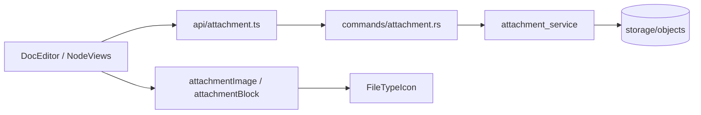
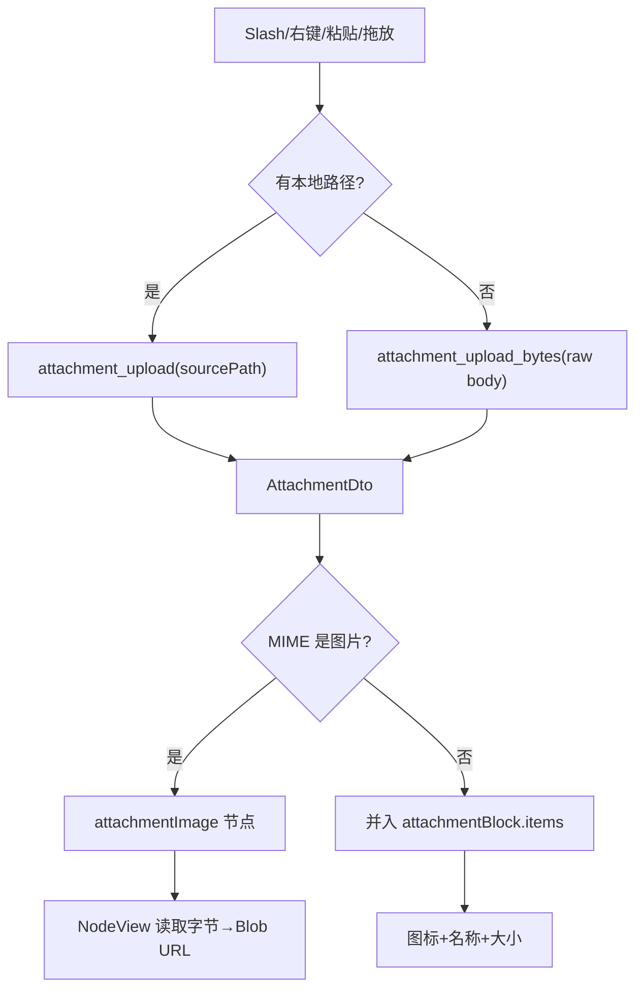
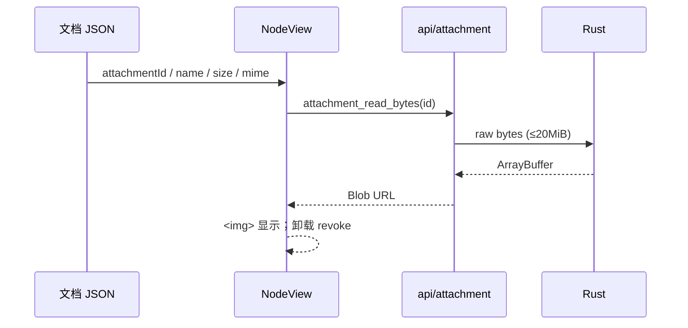
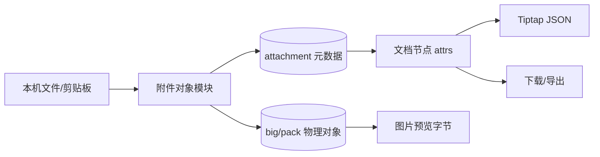
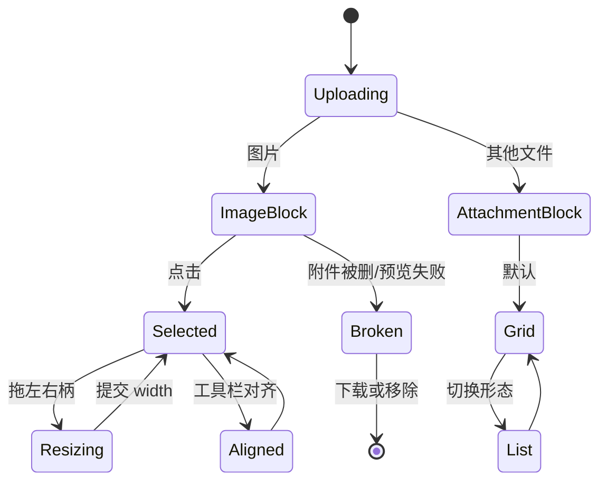
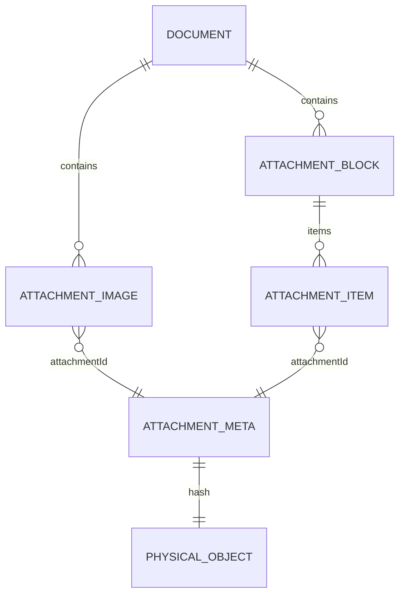
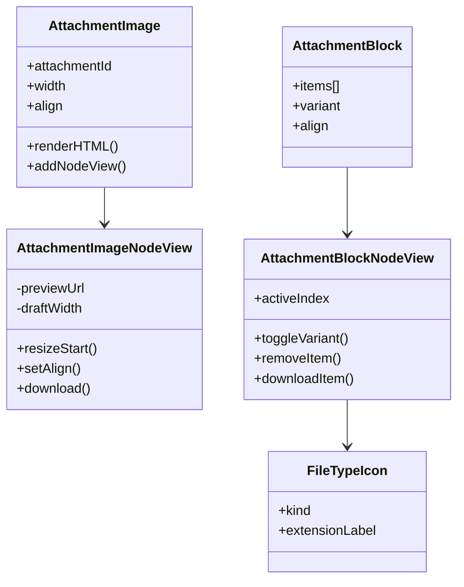
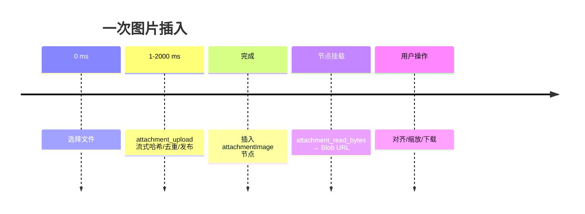
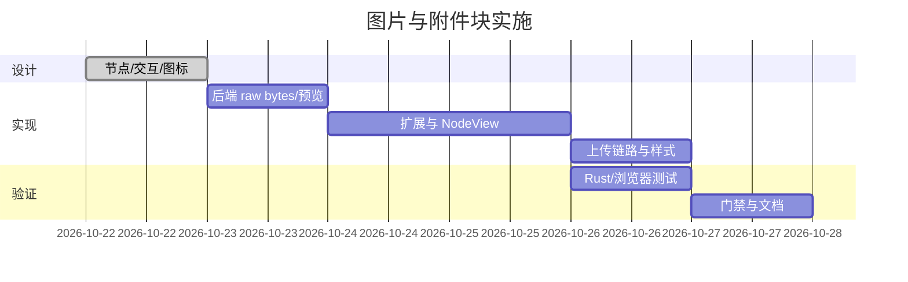

# 需求文档：文档图片块与附件块

- 日期：2026-10-22
- 状态：已实现（浏览器验证通过；真实 Tauri WKWebView/raw IPC 待人工复测）
- 关联任务：`docs/开发任务清单/2026-10-22-任务-006/`
- 前置：附件对象存储（任务-005）已落地

## 1. 背景与目标

任务-005 已提供工作区级附件对象存储（BLAKE3、big/pack、去重、引用计数、下载/校验）。编辑器目前仍把图片转成 ≤2 MB data URL 写入正文，附件没有文档内表达。本轮把图片与附件做成可编辑的文档块，并全部接入对象管理模块。

目标：

1. 新增 `attachmentImage` 图片块：直接显示预览，支持左/中/右对齐、左右拖拽缩放、块级拖动排序、下载原图。
2. 新增 `attachmentBlock` 附件块：一次承载 0..N 个附件，支持卡片网格与长条列表两种形态、组级对齐、逐项下载/移除。
3. 为不同附件类型设计统一文件图标：页面折角造型 + 类型色 + 扩展名标签；图片、PDF、文档、表格、演示、压缩包、音频、视频、代码、Markdown、JSON、文本、通用各一套。
4. 新上传的图片/附件全部经附件对象模块：文件选择走路径上传；粘贴/拖放走原始字节上传；文档 JSON 只存 attachmentId 与展示元数据，不存 data URL。
5. 回显时按 attachmentId 读取对象字节生成图片预览；附件卡片直接用节点内缓存的名称/大小/MIME 渲染，不依赖网络。
6. 下载统一调用附件模块的导出能力，不直接读物理路径。

## 2. 范围

### 2.1 本轮实现

- Rust：`attachment_read_bytes`（限图片预览大小，raw bytes 返回）、`attachment_upload_bytes`（raw IPC body + header 元数据）。
- Markdown/props：图片块输出图片引用；附件块输出附件链接；统计 attachment 数。
- Tiptap：两个 atom 节点 + React NodeView + 工具栏 + 图片缩放。
- 编辑器：Slash「图片」「附件」、右键「插入图片」、粘贴/拖放文件、上传中状态、错误提示。
- 图标：自定义 SVG `FileTypeIcon` 与分类映射。
- 测试：Rust 集成测试 + Chromium 功能测试。

### 2.2 不做

- 图片裁剪、滤镜、旋转、图注编辑、多图相册。
- 附件在线预览（PDF/Office/视频播放器）；本轮只显示图标并可下载。
- 旧 data URL `image` 节点迁移为附件（保留官方 Image 扩展兼容旧文档）。
- 拖入文件夹、批量目录上传、断点续传/进度/取消。
- 附件权限/加密。

### 2.3 约束

- 文档 JSON 不写 base64；图片预览数据只存在前端内存（Blob URL），卸载即释放。
- 预览上限 20 MiB；超过时显示「图片过大」状态并提供下载原图。
- 字节上传上限 64 MiB（粘贴/拖放）；更大文件走文件选择器的路径上传。
- 图片/附件块均为顶层 atom 块，可被现有块手柄拖动；不进入表格单元格内部编辑。
- 兼容旧 `image` 节点：继续使用官方 Image + ResizableNodeView 渲染，不强制迁移。

## 3. 节点契约

### 3.1 attachmentImage

```json
{
  "type": "attachmentImage",
  "attrs": {
    "attachmentId": "uuid-v7",
    "name": "封面.png",
    "size": 204800,
    "mime": "image/png",
    "alt": "封面",
    "width": 480,
    "align": "left"
  }
}
```

- `width` 为显示宽度 px；0/缺省 = 按自然宽度并受正文宽度约束。
- `align`: `left | center | right`。
- 不存 `src`；预览通过 `attachment_read_bytes(id)` 获取原始字节，前端转 Blob URL。
- 旧附件被删除时，NodeView 显示损坏态与「下载原图」；下载失败由编辑器错误通道提示。

### 3.2 attachmentBlock

```json
{
  "type": "attachmentBlock",
  "attrs": {
    "variant": "grid",
    "align": "left",
    "items": [
      {
        "attachmentId": "uuid-v7",
        "name": "流水线平台_黑盒自测.sh",
        "size": 7475,
        "mime": "text/x-shellscript"
      }
    ]
  }
}
```

- `variant`: `grid`（卡片，自动换行）| `list`（全宽长条）。
- `align`: 组级左/中/右；`list` 形态仍占满宽度。
- `items` 顺序即展示顺序；逐项移除只更新数组，全部移除时删除整块。
- 节点为 atom；附件项不是 ProseMirror 子节点，避免嵌套编辑与 schema 膨胀。

## 4. 交互

### 4.1 插入

- Slash「图片」：文件选择器仅图片过滤、可多选；逐个上传，每个图片一个图片块，按选择顺序插入。
- Slash「附件」/右键「插入附件」：任意文件可多选；上传后合并为一个附件块（默认卡片网格）。
- 右键「插入图片」与 Slash 图片共用上传逻辑。
- 粘贴/拖放：图片文件 → 图片块；其他文件 → 一个附件块；拖放位置优先，否则当前选区。
- 上传期间显示「正在上传附件…」浮动小条；失败按文件汇总提示，成功的不回滚。

### 4.2 图片块

- 点击图片 → NodeSelection，图片出现 2px 主色选中框与左右缩放柄。
- 左右手柄拖拽改变宽度，保持纵横比；最小 120px、最大正文宽度；松手提交 `width`。
- 选中时图片上方浮出工具栏：左/中/右对齐、下载原图；当前对齐用主色底白图标。
- 块手柄可拖动整块排序；不响应浏览器原生图片拖拽。
- 预览加载态：浅色骨架 + 进度图标；失败/超大：图标 + 文案 + 下载。

### 4.3 附件块

- 卡片网格：每张卡片上方 56×68 文件图标、名称最多两行、大小；选中卡片 2px 主色框。
- 长条列表：36×44 图标在左、名称/大小在中间、下载/移除在右。
- 卡片/长条右上角显示下载与移除按钮；hover 或选中时可见。
- 选中时上方浮出工具栏：左/中/右对齐 + 卡片/长条切换；工具栏点击不丢失选中。
- 卡片点击选择整块；块手柄拖动整组；移除最后一项删除整块。
- 附件块不读取附件内容即可回显；下载时才调用对象模块。

### 4.4 图标

- 统一造型：圆角页面 + 右上折角 + 底部扩展名标签；线宽 1.5px，页面底为类型色 8% 混卡片。
- 类型映射：图片/PDF/Word/表格/演示/压缩/音频/视频/代码/Markdown/JSON/文本/通用。
- 颜色全部来自语义令牌（primary / accent-foreground / destructive / logo-c / glow-b / muted-foreground）。
- 扩展名标签取大写、最多 4 字符（如 PDF、DOCX、XLSX、JSON、MD、SH、IMG、ZIP、MP4）。
- 图标尺寸：卡片 56×68，长条 36×44；同一类型在两种形态保持相同颜色与标签。

## 5. 图形

### 5.1 架构



### 5.2 上传流程



### 5.3 引用/回显时序



### 5.4 数据流



### 5.5 节点生命周期



### 5.6 节点 ER/结构



### 5.7 组件类图



### 5.8 目录树

```text
src/features/
├── attachments/
│   ├── components/FileTypeIcon.tsx
│   └── utils/fileKind.ts
└── editor/
    ├── extensions/attachmentImage.ts
    ├── extensions/attachmentBlock.ts
    ├── components/nodes/AttachmentImageNodeView.tsx
    ├── components/nodes/AttachmentBlockNodeView.tsx
    └── utils/attachmentUpload.ts
```

### 5.9 时间线



### 5.10 实施瀑布



## 6. 数据与性能

- 图片 NodeView 只按需读取一个对象；Blob URL 在组件卸载/ID 变化时 `revokeObjectURL`。
- 预览读取上限 20 MiB；服务端通过 `read_blob` 固定缓冲读取后一次返回，错误返回可读文案。
- 字节上传上限 64 MiB；Tauri raw IPC body，避免 JSON 数字数组/ base64 放大。
- 节点 attrs 只存必要展示字段；大数组附件块建议一次不超过 50 项（未强制），超出时列表滚动。
- 文档保存仍走现有 `doc_save` 块哈希；附件对象不重复写入正文。
- 旧 data URL 图片继续由官方 Image 扩展渲染；新图片不再写 data URL。

## 7. 验收标准

1. Slash「图片」选择本地图片后出现图片块，预览可见；重新打开文档后仍可见（附件仍在）。
2. 图片左/中/右对齐可切换并持久化；左右拖拽改变宽度并持久化，刷新后恢复。
3. 图片块可通过左侧块手柄拖动排序；下载能保存原始图片文件。
4. Slash「附件」多选文件后生成一个附件块；grid/list 可切换并持久化。
5. 不同扩展名显示不同颜色/标签图标；PNG/PDF/DOCX/XLSX/PPTX/ZIP/MP3/MP4/SH/JSON/MD/TXT 至少各命中正确类型。
6. 附件逐项下载成功；移除一项后 JSON 与 UI 同步；移除最后一项删除整块。
7. 粘贴/拖放图片与文件不写 base64，均进入对象模块；上传中状态可见；失败有错误提示。
8. 旧 data URL 图片文档可正常打开和渲染。
9. `cargo test`、`cargo fmt --check`、`npm run check`、`npm run typecheck`、`npm run build` 全绿；真实 Tauri 未执行项标注。
10. 选中图片块或附件块时，布局浮条的横向中心必须落在该块实际内容（图片本体/卡片组）的中心上，不得停在正文行中心。
11. 从系统文件管理器把文件拖入窗口：落点在正文容器内时按绝对路径流式上传并在落点插入（图片→图片块，其余合并为附件块）；落点在正文容器外时不写入当前文档。
12. 连续粘贴/拖放/选择同名文件（例如两次都叫 `image.png`）每次都上传成功并返回各自的附件 id；文件名不参与任何唯一性判断。

## 8. 决策点

| 决策 | 选择 | 理由 |
| --- | --- | --- |
| 图片预览传输 | raw bytes + Blob URL | 避免 base64 膨胀；Tauri v2 原生支持 raw IPC；上限 20 MiB 控制内存 |
| 粘贴/拖放上传 | raw bytes 上传 | 浏览器 File 无本地路径；上限 64 MiB，大文件走选择器路径 |
| 附件块结构 | atom + items attrs | 卡片由 NodeView 一次渲染，避免 N 个嵌套节点/NodeView；拖动/删除整组简单 |
| 图片节点 | 新 `attachmentImage` atom + NodeView | 需要动态预览、对齐、缩放；不改官方 Image（旧文档兼容） |
| 旧图片 | 保留官方 Image | 避免一次性数据迁移风险；新内容统一走附件 |
| 外部拖放通道 | Tauri webview 事件 + 路径流式上传 | `dragDropEnabled` 默认为 true，框架在原生层接管拖放，网页拿不到 HTML5 `drop`；事件直接给出绝对路径，可复用流式上传且不受 64 MiB 字节上限约束 |
| 图标实现 | 自绘 SVG 页面图标 | 与参考图一致、可缩放、颜色走令牌；不引入图标包 |
| 形态 | grid / list | 覆盖参考的卡片布局与“长条”形态 |

## 9. 风险

- 20 MiB 预览上限会让超大图片无法内嵌预览；提供下载兜底。
- NodeView 内缩放/工具栏与 ProseMirror 选中可能存在事件冲突，需要 `preventDefault` + NodeSelection。
- 附件被外部删除后文档仍保留引用；本轮显示损坏态，不做自动清理。
- WKWebView 的 Blob URL 与 raw IPC 需真实 Tauri 复测；浏览器 harness 只能验证 Chromium。
- 附件块不进入表格单元格内部（atom 块）。
