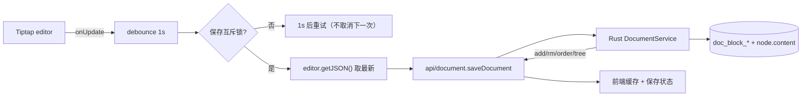
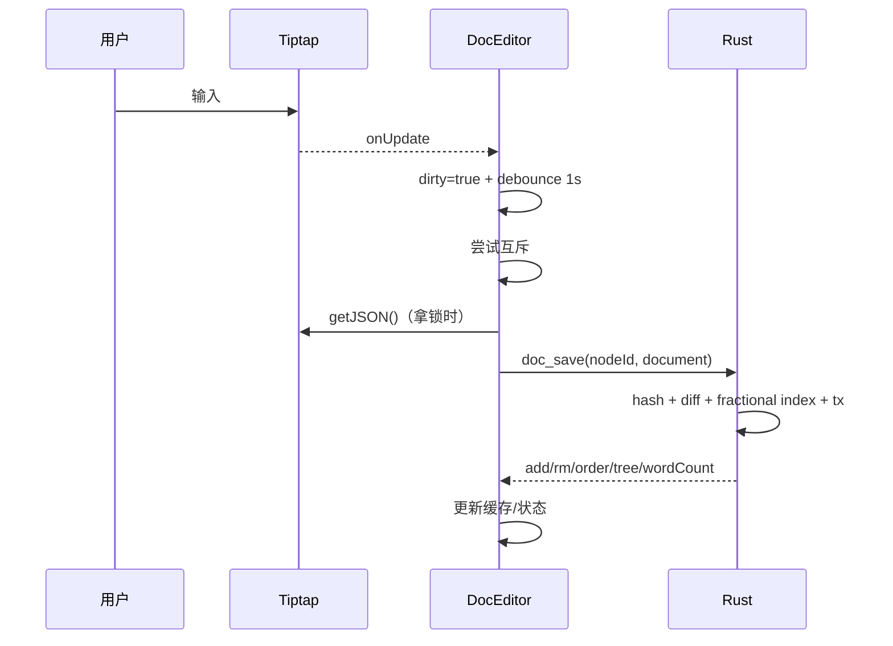

# 需求文档 · Tiptap 块级持久化与编辑器交互增强

- 日期：2026-10-22
- 关联任务：`docs/开发任务清单/2026-10-22-任务-003/`
- 状态：已确认，按本文实现

## 1. 背景与目标

当前文档编辑器使用 Tiptap StarterKit + mock 内容，正文不落库；工作区/知识库/文件树已使用 Rust + SQLite 持久化。本期目标：

1. 把 Tiptap 文档按“顶层块”做内容寻址存储：`doc_block_hash` + `doc_block_tree`，支持增量 diff。
2. 编辑后 1 秒防抖自动保存；保存互斥；锁冲突时本次保存延长 1 秒再试，且不取消下一次防抖。
3. Rust 侧用高性能哈希与 Fractional Index 完成新增/删除/排序，返回并落库 `add/rm/order` 差量。
4. 引入 Tiptap 官方 MIT 开源免费插件，优化编辑体验；按钮类操作通过选区气泡与右键浮层触发；支持颜色、对齐、表格、图片（暂不接附件后端）等。

## 2. 范围

### 2.1 本期做

- 文档正文 JSON 持久化（仅 `type=2` 文档节点）。
- 块哈希表/块顺序树表与迁移。
- 防抖保存、互斥、锁冲突重试、切换文档前 flush。
- 哈希差量：新增块、删除块、顺序变更、重复块、引用清理。
- Fractional Index：局部最小重排、长度上限、全量重排兜底。
- 编辑器扩展：文本样式/颜色/高亮、对齐、上下标、任务列表、表格、图片（本地 data URL）、代码块高亮、Emoji、折叠块、占位符、字符统计、BubbleMenu、真实目录（TOC）。
- 右键菜单、气泡菜单、Slash 菜单的统一操作入口。
- Rust 测试与真实 Tauri 验证。

### 2.2 本期不做

- 附件上传/下载与 `storage/` 文件管理（图片先以 data URL 写入文档，限制体积；后续迁移到附件服务）。
- 协同编辑、评论、AI、版本历史、Tiptap Cloud / Pro 付费扩展。
- 文档导出格式转换（Markdown/PDF）。
- 跨文档移动块。

## 3. 数据模型

工作区库迁移到 **v3**，新增：

### doc_block_hash

| 列 | 类型 | 约束 | 说明 |
|---|---|---|---|
| hash | TEXT | PK | `xxh3_128` 小写 hex（32 字符） |
| json | TEXT | NOT NULL | 规范化块 JSON |

### doc_block_tree

| 列 | 类型 | 约束 | 说明 |
|---|---|---|---|
| id | TEXT | PK | UUID v7，块实例 id |
| node_id | TEXT | NOT NULL, FK → node ON DELETE CASCADE | 所属文档 |
| hash | TEXT | NOT NULL, FK → doc_block_hash(hash) | 内容寻址 |
| order | TEXT | NOT NULL | Fractional Index（base62） |

索引：`(node_id, order)`；`hash` 索引用于引用检查。

- `node.content` 保存完整 doc JSON（快速加载缓存），与块表在同一事务更新。
- 一个文档的顶层块 = `editor.getJSON().content[]`；每块独立 hash。
- 重复内容块可复用 hash，但 tree 每实例一行独立 UUIDv7。

## 4. 保存流程

### 4.1 前端防抖与互斥

1. `onUpdate` → 设置 dirty，清除旧 debounce timer，1s 后尝试保存。
2. 保存互斥锁（前端 ref/Promise）：拿不到锁 → 本次保存再等 1s（不取消后续新编辑的 debounce）；拿到锁 → 才调用 `editor.getJSON()` 获取**当时最新**数据。
3. 成功：更新 block tree 缓存与保存状态；若保存期间又变 dirty，再排一次保存。
4. 失败：保留 dirty、显示错误，下次编辑/重试继续保存。
5. 切换文档/卸载：先 flush 当前 dirty 文档，再加载新文档。
6. 后端仍以工作区互斥 + SQLite 事务作为最终并发保护，前端锁不能替代服务端。

### 4.2 后端哈希与差量

1. 校验文档根 `type=doc`，取 `content[]` 为块数组。
2. 每块 `serde_json::Value` 规范序列化 → `xxh3_128` → 32 位 hex；同一次保存内缓存 hash。
3. 读取当前 `doc_block_tree`（按 order）作为“变更前缓存”（id/hash/order）。
4. 匹配策略：按最终顺序贪心复用同 hash 的旧块实例（重复 hash 依次配对）；未匹配旧块=删除，未匹配新块=新增（UUIDv7）。
5. 顺序：对保留下来的块按旧 order 求 LIS（最长递增子序列），LIS 块保持原位；其余新增/移动块只重排所在区段，使用 Fractional Index 在 `after/before` 之间生成。
6. 任一生成越界（长度 > 32、无可用 key、无锚点）→ 整篇等距重排（8 位 base62，u128 计算）；全量重排属于兜底。
7. `doc_block_hash`：新增 hash 先 `INSERT OR IGNORE`；删除 tree 行后若 hash 已无任何引用，才删除 hash 并放入 `rm`。
8. 事务内更新 tree/hash/content/word_count/update_time，提交后返回差量。

### 4.3 最终差量格式（IPC）

```json
{
  "add": [{ "hash": "…", "json": { "type": "paragraph", "content": [] } }],
  "rm": ["hash1", "hash2"],
  "order": [
    { "after": "ab", "before": "ac", "hashList": ["hash1", "hash2"] }
  ],
  "tree": [{ "id": "uuidv7", "hash": "…", "order": "ab" }],
  "wordCount": 128,
  "updatedAt": 1760000000000
}
```

- `add` 只含工作区 hash 表中原本不存在的块。
- `rm` 只含已无 tree 引用的 hash。
- `order` 为空表示顺序未变；`after/before` 为空串表示头部/尾部。
- `tree` 是保存后的完整顺序（前端缓存）。

## 5. Fractional Index 规则

- 字母表：`0-9A-Za-z`（ASCII 顺序即字典序），order 字段 TEXT，最大长度 32。
- 头部插入：生成小于首键、且尽量均匀的键；尾部插入：递增末位或追加中位字符。
- 两键之间插入：取公共前缀后的第一个可插入字符；相邻时追加中位字符。
- 局部重排只改新增/移动块；LIS 锚点不动。
- 全量重排：`width = 8`，`step = 62^width/(n+1)`，为每个块分配等距 key；N 超过 8 位容量时增大 width（上限 32）。
- 生成后断言 `prev < key < next`、唯一、长度 ≤32，否则走全量重排。

## 6. 编辑器扩展（仅 MIT/免费）

已核验 npm 元数据均为 MIT，且无 `@tiptap-pro`/Cloud：
- 已有 StarterKit（含 Link/Underline）、BubbleMenu 基础设施。
- 新增：`extension-text-style`、`extension-color`、`extension-highlight`、`extension-text-align`、`extension-subscript`、`extension-superscript`、`extension-task-list`、`extension-task-item`、`extension-table`（含 row/cell/header）、`extension-image`、`extension-code-block-lowlight` + `lowlight`、`extension-emoji`、`extension-details`、`extension-table-of-contents`、`extension-file-handler`、`extension-drag-handle(-react)`。
  - 2026-10-22 后续变更：`extension-drag-handle(-react)` 已移除，改由项目自绘手柄与 PointerEvent 拖拽替代（见 `2026-10-22-需求文档-编辑器交互重构.md` §3.4.1）。
- `@tiptap/extensions` 的 Placeholder / CharacterCount 直接使用，不重复安装。

### 6.1 交互

- **选区气泡菜单**：选中文本出现，含 B/I/U/S/Code、颜色、高亮、链接；点击不抢焦点。
- **右键浮层**：在编辑器内右键，定位光标/选区，打开菜单：
  - 块类型：正文/H1-H3、无序/有序/任务列表、引用、代码块、折叠块、分隔线；
  - 对齐：左/中/右/两端；
  - 颜色：文字颜色、高亮色（主题中性/语义色板，支持清除）；
  - 插入：图片（本地文件，≤2MB，data URL）、表格（3×3 带头）；
  - 表格上下文：增删行列、删除表格；
  - 链接：设置/移除。
- **Slash 菜单**：复用同一套命令，支持过滤与 ↑↓/Enter 选择。
- **图片**：toolbar/右键插入，写入 data URL；本期不接附件后端，文档 JSON 会包含图片数据，限制大小并记录已知限制。
- **目录**：TOC 扩展提供真实标题层级，替换 Toolbar mock 大纲。
- **保存状态**：编辑器 meta 行显示“正在保存… / 已保存 / 保存失败”。

## 7. 数据流与状态





## 8. 验收标准

| 编号 | 标准 |
|---|---|
| E1 | 编辑后 1s 自动保存；连续编辑只保存最终内容 |
| E2 | 同一编辑器并发保存被互斥；锁冲突 1s 后重试；保存时取最新 JSON |
| E3 | `doc_block_hash`/`doc_block_tree` 表随工作区库 v3 迁移创建 |
| E4 | 每块 hash 稳定（同内容同 hash，30 位以上区分），重复块可复用 |
| E5 | 新增/删除块差量正确；删除 hash 前检查 tree 引用 |
| E6 | 头部/中间/尾部插入、删除、移动后的顺序正确；LIS 保留多数旧块 |
| E7 | order 长度超限或无解时触发全量重排，结果唯一且递增 |
| E8 | 切换文档/重启后正文恢复；`node.content` 与块表一致 |
| E9 | 颜色、对齐、高亮、上下标、任务列表、表格、图片、代码高亮、折叠块、Emoji、链接可用 |
| E10 | 右键浮层/气泡菜单/Slash 菜单可用，按钮不破坏选区 |
| E11 | 所有新增依赖为 MIT/免费开源；许可证门禁通过 |
| E12 | Rust 测试、前端 check/typecheck/build、真实 Tauri 冒烟通过 |

## 9. 风险与假设

- xxh3-128 为非加密哈希，理论上存在碰撞；内容寻址场景下概率极低，若未来需要强一致可替换 BLAKE3。
- 图片 data URL 会增大文档 JSON 与块存储；本期限制 2MB，后续迁移到附件。
- Tiptap 免费扩展的行为随版本变化；锁定 3.32.0。
- 全量重排会更新较多 order，频率受 32 字符上限约束。
- 切换文档时若 flush 保存失败，保留错误并阻止静默丢失；用户可重试。
