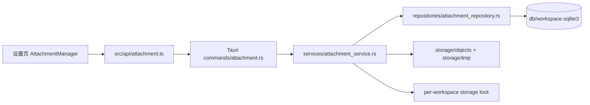
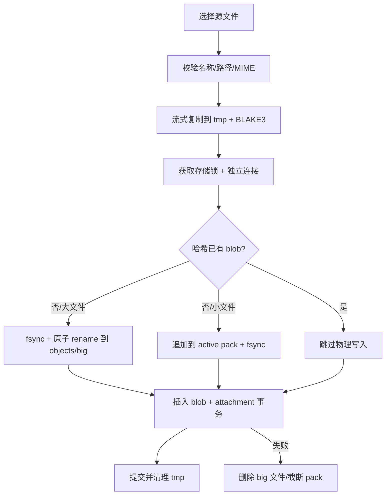
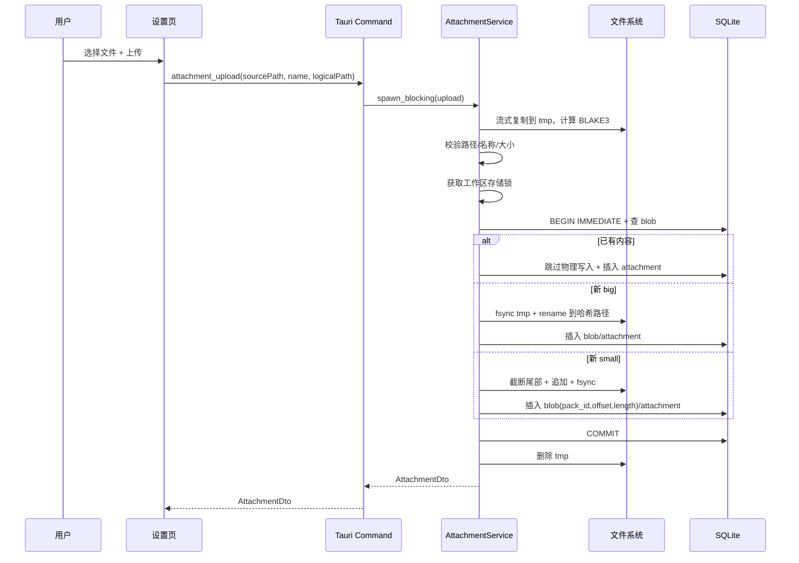
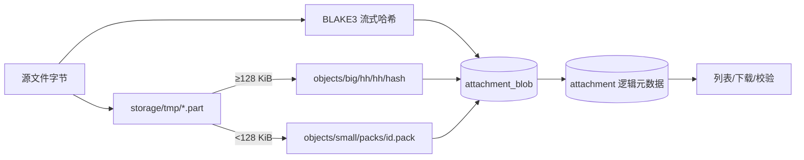
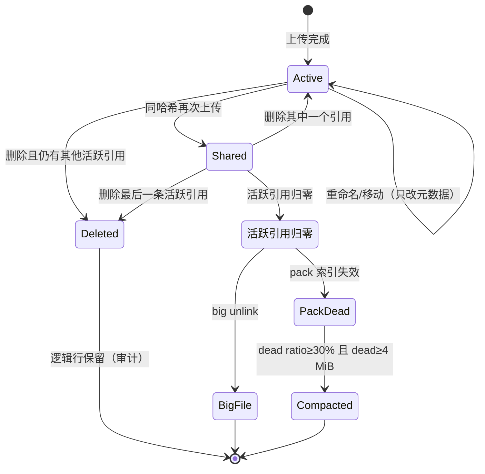
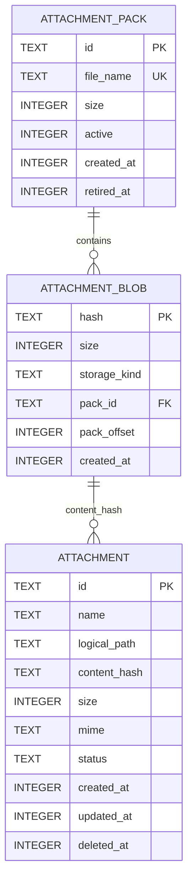
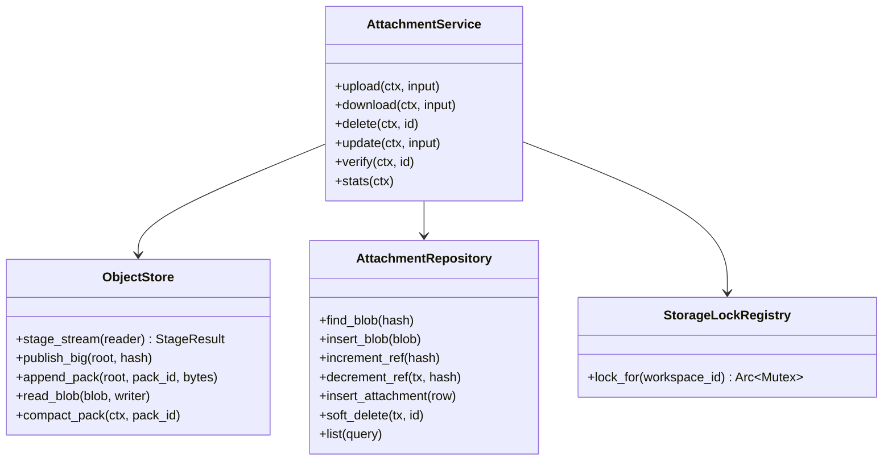
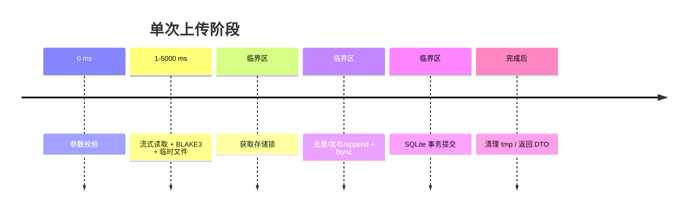
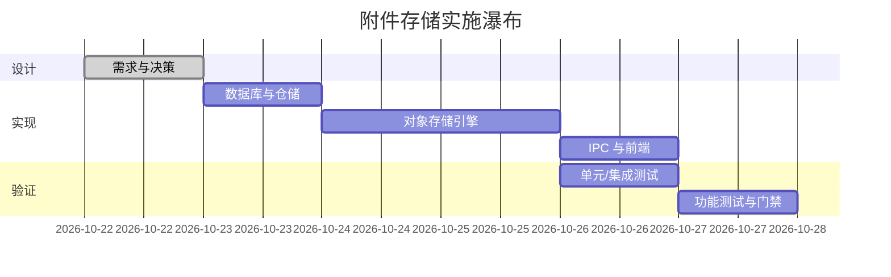

# 需求文档：附件对象存储

- 日期：2026-10-22
- 状态：待实现
- 关联任务：`docs/开发任务清单/2026-10-22-任务-005/`
- 适用工作区：每个本地工作区独立一份 `storage/` 与 `db/workspace.sqlite3`

## 1. 背景与目标

星屿当前只把图片以 ≤2 MB 的 data URL 写进文档正文，无法承载大量附件、10 GB 级文件、去重、重命名/移动、导出与删除。需要在一个本地工作区内实现独立的附件对象存储，使附件与文档正文解耦。

目标：

1. 附件元数据只存在工作区 SQLite 中；物理文件与用户可见名称/逻辑路径解耦。
2. 物理对象按内容寻址，BLAKE3 32 字节哈希（64 位小写十六进制）；相同内容只存一份。
3. 物理对象不可变；覆盖/修改等于写入新哈希并切换元数据引用。
4. 大文件全程流式处理，内存占用与文件大小无关。
5. 小文件进入 pack，避免数十万 inode；pack 支持索引读取、软删除与后台 compaction。
6. 上传、下载、删除、重命名、移动、校验、统计均有 IPC 与设置页入口。
7. 所有路径相对工作区根目录，工作区整体搬移后仍可用。

术语：

| 术语 | 含义 |
| --- | --- |
| 逻辑附件 | 用户看到的一行：文件名 + 逻辑目录 + MIME + 大小 |
| 物理对象 | 按内容哈希命名的一份不可变字节 |
| big 对象 | 大于等于 128 KiB、落在 `objects/big` 的物理对象 |
| pack | `objects/small/packs/*.pack` 中按偏移/长度切分的多个小对象集合 |
| 活跃引用 | `attachment.status='active'` 且 `content_hash=blob.hash` 的行数 |
| 软删除 | 逻辑附件标记 `deleted`，不立即删除整行元数据 |

## 2. 范围

### 2.1 本轮实现

- 工作区库 v5：`attachment`、`attachment_blob`、`attachment_pack` 及索引。
- 流式上传（源文件路径）、BLAKE3、big 原子发布、small pack 追加。
- 去重与引用计数；软删除；大对象物理删除；pack 失效与后台 compaction。
- 流式下载到用户选择的目标路径；显式校验；容量/对象统计。
- 附件重命名、逻辑目录移动、列表查询。
- 设置 → 存储页的附件管理器：统计、列表、上传、导出、删除、刷新。
- Rust 集成测试与 Chromium 功能测试。

### 2.2 本轮不做

- 附件内容预览、缩略图、文档正文内嵌附件（现有图片 data URL 逻辑暂不改）。
- 跨工作区引用、云同步、多设备并发写入同一工作区。
- 断点续传、上传取消、进度条（命令仍异步执行，UI 显示忙碌态）。
- 符号链接/网络盘的特殊语义；按普通本地文件系统处理。
- 物理对象加密与压缩。

### 2.3 约束与假设

- 单进程桌面应用；同一工作区同一时间由本应用独占写入。
- 文件系统支持同目录原子 rename、文件 fsync；不支持时降级为“先删后 rename”，此时仅可能产生不可见孤儿，不会暴露半截文件。
- 10 GB 级文件允许耗时较长；命令必须离开主线程，且不得整文件读入内存。
- 工作区数据库始终是唯一真相；物理文件缺失属于损坏，必须由校验命令显式报告。

## 3. 业务规则

### 3.1 目录布局

```text
<workspace>/
├── db/workspace.sqlite3
└── storage/
    ├── objects/
    │   ├── big/
    │   │   └── ab/cd/abcdef...（64 位哈希，两级分桶）
    │   └── small/
    │       └── packs/<pack-id>.pack
    └── tmp/<uuid>.part
```

- big 路径为纯计算：`objects/big/{hash[0..2]}/{hash[2..4]}/{hash}`。
- pack 文件内只存原始字节，不存对象头；偏移/长度存 SQLite，避免第二份索引。
- 所有元数据只存相对路径或哈希，不存工作区绝对路径。

### 3.2 逻辑元数据

- 文件名：不含 `/`、`\`、NUL、控制字符；不为 `.`/`..`；≤255 字节；允许中文与空格。
- 逻辑目录：相对路径，统一 `/`；空串表示根；拒绝绝对路径、盘符、`.`/`..`、控制字符；≤1024 字符。
- 文件名允许重复：`(logical_path, name)` **不做唯一约束**。文件名只是展示元数据，附件身份是 `id`，内容去重靠 BLAKE3；两张都叫 `image.png` 的截图必须都能上传成功并各自拿到 id。（v1 需求曾要求活跃路径唯一，2026-10-22 真机反馈推翻：连续粘贴同名剪贴板图片会被挡下，见 §8 第 11 条。）
- 内容相同 = 一份真实文件，多条逻辑记录：同一文件重复上传（文件名可以不同）**每次都新建一条记录**，各自拿到自己的 `id`、名称、目录与时间；它们指向同一条 `attachment_blob`，磁盘上只有一份真实文件。
- 物理对象是否该删**不存计数器**：唯一判据是"还有没有活跃 `attachment` 行引用这个哈希"（按 `content_hash` 索引 COUNT）。引用归零才允许删除真实文件；big 立即 unlink，pack 交给后台 compaction 回收。blob 行本身也只在被引用期间存在。
- 磁盘上不出现用户真实文件名：暂存文件写入期用唯一临时名，写完立即改名为 `storage/tmp/<BLAKE3>.part`；big 对象名就是哈希，pack 文件名叫 pack id。崩溃残留的 `<hash>.part` 自描述，可按 blob 表比对回收。
- MIME：调用方提供合法值则使用；否则按扩展名推断；未知用 `application/octet-stream`。
- 哈希：BLAKE3 32 字节，输出 64 位小写十六进制。
- 时间：Unix 毫秒；创建/更新时间/删除时间。

### 3.3 上传

1. 校验源路径存在且为普通文件；校验逻辑目录/文件名/MIME。
2. 建 `storage/tmp/.<uuid>.writing`，用固定 256 KiB 缓冲区边读边写边算 BLAKE3；`sync_all` 后改名为 `storage/tmp/<BLAKE3>.part`。
3. 取得工作区存储锁后打开独立工作区连接，`BEGIN IMMEDIATE` 检查哈希是否已有活跃 blob：
   - 已有：跳过物理写入，直接插入逻辑附件，提交，删除临时文件。
   - 新 big：把临时文件原子 rename 到哈希路径（先 fsync），插入 blob 与附件，提交；提交失败删除刚发布文件。
   - 新 small：选择活跃 pack，截断未索引尾部 → 追加字节 → fsync → 插入 blob（pack_id/offset/length）与附件 → 更新 pack 大小 → 提交；提交失败把文件截回原长度。
4. 任何时刻读取方只能看到“物理字节已落盘且元数据已提交”的对象。
5. 同一路径已有活跃附件不再报冲突（v6 起允许同名）：同名文件各自成行，物理去重由哈希保证。

### 3.4 下载与校验

- 下载只允许活跃附件；big 直接流式读；pack 按 `offset/length` seek 后精确读取。
- 写入目标同目录临时文件，成功后原子 rename；`overwrite=false` 时目标已存在返回冲突。
- 校验：重新流式计算 BLAKE3 并比较大小/哈希；损坏返回 `valid=false`，不把整文件读入内存。
- 读取 pack 时若提前 EOF 或读到的字节数不等于索引长度，视为损坏。

### 3.5 重命名与移动

- 只改 `attachment.name` / `attachment.logical_path` / `updated_at`，不复制物理对象、不改哈希、不动任何计数。
- 目标目录已有同名附件也允许（v6 起没有唯一约束）；改名/移动只影响这一条记录。
- 已删除附件不可重命名/移动/下载。

### 3.6 删除与引用判定

1. 活跃附件改为 `deleted`，写 `deleted_at`。
2. 同一事务内统计还有多少条活跃附件引用同一哈希（`COUNT(*) ... WHERE content_hash = ? AND status = 'active'`）：
   - > 0：物理对象保留，其他逻辑附件继续引用；
   - = 0：删除 blob 行；big 在存储锁内 unlink 哈希文件（异步命令线程执行，UI 不阻塞）；small 索引行消失即失效，pack 字节留待 compaction。
3. 删除后再上传同名/同内容允许；删除行保留用于审计。
4. 每次 pack 失效后计算 `dead_bytes / pack_size`：≥30% 且 dead ≥4 MiB 时调度后台 compaction。

### 3.7 Pack 选择与压缩

- 每个工作区最多一个 `active=1` 的 pack；新追加只写活跃 pack。
- 活跃 pack 达到 1 GiB 时停止追加，下一次上传创建新 pack。
- compaction：
  1. 把旧 pack 置为非活跃，保证不会再有新追加；
  2. 建新 pack（非活跃，不接收新追加），把旧 pack 中仍活跃的条目按长度复制并 fsync；
  3. `BEGIN IMMEDIATE` 条件更新仍指向旧位置的 blob 行到新 pack；插入新 pack 元数据；提交；
  4. 若无 blob 引用旧 pack，删除旧 pack 文件；崩溃时最多留下不可见孤儿包，旧包仍完整。
- 死数据比例按“pack 文件实际长度 − 活跃条目长度之和”计算。

### 3.8 并发与异步

- 每个工作区一个进程内存储锁（按 workspace id 共享），只包住“发布/追加/删除/compaction 提交”等临界区；哈希与复制在锁外。
- 附件写入使用 `open_existing` 独立连接 + `BEGIN IMMEDIATE`，不长期占用主工作区连接；10 GB 哈希期间可切换工作区。
- 命令使用 `#[tauri::command(async)]` + `spawn_blocking`；不得阻塞 Tauri 主线程。
- 同一内容的并发上传由存储锁与唯一 blob 主键收敛为一份物理对象；删除时按活跃引用数现算，不依赖任何计数器。

### 3.9 异常与边界

| 场景 | 行为 |
| --- | --- |
| 源文件不存在/不是文件 | `Validation`，不创建任何对象 |
| 空文件 | 允许；哈希为 BLAKE3 空串，小文件 pack 条目长度为 0 |
| 逻辑路径/文件名非法 | `Validation`，不写盘 |
| 活跃路径重名 | `Conflict` |
| 已删除附件 id 再操作 | `NotFound` |
| 物理文件缺失 | 下载/校验报错或 `valid=false`，不伪造成功 |
| DB 提交失败 | 删除刚发布的 big 文件 / 截断刚追加的 pack，避免可见半截 |
| 进程在 pack 追加后、提交前崩溃 | DB 无索引，下一次追加按最大索引尾截断；字节不可见 |
| 同一工作区并发删除/上传 | 存储锁串行化临界区，refcount 不出现负数 |
| 工作区被删除 | 独立连接打不开 → 失败；临时文件随目录消失 |

## 4. 交互与页面状态

设置 → 存储页：

- 顶部统计：活跃附件数、逻辑大小、物理占用、唯一对象数、big/pack 分布、pack 死字节。
- 工具条：逻辑目录输入（可选）、选择文件上传、刷新。
- 列表：文件名、逻辑目录、大小、MIME、哈希前 12 位、创建时间。
- 行操作：导出（保存对话框）、删除（行内二次确认）。
- 状态：加载骨架、空列表、上传中、错误条（`role=alert`）、成功 toast/状态文案。
- 上传多个文件时逐个串行，失败一个不阻断后续，最终汇总失败数。

## 5. 图形

### 5.1 架构图



### 5.2 上传工作流



### 5.3 上传时序



### 5.4 数据流



### 5.5 附件与物理对象生命周期



### 5.6 ER 图



### 5.7 类图



### 5.8 目录树

```text
storage/
└── objects/
    ├── big/
    │   └── <2 hex>/<2 hex>/<64 hex>
    └── small/
        └── packs/
            ├── <pack-uuid>.pack
            └── ...
```

### 5.9 上传时间线



### 5.10 实施瀑布



## 6. 数据定义

### 6.1 SQL（v5 目标）

```sql
CREATE TABLE attachment_pack (
  id          TEXT PRIMARY KEY NOT NULL,
  file_name   TEXT NOT NULL UNIQUE,
  size        INTEGER NOT NULL DEFAULT 0 CHECK (size >= 0),
  active      INTEGER NOT NULL DEFAULT 1 CHECK (active IN (0, 1)),
  created_at  INTEGER NOT NULL,
  retired_at  INTEGER
);
CREATE UNIQUE INDEX uq_attachment_pack_active
  ON attachment_pack(active) WHERE active = 1;

CREATE TABLE attachment_blob (
  hash         TEXT PRIMARY KEY NOT NULL,
  size         INTEGER NOT NULL CHECK (size >= 0),
  storage_kind TEXT NOT NULL CHECK (storage_kind IN ('big', 'pack')),
  pack_id      TEXT,
  pack_offset  INTEGER,
  created_at   INTEGER NOT NULL,
  FOREIGN KEY (pack_id) REFERENCES attachment_pack(id) ON DELETE RESTRICT,
  CHECK ((storage_kind = 'big' AND pack_id IS NULL AND pack_offset IS NULL)
      OR (storage_kind = 'pack' AND pack_id IS NOT NULL AND pack_offset IS NOT NULL))
);
CREATE INDEX idx_attachment_blob_pack ON attachment_blob(pack_id, pack_offset);

CREATE TABLE attachment (
  id           TEXT PRIMARY KEY NOT NULL,
  name         TEXT NOT NULL,
  logical_path TEXT NOT NULL DEFAULT '',
  content_hash TEXT NOT NULL,
  size         INTEGER NOT NULL CHECK (size >= 0),
  mime         TEXT NOT NULL,
  status       TEXT NOT NULL DEFAULT 'active' CHECK (status IN ('active', 'deleted')),
  created_at   INTEGER NOT NULL,
  updated_at   INTEGER NOT NULL,
  deleted_at   INTEGER
);
CREATE INDEX idx_attachment_active_path
  ON attachment(logical_path, name) WHERE status = 'active';
CREATE INDEX idx_attachment_hash ON attachment(content_hash);
CREATE INDEX idx_attachment_status ON attachment(status, updated_at DESC);
```

### 6.2 关键常量

| 常量 | 值 | 理由 |
| --- | --- | --- |
| `SMALL_OBJECT_THRESHOLD` | 128 KiB | 常见 4 KiB 簇的 32 倍；兼顾 inode 压力与 pack 内单对象回放成本 |
| `PACK_ROLL_BYTES` | 1 GiB | 单 pack 可管理、复制/校验耗时可控 |
| `COMPACTION_DEAD_RATIO` | 0.30 | 死字节超过三成才值得重写 |
| `COMPACTION_MIN_DEAD_BYTES` | 4 MiB | 避免频繁压缩小包 |
| `STREAM_BUFFER_BYTES` | 256 KiB | 固定内存，适配大文件吞吐 |
| 哈希 | BLAKE3-256 / 64 hex | 需求指定；流式友好 |

### 6.3 迁移

- 工作区库 `user_version: 4 → 5`；仅新建表与索引，不修改既有数据。
- 旧库打开时自动迁移；版本高于 5 拒绝打开。
- 工作区目录搬迁：元数据只存哈希/逻辑路径，`storage/` 随目录整体搬移。

## 7. 性能与安全

- 上传/下载/校验固定 256 KiB 缓冲；哈希/复制期间不持有主工作区连接与 UI 线程。
- 分桶路径 O(1) 计算；去重按哈希主键查询。
- `(logical_path, name)` 非唯一索引（目录检索用） + `(status, updated_at)` 列表索引；哈希索引用于去重审计。同名不做唯一约束。
- 所有 SQL 参数化；路径/名称严格校验，禁止穿越；下载目标由保存对话框选择。
- 不记录文件内容；错误信息不暴露工作区绝对路径（日志可记录相对标签）。
- `spawn_blocking` 承载大文件 IO；删除 compaction 使用命名后台线程。

## 8. 验收标准

1. 同一内容上传两次只产生一个 big 文件/pack 条目，但两条逻辑记录；删除一次文件仍在（还有一条活跃引用），删掉最后一次物理文件/索引引用归零。
2. 小文件进入 pack；读取结果与源文件逐字节一致；索引 offset/length 正确。
3. 上传 10 MB 级文件不出现一次性 `read_to_end`；内存不随文件大小线性增长（代码审查 + 流式 API）。
4. big 上传在 rename 之前对读取方不可见；pack 对象在事务提交前不可见。
5. 软删除后默认列表不显示；`include_deleted` 可见；下载被拒绝。
6. 重命名/移动只改元数据，物理文件与哈希不变；改名或移动到已有同名附件的目录都不被拒绝。
7. 超过阈值后 compaction 执行，旧 pack 被替换，存活对象可继续读取。
8. 路径穿越/非法文件名被拒绝；并发同哈希上传 refcount 正确。
9. 设置页可完成上传、列表、导出、删除；错误/空/加载状态可见。
11. 同一目录上传两个**同名不同内容**的文件都成功并各自返回 `id`，两条记录都能在列表里看到；v5 老库升级后同名旧数据不丢、唯一索引被撤下。
12. 暂存文件在哈希算完后改名为 `storage/tmp/<BLAKE3>.part`；上传结束（成功或失败）后 `storage/tmp` 不残留文件；并发上传同一内容也只产生一个对象。
13. 同一文件重复上传（含改名、换目录、并发、连续粘贴）每次都新建记录并返回新 `id`：`active_count` 随上传次数增长，`unique_objects` 与 `physical_bytes` 不变（真实文件只有一份）；引用数由活跃记录现算（表里不存计数器），逐条删除到只剩一条时文件仍在，删掉最后一条才物理删除并删 blob 行。
14. `cargo test`、`cargo fmt --check`、`npm run check`、`npm run typecheck`、`npm run build` 全绿；真实 Tauri 未执行的项如实标注。

## 9. 决策点与理由

| 决策点 | 选择 | 理由 |
| --- | --- | --- |
| 小文件阈值 | 128 KiB | 用户建议 64–128 KiB；128 KiB 在 inode 节省与 pack 重写成本之间更平衡 |
| pack 索引位置 | SQLite 而非 sidecar | 元数据是唯一真相；与 refcount 同事务，避免双索引漂移 |
| 删除策略 | 逻辑行软删；blob 归零即删；pack 失效后 compaction | 满足“延迟删除”与“归零直接异步删除”的组合要求 |
| refcount | blob 表冗余计数 | 删除/列表 O(1)，同事务维护；等价活跃引用可直接校验 |
| 大对象发布 | 同目录 fsync + rename | 原子可见；失败只留不可见孤儿 |
| 小对象发布 | append + fsync 后提交索引 | 读取按索引；提交前不可见 |
| 压缩触发 | 30% 且 ≥4 MiB | 降低小包频繁重写，同时避免长期占用 |
| 并发 | 每工作区存储锁 + 独立连接 | 不阻塞主连接/切换工作区；避免 refcount 竞态 |
| MIME | 调用方优先，扩展名兜底 | 不读取整文件嗅探；可控且低开销 |
| UI | 设置页内附件管理器 | 不引入新页面；附件是工作区级资源 |

## 10. 风险与未决

- 多进程同时打开同一工作区不受支持；文件锁只覆盖单进程。
- 10 GB 上传没有进度/取消；后续可加 Tauri 事件与 operation id。
- 大文件孤儿（进程在发布后、提交前崩溃）不会自动全盘扫描；可在后续维护任务中按引用差集清理。
- pack compaction 目前单线程后台执行；大量小对象时可能持续占用磁盘 IO，后续可限速/分片。
- 现有编辑器图片仍使用 data URL；附件与正文的嵌接是后续需求。
