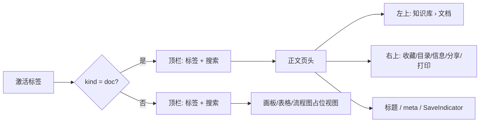

# 需求文档：文档操作下沉到正文页头

- 日期：2026-10-23
- 状态：已实现（第十二轮）
- 关联任务：`docs/开发任务清单/2026-10-23-任务-003/`
- 关联设计：`docs/设计/2026-10-23-文档页头-001/`

## 1. 背景与目标

第十一轮把窗口栏与文档工具栏并成 44px 单行顶栏，顶栏同时承载标签、面包屑、保存态、文档操作、搜索与设置。文档操作与窗口 chrome 混在一排，顶栏在 1280px 宽度下明显拥挤，且「已保存」与正文 meta 行的 `SaveIndicator` 重复表达同一状态。

本轮目标：

1. 顶栏只保留**标签页与全局搜索**（以及 macOS/Windows 的窗口层必需项），恢复窗口 chrome 的轻薄感。
2. 「收藏 / 目录 / 信息 / 分享 / 打印」下沉到**文档页头**，仅文档视图出现。
3. 保存态只保留正文 meta 行的 `SaveIndicator`，删除顶栏的「已保存」胶囊。
4. 面包屑从顶栏移到正文左上空白区，与标题左对齐。

## 2. 范围

### 2.1 本轮实现

- `WindowBar` 删除面包屑、保存胶囊、收藏/目录/信息/分享/打印与设置入口；保留标签页、全局搜索、Windows 自绘窗控与 macOS 红绿灯回补槽。
- 新增 `DocPageBar`：左侧面包屑（知识库 › 文档），右侧 5 个 28px 图标钮（收藏/目录/信息/分享/打印）。
- `DocEditor` 接收页头所需回调；`TabContentView`、`WorkspaceLayout` 透传。
- 信息浮窗起点从内容区顶部 `top-4` 下移到 `top-16`，避免展开时盖住页头操作行。
- 修复目录首次打开为空：TOC `setContent` 使用 `emitUpdate:false` 不自动刷新，加载后显式发布；同时用来源编辑器过滤旧实例的延迟回调，避免 StrictMode 下旧实例把目录清空。
- 「设置」仍可从侧栏「更多」菜单进入，不丢失入口。

### 2.2 本轮不做

- 不改画板/表格/流程图视图的页面结构；这些视图不显示文档页头，也不出现文档操作。
- 不改信息浮窗内容、分享弹窗、打印实现。
- 不调整标签页、搜索、窗口控制的交互。
- 不新增依赖。

### 2.3 约束

- 颜色、圆角、缓动继续消费 `tokens.css` 与既有 Tailwind 语义类，不硬编码色值。
- 文档操作只在 `kind === "doc"` 时渲染；非文档标签不出现半套操作。
- 页头操作按钮必须保留 `aria-label` / `aria-pressed`；面包屑使用 `nav[aria-label="所在位置"]` 与 `aria-current="page"`。

## 3. 交互与布局

- 页面纵向顺序：面包屑与操作行 → 「文档」徽标 + 输入提示 → 标题 → meta（字数/创建/最近编辑/上传中 + `SaveIndicator`）。
- 页头随正文滚动；顶栏固定。页头不再重复「已保存」胶囊。
- 信息浮窗展开时从页头操作行下方开始，操作按钮始终可点；收起把手仍位于右缘中部。

## 4. 验收标准

| # | 判据 | 方式 |
|---|---|---|
| 1 | 顶栏 DOM 只含标签页、搜索与窗口控制 | 可访问性快照 + 截图 |
| 2 | 顶栏无面包屑、无「已保存」胶囊、无文档操作、无设置 | 快照 |
| 3 | 文档页头左上显示「知识库 › 文档」，右上 5 个操作钮 | 快照 + 截图 |
| 4 | 收藏可切换 `aria-pressed` 与星标填充 | 点击验证 |
| 5 | 目录首次打开即列出正文标题 | 首开截图（`after-3-目录.png`） |
| 6 | 信息浮窗展开/收起，且不遮挡页头操作钮 | 截图（`after-2-信息浮窗.png`） |
| 7 | 分享打开弹窗、打印走既有 toast | 点击验证 |
| 8 | 正文 meta 行仍显示 `SaveIndicator` | 快照 |
| 9 | `npm run check`、`npm run typecheck`、`npm run build` 全绿 | 命令输出 |

## 5. 风险与已知限制

- **信息浮窗与页头的层叠**：浮窗仍是绝对定位；下移到 `top-16` 后避开操作行，但在极窄窗口下仍会覆盖正文右侧，这是浮窗的既有行为。
- **非文档标签不显示收藏入口**：本轮按要求把操作收进文档页头；画板等视图如需收藏，应在各自页面头另设入口。
- **目录修复依赖 Tiptap TOC 命令**：加载后显式 `updateTableOfContents()`；若未来替换 TOC 扩展，需要同步调整发布时机。
- 截图来自浏览器 IPC 桩 + Playwright（1280×800）与 Tauri debug 真机（1280×800）；真机数据中的示例文档无标题，目录内容由浏览器桩覆盖。
