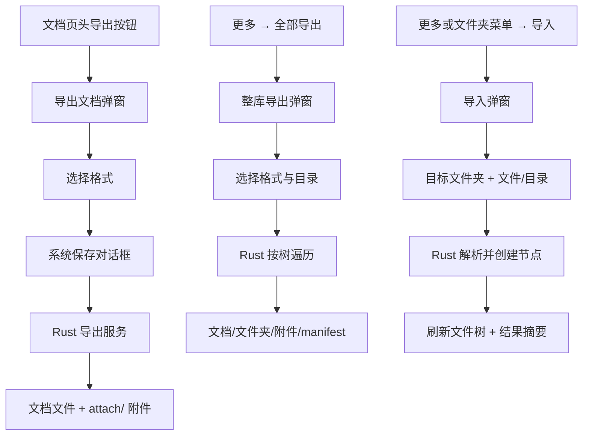

# 需求文档：文档页头细化 + 导出 / 导入闭环

- 日期：2026-10-24
- 状态：已实现并验证（2026-10-24）
- 关联任务：`docs/开发任务清单/2026-10-24-任务-001/`
- 关联设计：`docs/设计/2026-10-24-导出导入-001/`

## 1. 背景与目标

第十二轮把文档操作下沉到正文页头后，页头仍有一个提示胶囊「输入 / 唤起命令」，保存态却在 meta 行右侧；文档 meta 同时展示创建时间，信息浮窗重复「创建时间」；打开文档时信息浮窗默认展开，挤压正文。导出按钮仍是 mock，更多菜单里的「全部导出 / 导入文档」也未实现。

本轮目标：

1. 删除「输入 / 唤起命令」提示，把 `SaveIndicator` 放到「文档」徽标旁。
2. 文档主界面 meta 删除创建时间；信息浮窗保留并明确「新建时间」；打开文档时信息浮窗默认关闭。
3. 单文档导出支持 Markdown / HTML / Word / PDF；Markdown 附件放在与 `.md` 同级的 `attach/` 目录。
4. 左下角「更多 → 全部导出」按文件树导出整个知识库，包含每篇文档的附件、未引用附件与 manifest。
5. 提供导入 / 批量导入：支持 Markdown 与 Word，能导入到子级文件夹，目录导入保留层级。
6. 内容转换尽量覆盖两种格式的全部块类型；无法原生表达的块以代码块/文本保留，并把原始文件附加到文末，确保不丢数据。

## 2. 功能范围

### 2.1 页头与信息浮窗

- `SaveIndicator` 改为 22px 胶囊，放在「文档」徽标右侧；meta 行只保留「字数 · 最近编辑」。
- 删除 `.doc-editor-hint` 及其样式。
- 信息浮窗：字段「创建时间」→「新建时间」；`infoOpen` 初始值固定为 `false`。
- 导出按钮图标从分享改为下载，tooltip/aria-label 为「导出文档」。

### 2.2 单文档导出

| 格式 | 输出 | 附件 |
|---|---|---|
| Markdown | `<name>.md` | 与 md 同级的 `attach/<附件名>`，正文链接改为相对路径 |
| HTML | `<name>.html` | 引用同级 `attach/` 相对路径 |
| Word | `<name>.docx` | 图片嵌入；其它附件在正文中以「附件名（路径）」列出 |
| PDF | `<name>.pdf` | 图片嵌入；附件文件复制到 `attach/` 并在正文列出 |

- 内联 base64 图片在导出时落成 `attach/image-N.<ext>` 并改写引用。
- 缺失/已删除的附件保留原 token 并给出警告，不中断其余内容导出。

### 2.3 整库导出

- 用户在弹窗选择格式后选择目标目录；后端在目标目录下创建 `<知识库名>/`，同名时追加序号。
- 文件夹节点 → 同名目录；文档 → `<标题>.<ext>`，其附件在**文档文件同级**的 `attach/<标题>-<短id>/` 目录，避免同目录多文档重名。
- 非文档节点（画板/表格/流程图）→ `<标题>.json`，保存节点元信息并注明暂无可导出正文。
- 所有未被文档引用的活跃附件 → `_attachments/<逻辑目录>/<文件名>`。
- 根目录写 `manifest.json`（格式、知识库、树、文件清单、附件数、警告）与 `导出说明.md`。

### 2.4 导入 / 批量导入

入口：
- 侧栏「更多 → 导入文档…」：默认导入到知识库根目录。
- 文件夹行操作菜单「导入到此文件夹」：默认目标为该文件夹。

弹窗字段：
- 目标文件夹：根目录或任意文件夹（显示完整路径）。
- 来源：选择文件（多选，同层导入）或选择文件夹（递归导入，可选保留层级）。
- 支持扩展名：`.md/.markdown/.mdown/.mkd`、`.docx/.docm/.dotx/.dotm/.doc`。
- 执行中显示忙碌态；完成后显示成功/失败数量、失败原因与警告摘要。

转换规则：
- 标题取文件名（不含扩展名）；同层重名追加 ` (2)`。
- Markdown 覆盖：标题、段落、强调/加粗/删除线/上下标、行内代码、链接、图片、有序/无序/任务列表、表格、引用、代码块、分隔线、脚注、定义列表、数学、YAML front matter、原始 HTML。
- Word 覆盖：标题、段落、列表（含嵌套）、表格（含表头/合并单元格跨度）、图片、超链接、颜色/高亮/下划线/上下标/删除线、脚注/尾注/批注、页眉页脚、文本框、代码块、分页/分栏、形状。
- 本地图片与本地链接文件上传到附件库；远程图片保留 URL。
- 原文件始终上传为附件并追加到文末 attachmentBlock；转换失败时创建说明段落 + 原文件附件，仍算导入成功并带警告。

## 3. 交互流程

## 4. 验收标准

| # | 判据 | 方式 |
|---|---|---|
| 1 | 文档页头无「输入 / 唤起命令」；保存胶囊位于「文档」徽标旁 | 截图/DOM |
| 2 | meta 行无创建时间；信息浮窗显示「新建时间」；初始不展开 | 截图/DOM |
| 3 | 单文档 md/html/docx/pdf 四个文件均生成且非空 | Rust 集成测试 + 导出目录检查 |
| 4 | md 附件位于同目录 `attach/`，正文不含 `attachment://` | 集成测试 |
| 5 | 整库导出保留文件夹层级、manifest、未引用附件 | 集成测试 |
| 6 | Markdown 导入保留标题/列表/表格/图片/脚注，原文件附加 | 集成测试 |
| 7 | Word + 目录导入成功，目录层级创建为文件夹节点 | 集成测试 |
| 8 | 导入同层重名自动加序号，不覆盖既有节点 | 代码审查/后续测试 |
| 9 | `npm run check/typecheck/build`、`cargo test`、`cargo clippy` 通过 | 命令输出 |

## 5. 风险与已知限制

- **PDF 字体**：PDF 通过系统字体渲染，macOS 使用 PingFang SC；Windows/Linux 需要微软雅黑/Noto Sans SC，缺失时回退字体可能影响中文观感。
- **Word 原生列表**：导出 DOCX 的列表使用文本项目符号与缩进，未生成 Word 原生 numbering；内容与层级完整，但列表编号不是 Word 编号域。
- **Legacy DOC**：内容由 office_oxide 解析；复杂域、宏、嵌入 OLE 对象可能只能以原文件附件形式保留。
- **RTF** 不在本轮支持范围（Word 二进制/OOXML 已覆盖）。
- **md 中无法映射的扩展语法**：原始 HTML、数学、front matter 以代码块保留；脚注统一收束到文末。
- **PDF/大批量导出**：当前逐文件串行生成，超大知识库耗时较长；后续可做进度条与并行。
