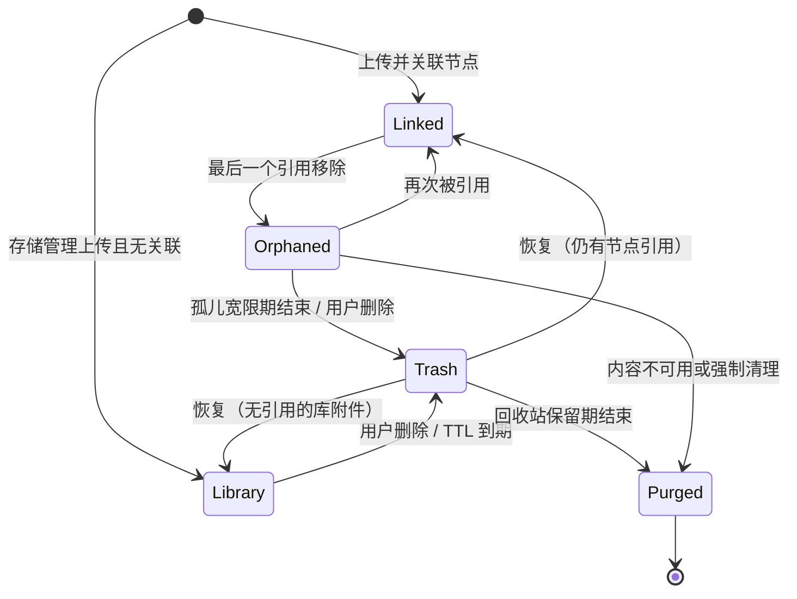
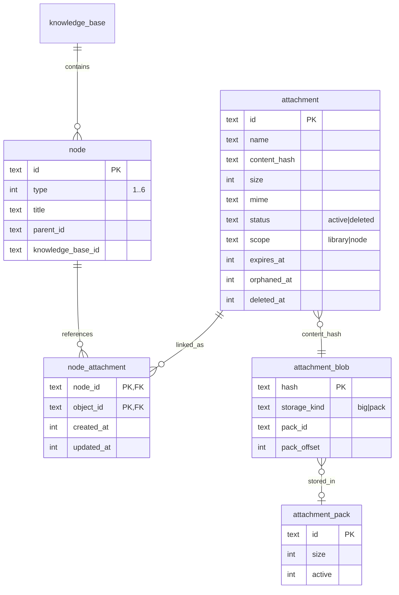

# 需求文档 · 对象存储与附件生命周期（2026-10-25）

- 关联任务：`docs/开发任务清单/2026-10-25-任务-004/`
- 关联需求：附件树（任务-005）、快捷键（任务-006）
- 可交互生命周期图：`docs/设计/2026-10-25-对象存储附件与快捷键-001/原型/object-lifecycle.html`（archify 9/9 校验通过，浏览器 4 档视口证据通过）

## 背景与目标

现有对象存储已具备 BLAKE3 去重、big/pack 双存储、软删除与 pack 压缩，但附件没有业务引用表：删除文档、画板、节点后，附件行与物理对象会残留；软删除没有恢复；临时文件、崩溃残留、孤儿 blob 没有统一清理。目标是建立可证明的引用闭环和生命周期管理，避免垃圾碎片，同时保留误删恢复能力。

## 术语

| 术语 | 含义 |
|---|---|
| object_id | 逻辑附件 id，即 `attachment.id`，也是文档/画板引用的 id |
| content_hash | BLAKE3 内容哈希，决定物理对象去重 |
| blob | `attachment_blob` 物理对象索引；big 文件或 pack 内片段 |
| 引用 | 业务节点（文档、画板、附件节点）对 object_id 的使用 |
| 关联表 | `node_attachment(node_id, object_id, created_at, updated_at)` |
| library | 从存储管理上传、没有节点引用也保留的附件 |
| node | 由文档/画板/附件节点产生并受引用关系约束的附件 |

## 范围

### 做

- 业务引用表与一次性回填。
- 文档/画板保存、附件节点创建时同步引用；节点/知识库删除后标记孤儿。
- 附件生命周期：活跃、孤儿宽限、回收站、物理清理。
- 临时上传 TTL、回收站恢复、看门狗与手动清理。
- 实际磁盘占用、孤儿/回收站统计。
- 迁移、单元/集成测试与真机黑盒验证。

### 不做

- 不做节点级全局撤销/回收站；编辑器撤销通过“保存时重新同步引用”恢复。
- 不做跨工作区对象共享；每个工作区独立 storage。
- 不做对象加密、压缩算法替换或远程同步。
- 不删除历史导出的文件；只管理当前工作区 storage。

## 状态机

约束：

- `library` 附件不会被“无引用”自动删除，只能显式删除或 TTL 到期。
- `node` 附件失去全部引用后进入孤儿宽限，不立即物理删除。
- 回收站中的附件保留 blob，允许恢复；物理删除只发生在 purge。
- 已关联附件不允许从存储管理直接硬删除；必须先解除所有引用。

## 数据模型

### 字段与索引

- `attachment.scope TEXT NOT NULL DEFAULT 'library' CHECK IN ('library','node')`
- `attachment.expires_at INTEGER`：未关联时的到期时间；关联期间不执行。
- `attachment.orphaned_at INTEGER`：最后一次引用移除时间。
- `node_attachment` 主键 `(node_id, object_id)`；`object_id` 单列索引；两端外键 `ON DELETE CASCADE`。
- `idx_attachment_lifecycle(scope, status, orphaned_at, expires_at)`。
- 节点类型 CHECK 扩为 `1..6`，现有数据保留。

## 引用闭环规则

1. 文档保存：从最终文档 JSON 提取 `attachmentImage` / `attachmentBlock` 的 `attachmentId`，与关联表做增删差量；同一事务提交。
2. 画板保存：从最终 elements 提取 image `fileId` 与文件卡片 `customData.objectId`，同一事务同步。
3. 附件节点创建：上传附件（scope=node）后创建 type=6 节点并插入关联，同一业务动作内完成。
4. 节点删除：外键级联删除关联；提交后对受影响 object_id 标记孤儿。
5. 知识库删除：级联删除全部节点与关联；提交后增量标记孤儿。
6. 编辑器撤销/重做：不直接操作对象；下一次保存按最终文档重新同步，宽限期内对象仍在，可恢复引用。
7. 明确删除附件：若 `reference_count > 0`，拒绝并提示先解除引用；树附件节点删除走节点删除流程。
8. 附件删除进入回收站；30 天后 purge。恢复仅在 blob 仍存在时成功。

## 看门狗

- 应用启动运行一次；之后每 6 小时异步运行；应用关闭期间不执行，下次启动补跑。
- 串行于工作区存储锁；切换工作区取消当前轮次。
- 每轮执行：
  1. 清理超过 24 小时的 `storage/tmp/.writing`、`*.part`。
  2. `scope=node` 且无引用、`orphaned_at` 超过 7 天 → 移入回收站。
  3. 未关联且 `expires_at` 已过的附件 → 移入回收站。
  4. 回收站超过 30 天 → purge（删除 attachment 行、无剩余行的 blob、必要时 pack 压缩）。
  5. 清理无 attachment 行引用的孤儿 blob（含崩溃残留）。
  6. pack 死字节达到阈值 → 压缩。
- 手动“立即清理”执行同一套规则，并返回清理数量/字节。
- 时间计算不得阻塞 UI；DB 与文件系统错误写入日志，单轮失败不回滚已成功项。

## 统计与管理 UI

设置 → 存储展示：

- 活跃附件、关联/未关联、回收站数量。
- 逻辑大小、实际磁盘占用、可回收字节。
- 最近维护时间、最近维护结果。
- 操作：上传、显示已删除、恢复、彻底删除、立即清理。
- 关联附件行展示“N 处引用”，禁止直接删除并给出原因。

## 迁移与兼容

- 工作区 `SCHEMA_VERSION` 升到 10。
- v9 → v10：重建 node 表扩展 type=6；新增生命周期列与关联表；保留所有现有数据。
- 迁移后回填：解析现有 `node.content`（文档）与 `board_scene.elements_json`（画板），建立关联；被引用的既有附件 scope 改为 node。
- 迁移失败必须回滚，不得留下半迁移状态。
- 旧版本程序打开 v10 数据库时按现有“版本过高”策略拒绝。

## 性能与安全

- 保存路径只做 O(引用数) 差量，不扫描全库。
- 看门狗在独立线程/阻塞池执行，不持有 Tauri UI 状态锁；与上传/删除共用每工作区存储锁。
- 全部 SQL 参数化；文件操作限制在 storage 根内；不把绝对路径写入日志。
- 看门狗单轮有上限与日志，避免一次清理拖垮启动。

## 验收标准

1. 删除包含图片/附件的文档后，关联行消失；宽限期后进入回收站，保留期内可恢复；恢复后文档重新引用可正常读取。
2. 同一对象被文档与画板同时引用时，删除其中一个不物理删除对象；删除全部引用后才进入孤儿流程。
3. 画板撤销/重做后保存，关联表与最终元素一致。
4. 附件节点删除后关联消失，附件进入孤儿流程；共享对象不受影响。
5. 回收站恢复后附件可下载；purge 后 blob 不存在且统计更新。
6. TTL 到期且无引用的附件被清理；已关联附件不会因 TTL 被删。
7. 看门狗清理 staging/孤儿 blob/回收站；手动清理返回真实计数。
8. v9 数据库迁移后数据完整，文档/画板旧引用被回填。
9. Rust 集成测试、前端门禁、真机 E2E 全部通过。
