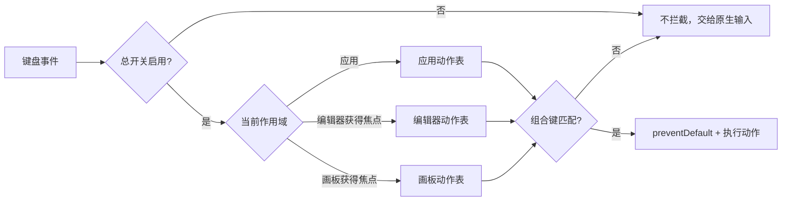

# 需求文档 · 快捷键体系（2026-10-25）

- 关联任务：`docs/开发任务清单/2026-10-25-任务-006/`

## 背景与目标

快捷键目前固定写在窗口 `keydown` 中，设置页只展示不可改；没有总开关；编辑器与画板快捷键没有统一管理。目标是建立应用内全局快捷键注册表，支持一键开关、按作用域配置、录制与冲突提示，并明确第三方内置键的可改边界。

## 范围

- 作用域：应用、编辑器、画板；默认均为应用内（窗口内），不注册系统级热键。
- 配置：总开关、各作用域开关、动作绑定、恢复默认。
- UI：设置 → 快捷键的录制、冲突提示、搜索、分组、清空。
- 编辑器：自有动作可改键，通过 Tiptap 高层 keymap 执行。
- 画板：自有动作可改键，通过 Excalidraw 公共 API 执行；原生绘图键位只读展示。

### 不做

- 不做系统级全局热键（后台唤起），留后续扩展。
- 不修改 Excalidraw 源码；不承诺其全部内置快捷键可改。
- 不允许把基础文本输入、复制粘贴、输入法组合键纳入可关闭范围。

## 作用域模型



优先级：当前视图作用域 > 应用作用域；同一作用域禁止重复绑定；跨作用域重复时提示但允许（明确提示谁优先）。

## 动作目录

### 应用

新建、更多菜单、设置、关闭标签、保存、收藏、侧栏、快速跳转（占位）、全局搜索（占位）、放映画板（占位）。

### 编辑器

保存、加粗、斜体、下划线、删除线、行内代码、链接、H1/H2/H3、无序/有序/任务列表、引用、代码块、插入图片、插入附件、撤销、重做、Slash 菜单。

### 画板

插入附件、组件库、导出 PNG、撤销、重做、选择工具、矩形、椭圆、箭头、文本、删除选中、复制选中。
未实现的画板/编辑器动作不得出现在可编辑列表；第三方内置键位列在“内置快捷键”只读区。

## 配置与持久化

存储于全局 SQLite `settings` 表，键 `shortcuts.config`，值为 JSON：

```json
{
  "version": 1,
  "enabled": true,
  "scopes": { "app": true, "editor": true, "board": true },
  "bindings": {
    "app.newNode": "Mod+N",
    "app.settings": "Mod+,",
    "editor.bold": "Mod+B"
  }
}
```

- 读取失败或字段非法：使用默认配置并在设置页提示。
- 保存失败：保留当前编辑值并显示错误，不静默丢失。
- 组合键规范化：`Mod` 表示平台主修饰键；录制 Cmd 存为 `Mod`，Ctrl 显式存 `Control`；组合按固定顺序显示。
- 录制：点击行进入录制；Esc 取消；Backspace 清空；仅按下修饰键不提交。
- 冲突：同作用域重复直接拒绝；跨作用域重复显示警告；系统保留键给出提示但不猜测系统行为。

## 设置 UI

设置 → 快捷键：

- 顶部总开关 + 三个作用域开关。
- 搜索框与“恢复默认”。
- 分组列表：应用 / 编辑器 / 画板 / 内置只读。
- 行：动作名、当前键帽、录制按钮、冲突状态。
- 底部说明：应用内生效；系统级热键未启用；第三方内置键位不可改。
- 空搜索：显示“没有匹配的快捷键”。

## 编辑器与画板实现边界

- 编辑器使用 ProseMirror 插件在按键阶段读取最新配置并执行命令；配置变更无需重建编辑器。
- 画板通过 Excalidraw 公共 API 执行动作；捕获阶段命中自定义绑定后阻止其内置处理。
- 画板原生快捷键（缩放、绘图等）由 Excalidraw 管理，不提供改键；设置中注明。
- 总开关关闭时，星屿注册的动作不执行，原生文本输入与系统级编辑键保持可用。

## 验收标准

1. 设置页可一键关闭/开启所有星屿快捷键；关闭后 Cmd+N、Cmd+J 等不再触发。
2. 可录制、清除、恢复单个与全部快捷键；重启后保持。
3. 同作用域冲突无法保存；跨作用域冲突有可见警告。
4. 修改应用快捷键后立即生效；修改编辑器快捷键无需重开文档。
5. 编辑器自有动作与画板自有动作可改键；内置键位只读展示且有说明。
6. 输入框、输入法组合与基础文本编辑不被误拦截。
7. 配置损坏时回退默认且不崩溃。
8. 前端门禁与真机 E2E 通过。
