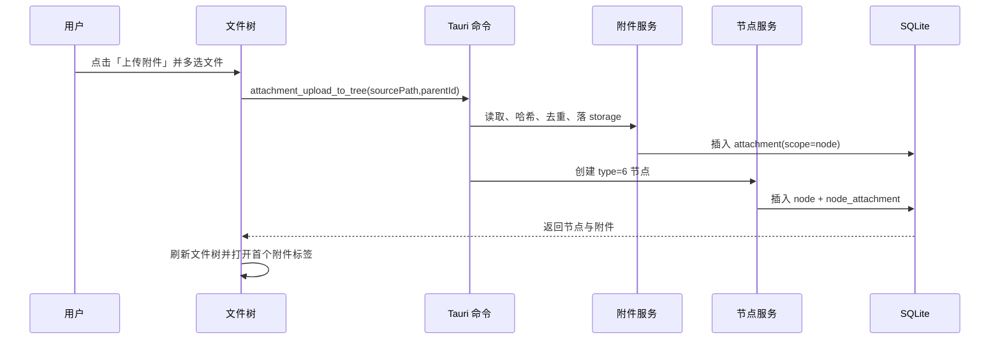

# 需求文档 · 附件进入文件树（2026-10-25）

- 关联任务：`docs/开发任务清单/2026-10-25-任务-005/`
- 依赖：对象存储与附件生命周期（任务-004）

## 背景与目标

附件现在只能在设置 → 存储或文档/画板中管理，文件树无法直接看到和打开。目标是让附件成为一种正式节点类型，复用现有树层级、拖拽、标签页与导出，同时共用全局 object_id 与引用表。

## 范围

### 做

- 新增节点类型 6「附件」。
- 文件树顶部与文件夹菜单支持多选上传附件。
- 附件标签页：图片预览、文件信息、下载。
- 重命名、移动、收藏、删除；删除走对象生命周期。
- 整库导出包含附件节点并在 manifest 记录。
- 附件管理器展示关联数与状态。

### 不做

- 本次不做附件节点导入、附件内联编辑、版本历史。
- 不改变文档/画板现有图片、文件卡片的引用格式。
- 不把附件节点放入通用“新建”类型选择（附件必须通过上传创建）。

## 节点规则

- `NodeType::Attachment = 6`；叶子节点，不能作为父级。
- 标题默认等于文件名；重命名节点同时更新 `attachment.name`，保证下载文件名一致。
- 收藏、拖拽、排序、路径、级联删除复用现有 node 规则。
- `node_attachment` 为附件节点提供 object_id；一个对象可同时被多个文档/画板/附件节点引用。
- 删除附件节点只解除该节点引用；对象仍有其他引用时保留。

## 上传时序

失败处理：

- 上传失败：不创建节点，返回逐文件错误。
- 节点创建失败：将刚上传的附件软删除，避免无主对象。
- 多文件中部分失败：成功的照常创建，结果 toast 显示成功/失败数量。

## 文件树交互

- 知识库树标题右侧：+（新建）与上传图标（上传附件）。
- 文件夹行菜单：新建、导入到这里、上传附件到这里、重命名、删除。
- 上传目标：知识库根或当前文件夹；目录不存在或不属于当前知识库时拒绝。
- 附件行图标使用回形针/文件类型图标；点击打开附件标签页。
- 拖拽：只允许前后排序或移动到文件夹内，不允许附件拥有子级。

## 附件标签页

- 顶部：面包屑、标题、下载按钮。
- 内容：
  - 图片：内联预览，加载中/失败/过大状态。
  - 其他：文件图标、名称、大小、MIME、创建/更新时间。
- 空/异常：附件已删除、物理内容缺失、读取失败，显示可操作提示与重新加载。
- 不显示 BLAKE3、pack、物理路径等实现细节。

## 导出

- 整库导出遍历 type=6 节点，在对应树位置写出附件文件。
- 文件名与节点标题一致；冲突时追加短 id，manifest 记录实际路径。
- manifest `tree` 中 kind 为 `attachment`；`attachments` 记录 object_id、node_id、path、size、mime。
- 已被附件节点导出的对象，不再重复写入 `_attachments/`。
- 单文档/画板导出逻辑不变。

## 验收标准

1. 文件树可一次上传多个附件，生成 type=6 节点并持久化。
2. 关闭并重启应用后节点、关联、文件仍存在。
3. 点击附件节点打开标签页；图片显示预览，其他文件可下载。
4. 重命名节点后下载文件名同步；移动/收藏/排序行为与普通叶子一致。
5. 删除附件节点后关联消失，其他引用不受影响，对象进入孤儿流程。
6. 整库导出包含附件节点文件与 manifest 条目，且没有重复附件。
7. 无引用、已删除、内容缺失等异常状态有明确提示。
8. Rust 测试、前端门禁与真机 E2E 通过。
