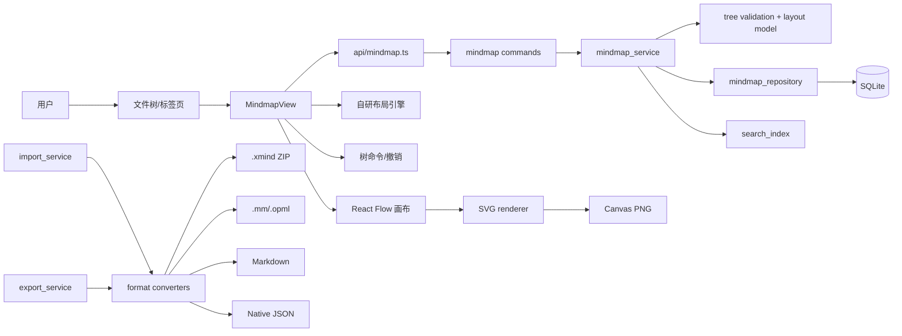
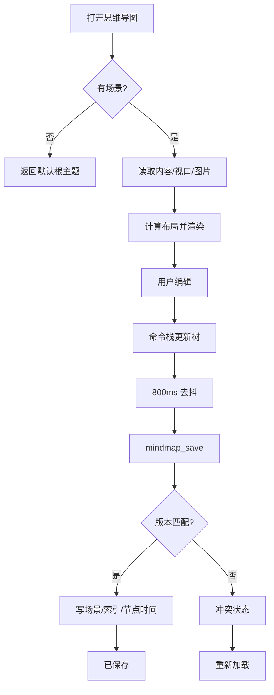
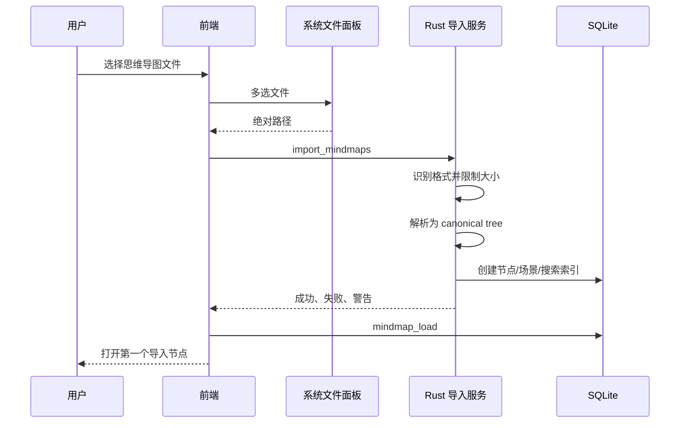
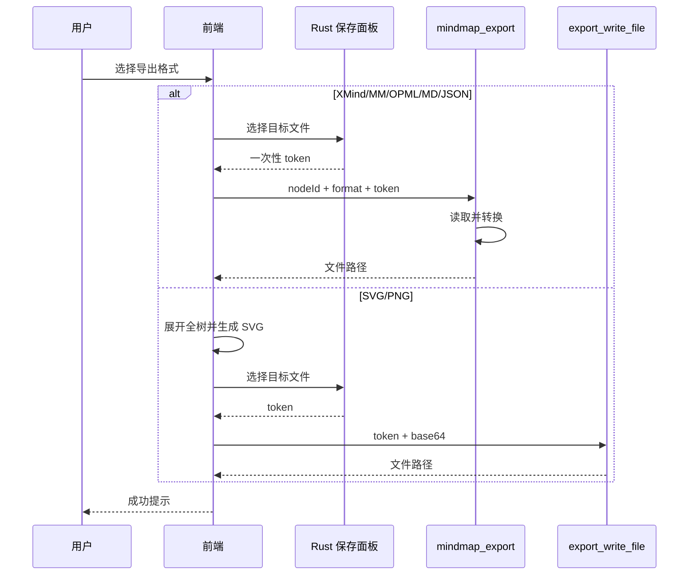
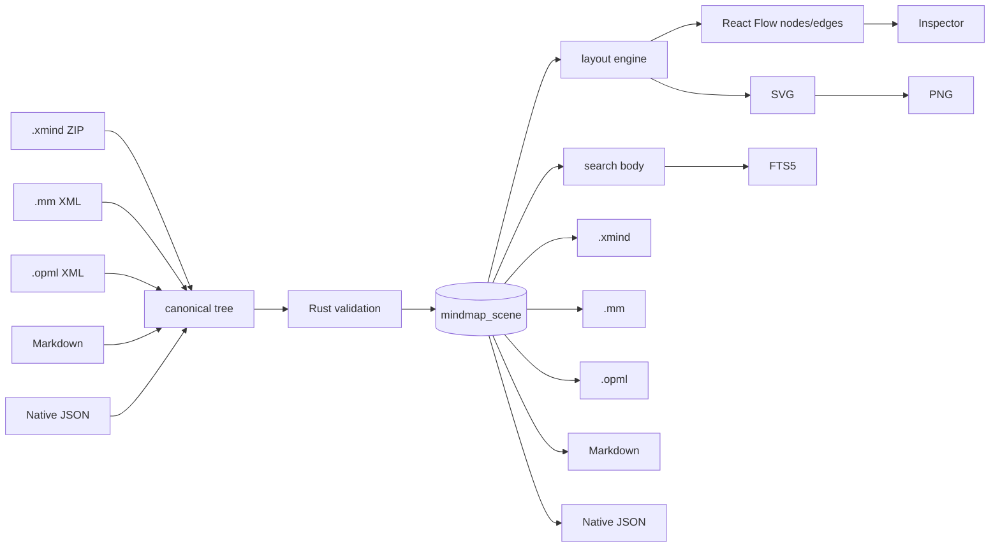
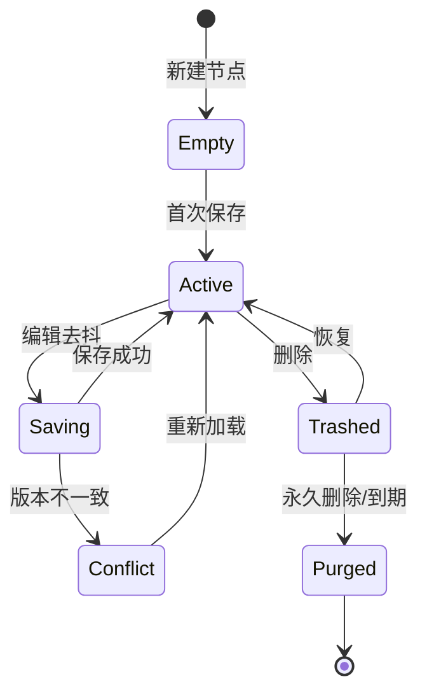
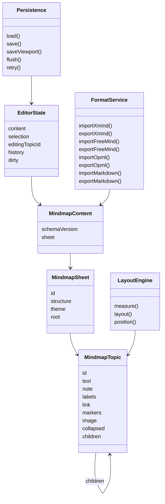
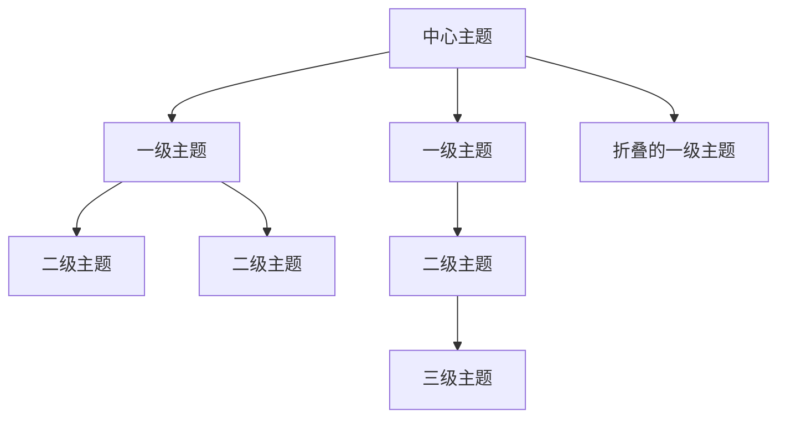
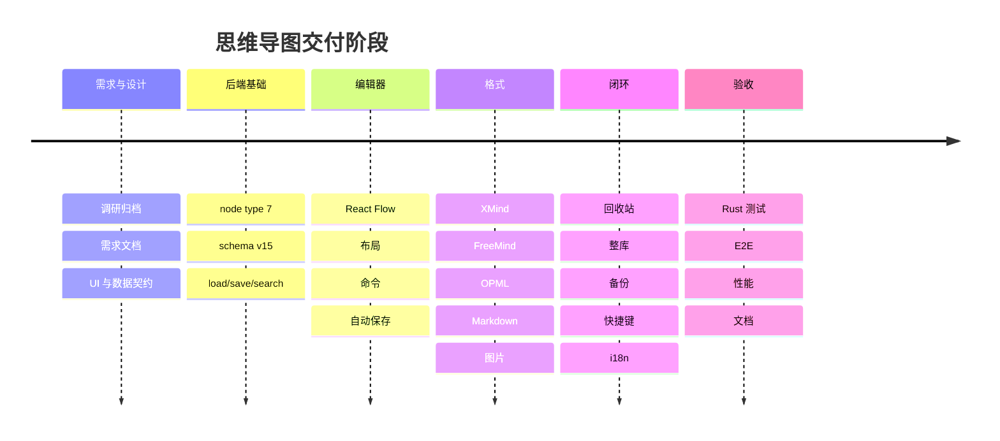
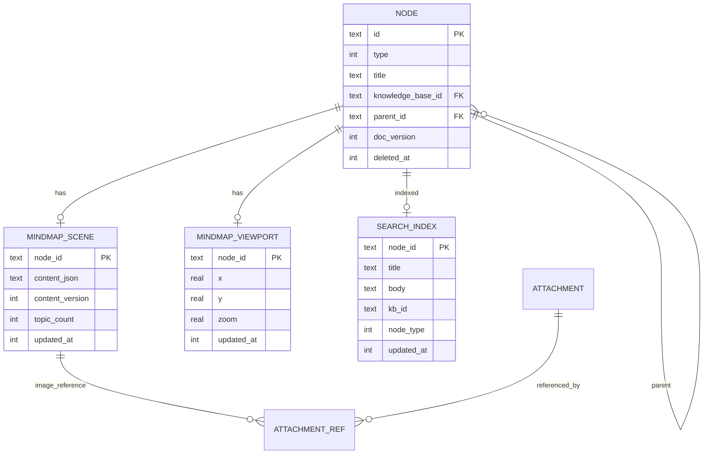

# 需求文档 · 思维导图（2026-10-26）

- 关联调研：`docs/产品功能调研/2026-10-26-思维导图-001/调研报告.md`
- 引擎路线：**React Flow `@xyflow/react` MIT 核心 + Starris 自研树模型**
- 目标：在现有文档/表格/画板/附件之外，新增可长期保存、可检索、可回收、可导入导出的“思维导图”节点，形成从创建到备份的完整闭环。

## 1. 背景、目标与角色

### 1.1 背景

Starris 的画板适合自由绘制，但思维导图需要稳定的树语义：中心主题、父子层级、自动布局、折叠、键盘快速扩展、主题备注与跨工具交换。React Flow 只提供通用画布，不直接提供思维导图语义；本需求把树模型、布局、编辑命令和格式转换都收进 Starris 自己的领域层。

### 1.2 目标

1. 文件树可创建、打开、重命名、删除、恢复“思维导图”节点。
2. 提供接近 XMind 的核心编辑体验：增删主题、拖拽改父级、折叠、键盘导航、撤销重做、自动保存。
3. 主题支持备注、标签、超链接、标记与图片，并进入全局搜索。
4. 支持 `.xmind`、FreeMind `.mm`、OPML 2.0、Markdown 的导入/导出；Starris 原生 JSON 用于无损交换。
5. 思维导图纳入整库导出、工作区备份/恢复、回收站和关闭守卫。
6. 1,000 个主题下保持可交互；5,000 个主题达到可用上限，超过时明确拒绝而不是静默截断。

### 1.3 角色与场景

| 角色 | 场景 | 关键诉求 |
|---|---|---|
| 知识工作者 | 把读书笔记整理成主题树 | 快速 Tab/Enter、备注、搜索 |
| 项目策划 | 从 XMind 导入后继续编辑 | 层级/备注/标签/链接不丢 |
| 文档作者 | 把大纲转成导图或反向导出 | Markdown/OPML 往返 |
| 本地用户 | 离线保存并迁移到另一台机器 | 自动保存、备份、整库导出 |

## 2. 范围

### 2.1 v1 必做

- 新节点类型 `mindmap`（数据库 type=7）。
- 单画布思维导图；导入多画布 XMind 时按画布拆成多个节点。
- 三种结构：左右平衡导图、向右逻辑图、向下组织图。
- 主题文本、备注、标签、超链接、标记（优先级/进度/旗标/星标）、图片。
- 新建、加载、自动保存、视口恢复、版本冲突、关闭前 flush。
- 增加子主题/同级主题、删除、移动、重排、折叠/展开、多选删除/移动。
- 键盘：Tab、Enter、F2、Delete、方向键、空格、⌘Z/⇧⌘Z、F、⌘D。
- 拖拽改父级；禁止把节点移动到自身后代。
- 主题搜索、结果定位、自动展开祖先。
- 导入：`.xmind`（XMind 2020+ / XMind 8）、`.mm`、`.opml`、`.md`、`.starris-mindmap.json`。
- 导出：`.xmind`、`.mm`、`.opml`、`.md`、`.svg`、`.png`、`.starris-mindmap.json`。
- 全局搜索索引主题文本、标签、备注；回收站/永久删除；整库导出与备份恢复。
- 快捷键设置新增 `mindmap` 作用域；中英文界面与错误文案。

### 2.2 v1 明确不做

- 概要、外框、关系线、自由主题、多画布内标签页。
- 自定义主题编辑器、XMind 像素级样式还原、主题继承。
- PDF 直接导出；使用系统打印另存 PDF。
- 多人协作、冲突合并、云端实时同步。
- 历史版本时间轴（文档历史能力不自动扩展到思维导图；后续单独立项）。
- 加密 XMind、受密码保护文件、损坏 ZIP 的修复。

## 3. 术语

| 术语 | 定义 |
|---|---|
| Sheet | 一个思维导图画布；v1 每个节点只有一个 Sheet |
| Topic | 树节点，包含文本、备注、标签、链接、标记、图片和子主题 |
| Root topic | 中心主题；不是文件树节点标题 |
| Structure | 自动布局模式：balanced / logic-right / org-down |
| Theme | 导图配色：auto / warm / sea / mono |
| Native JSON | Starris 无损交换格式，不是行业格式 |

## 4. 用户故事与验收映射

1. **创建**：作为用户，我在文件树新建思维导图后能立即看到中心主题并输入内容。→ FR-01/02/10
2. **快速扩展**：作为用户，选中主题按 Tab 建子主题、Enter 建同级主题并自动进入编辑。→ FR-11/12
3. **整理**：作为用户，我可以拖拽主题改变父级，或用 ⌘↑/⌘↓ 重排。→ FR-13/14
4. **降噪**：作为用户，我可以折叠复杂分支，折叠状态在重新打开后保留。→ FR-15
5. **补充信息**：作为用户，我给主题加备注、标签、链接、标记或图片。→ FR-16～FR-19
6. **找回**：作为用户，我用 ⌘F 搜索主题并定位；全局搜索也能命中。→ FR-20/21
7. **交换**：作为用户，我导入 XMind 后能编辑，也能导出回 XMind/Markdown。→ FR-22～FR-28
8. **安全**：作为用户，应用崩溃或关闭时未保存内容不丢失；别处更新时不静默覆盖。→ FR-09/29
9. **生命周期**：作为用户，思维导图删除进回收站、恢复、永久删除和备份均正常。→ FR-30～FR-32

## 5. 功能需求

### 5.1 节点与文件树

- **FR-01**：`NodeType` 增加 `Mindmap = 7`；数据库、IPC、前端类型、新建菜单、文件树图标、标签页、搜索徽章统一支持。
- **FR-02**：新建思维导图只创建节点，不强制写场景；首次加载返回默认内容（一个 Sheet、根主题“中心主题”、结构 balanced、主题 auto）。
- **FR-03**：节点标题与根主题文本相互独立：节点标题用于文件树/导出文件名，根主题用于画布中心主题；这与 XMind 的 sheet 标题/中心主题分离一致。
- **FR-04**：重命名节点只改节点标题，不改根主题；删除节点沿用现有回收站与级联规则。
- **FR-05**：思维导图不能成为父节点；只能放在知识库根或文件夹下。

### 5.2 数据与持久化

- **FR-06**：新增 `mindmap_scene` 与 `mindmap_viewport` 表；场景以 JSON 保存，不持久化坐标。
- **FR-07**：保存采用乐观并发：`baseVersion` 不匹配返回冲突，不覆盖；冲突状态允许重新加载。
- **FR-08**：视口单独保存，不增加场景版本，不改变节点更新时间。
- **FR-09**：自动保存采用与画板一致的 800ms 去抖、5s 最大等待、单飞、失败退避；关闭标签/切换工作区/退出前 flush。
- **FR-10**：加载失败、节点不存在、内容损坏必须给出可重试或重新加载状态，不得白屏。

### 5.3 编辑器

- **FR-11**：React Flow 只负责画布、缩放、平移、节点/边渲染和命中；树结构、命令、撤销和布局由 Starris 自研。
- **FR-12**：双击或 F2 进入文本编辑；Enter 提交，Shift+Enter 换行，Escape 取消；中文输入法组合期间不得误提交。
- **FR-13**：Tab 在当前主题下追加子主题；Enter 在当前主题后追加同级主题；根主题 Enter 追加一级子主题。
- **FR-14**：拖拽一个或多个主题落到目标主题上，目标成为新父级；禁止落到自身后代；空画布不落位。
- **FR-15**：⌘↑/⌘↓ 在当前父级下移动主题；⌘←/⌘→ 升级/降级（根主题不升级）。
- **FR-16**：节点折叠按钮与空格键切换折叠；折叠节点显示未隐藏后代总数；搜索定位时自动展开祖先。
- **FR-17**：撤销/重做至少保留 100 步，覆盖文本、结构、折叠、备注、标签、链接、标记、图片变更。
- **FR-18**：方向键按视觉几何选择最近邻主题；编辑态不抢占文本光标。
- **FR-19**：⌘D 在当前父级下复制整个子树，新主题进入编辑态；删除多主题一次可撤销。
- **FR-20**：右侧检查器编辑当前主题的备注、标签、超链接、标记；图片通过粘贴、拖入或“插入附件”进入全局对象库，场景只保存 `objectId`。
- **FR-21**：结构切换和主题切换即时重排，不改变树数据。
- **FR-22**：画布只渲染视口附近节点；1,000 主题交互目标见 §9。

### 5.4 搜索

- **FR-23**：`⌘F` 打开画布内搜索，匹配主题文本、备注、标签；结果按树顺序显示，回车定位并高亮。
- **FR-24**：保存场景时 Rust 生成扁平化正文并更新 `search_index.body`；正文包含主题文本、标签、备注，不包含图片字节。
- **FR-25**：全局搜索结果点击后打开节点；若命中主题在折叠分支中，编辑器自动展开并定位。

### 5.5 导入

- **FR-26**：新增“导入思维导图”入口，支持多选 `.xmind/.mm/.opml/.md/.starris-mindmap.json`；目标为知识库根或文件夹。
- **FR-27**：`.xmind` 为 ZIP：
  - 现代格式读取 `content.json`；
  - XMind 8 读取 `content.xml`；
  - 单画布创建一个节点；
  - 多画布创建以文件 stem 命名的文件夹，再为每个 Sheet 创建一个节点；
  - `children.detached` 浮主题导入为根主题子节点并给出警告；
  - 样式、主题、扩展字段不保证还原；
  - 加密、超限、缺 `content.json/content.xml` 的文件明确失败。
- **FR-28**：`.mm` 读取根节点、层级、`TEXT`、`FOLDED`、`LINK HREF`、`richcontent TYPE=NOTE`；`POSITION` 用于左右方向；图标暂不映射并警告。
- **FR-29**：`.opml` 读取 `outline@text/title`、`_note`、`url`；第一个 outline 为根，其余按嵌套。
- **FR-30**：Markdown 导入规则：
  - 首个 H1 为根；多个 H1 时文件 stem 为根，每个 H1 为一级主题；
  - H2～H6 按标题层级嵌套；
  - 无序/有序列表按缩进嵌套；
  - 标题或列表项后的段落追加到最近主题的备注；
  - 代码块不进入导图，记录“已跳过 N 个代码块”警告；
  - 图片/链接文本保留为纯文本，不自动下载。
- **FR-31**：Native JSON 导入保留 Starris 支持的全部字段；版本不支持时拒绝，不猜测。
- **FR-32**：批量导入逐文件返回成功/失败/警告，一个文件失败不回滚其他文件；每个成功项创建节点和初始场景。

### 5.6 导出

- **FR-33**：单节点导出菜单提供 XMind、FreeMind、OPML、Markdown、SVG、PNG、Starris JSON；所有写路径使用 Rust 一次性路径令牌。
- **FR-34**：`.xmind` 写现代 ZIP：`content.json`、`metadata.json`、`manifest.json`；主题文本、层级、备注、标签、链接、折叠、标记、图片进入 `content.json` 与 `resources/`。
- **FR-35**：`.mm` 写 FreeMind 1.0.1 XML；根节点、层级、折叠、链接、备注；左右结构写 `POSITION`。
- **FR-36**：`.opml` 写 OPML 2.0；文本、层级、备注 `_note`、链接 `url`。
- **FR-37**：`.md` 写标题/嵌套列表；标签以 `[标签1, 标签2]` 后缀表示，链接使用 Markdown 链接，备注写为缩进 blockquote。该格式不承诺无损往返。
- **FR-38**：`.starris-mindmap.json` 是 UTF-8 JSON，包含 schemaVersion、structure、theme、完整树和元数据；用于无损迁移。
- **FR-39**：SVG 由布局数据生成，包含全部主题、边、标签、备注角标、标记和图片引用；PNG 由同一 SVG 光栅化。导出前展开所有折叠分支，并记录原折叠状态不受影响。
- **FR-40**：整库导出为每个思维导图创建 `标题/` 目录，写 `标题.starris-mindmap.json`、`标题.xmind`、`标题.md`，并把 SVG/PNG 目标交给桌面端渲染；manifest 记录节点与文件关系。
- **FR-41**：导入整库目录时识别 manifest 与 `.starris-mindmap.json`，恢复节点、结构、主题、标记、图片引用；缺失图片对象时保留主题并警告。

### 5.7 生命周期与系统能力

- **FR-42**：回收站列出思维导图节点；恢复后场景、视口和搜索索引原样可用；永久删除级联清理场景与视口，并释放图片对象引用。
- **FR-43**：工作区备份/恢复包含新表；迁移前自动备份现有工作区库。
- **FR-44**：快捷键注册表增加 `mindmap` 作用域，默认启用；设置页可按作用域关闭。
- **FR-45**：所有用户可见文案进入 i18n；英文词典覆盖错误、快捷键、结构、主题、导入导出格式。
- **FR-46**：React Flow 归属不显示在画布角落；“设置 → 关于 → 第三方开源组件”列出 React Flow、MIT 与项目地址。

## 6. 数据定义

### 6.1 领域 JSON（schemaVersion=1）

```json
{
  "schemaVersion": 1,
  "sheet": {
    "id": "sheet-uuidv7",
    "structure": "balanced",
    "theme": "auto",
    "root": {
      "id": "topic-uuidv7",
      "text": "中心主题",
      "note": "",
      "labels": ["标签"],
      "link": "https://example.com",
      "markers": ["priority-1"],
      "image": {
        "objectId": "object-id",
        "width": 160,
        "height": 90
      },
      "collapsed": false,
      "children": []
    }
  }
}
```

字段约束：

| 字段 | 约束 |
|---|---|
| `sheet.id` | `sheet-` + UUID v7，全局唯一 |
| `structure` | `balanced` / `logic-right` / `org-down` |
| `theme` | `auto` / `warm` / `sea` / `mono` |
| `topic.id` | `topic-` + UUID v7，同一 Sheet 内唯一 |
| `text` | 0～2,000 个 Unicode 字符；不得含控制字符 |
| `note` | 0～8,000 个 Unicode 字符；纯文本 |
| `labels` | 0～10 项，每项 1～50 字符 |
| `link` | 空或 `http` / `https` / `mailto`，≤2,048 字符 |
| `markers` | 允许列表：priority-1～5、progress-0～6、flag、star |
| `image.objectId` | 必须存在于当前工作区对象库；width/height 1～4,096 px |
| `collapsed` | 根节点可为 true；折叠只影响显示，不改变子树 |
| 树规模 | ≤5,000 主题、深度 ≤100、序列化 ≤8 MB |

### 6.2 SQLite

```sql
CREATE TABLE mindmap_scene (
  node_id        TEXT PRIMARY KEY NOT NULL,
  content_json   TEXT NOT NULL,
  content_version INTEGER NOT NULL DEFAULT 1,
  topic_count    INTEGER NOT NULL DEFAULT 1,
  updated_at     INTEGER NOT NULL,
  FOREIGN KEY (node_id) REFERENCES node(id) ON DELETE CASCADE
);

CREATE TABLE mindmap_viewport (
  node_id    TEXT PRIMARY KEY NOT NULL,
  x          REAL NOT NULL DEFAULT 0,
  y          REAL NOT NULL DEFAULT 0,
  zoom       REAL NOT NULL DEFAULT 1 CHECK (zoom > 0),
  updated_at INTEGER NOT NULL,
  FOREIGN KEY (node_id) REFERENCES node(id) ON DELETE CASCADE
);
```

迁移 v14 → v15：

1. `node.type` CHECK 从 1～6 扩为 1～7，必须重建 node 表并保留 `doc_version`、`deleted_at`。
2. 重建期间关闭外键并启用 `legacy_alter_table`，迁移后执行 `PRAGMA foreign_key_check`。
3. 创建两张新表与必要索引；`search_index` 复用现有 FTS5 结构。
4. 旧工作区首次打开时自动备份，再迁移。

### 6.3 IPC 契约

| 命令 | 输入 | 输出 |
|---|---|---|
| `mindmap_load` | `nodeId` | `{nodeId, content, version, updatedAt, topicCount, viewport, images}` |
| `mindmap_save` | `{nodeId, baseVersion, content}` | `{version, updatedAt, topicCount}` |
| `mindmap_save_viewport` | `{nodeId, x, y, zoom}` | `{x, y, zoom}` |
| `mindmap_export` | `{nodeId, format, token}` | `{rootPath, files, warnings}` |
| `import_mindmaps` | `{knowledgeBaseId, parentId, paths}` | `{imported, failed, files, createdFolderIds}` |
| `export_write_file` | `{token, path, dataBase64, overwrite}` | `{path, kind}` |

`mindmap_load.images` 返回场景引用到的图片 dataURL、尺寸和缺失 object id；保存不重复传输图片字节。

## 7. 架构与组件

### 7.1 组件图



### 7.2 前端模块

```text
src/features/mindmap/
├── components/
│   ├── MindmapView.tsx
│   ├── MindmapCanvas.tsx
│   ├── MindmapTopicNode.tsx
│   ├── MindmapEdge.tsx
│   ├── MindmapPageBar.tsx
│   ├── MindmapInspector.tsx
│   ├── MindmapSearch.tsx
│   └── MindmapImagePicker.tsx
├── hooks/
│   ├── useMindmapEditor.ts
│   ├── useMindmapPersistence.ts
│   ├── useMindmapKeymap.ts
│   └── useMindmapExport.ts
├── utils/
│   ├── layout.ts
│   ├── tree.ts
│   ├── measure.ts
│   ├── history.ts
│   └── exportGraphics.ts
└── mindmap.css
```

React Flow 组件懒加载，不阻塞工作区首屏。

### 7.3 Rust 模块

```text
src-tauri/src/
├── commands/mindmap.rs
├── models/mindmap.rs
├── repositories/mindmap_repository.rs
├── services/mindmap_service.rs
└── services/mindmap_format/
    ├── mod.rs
    ├── xmind.rs
    ├── freemind.rs
    ├── opml.rs
    ├── markdown.rs
    └── native.rs
```

## 8. 关键流程

### 8.1 编辑与保存工作流



### 8.2 导入时序



### 8.3 导出时序



### 8.4 数据流



### 8.5 节点生命周期



## 9. 类与树模型

### 9.1 类图



### 9.2 主题树



## 10. 项目时间线与瀑布式阶段

### 10.1 时间线



### 10.2 瀑布阶段


> 说明：本功能采用阶段门推进，不表示交付后不再迭代；Archify 当前只原生支持架构/流程/序列/数据流/生命周期五类，ERD、类、树、时间线和瀑布在本需求中以 Mermaid 补齐，避免为了工具限制而省略必要视图。

## 11. ER 图



## 12. 交互状态

| 状态 | 界面 | 操作 |
|---|---|---|
| loading | 页头“加载中”胶囊 + 画布骨架 | 禁止编辑 |
| ready | 已保存/未保存状态 | 正常编辑 |
| saving | “保存中” | 可继续编辑，快照排队 |
| saved | “已保存” | 正常 |
| error | 红色“保存失败 · 重试” | 保留本地编辑，点击重试 |
| conflict | “已更新 · 重新加载” | 明确选择后才丢弃本地 |
| empty | 默认中心主题 + 操作提示 | Tab/Enter 创建子主题 |
| search-empty | “没有匹配主题” | 修改关键词 |
| import-partial | 成功/失败/警告列表 | 打开成功项 |
| export-busy | 对应菜单项 spinner | 禁止重复导出 |
| invalid-file | 文件级错误说明 | 选择其他文件 |

## 13. 视觉与交互规范

- 页面壳沿用画板页头：36px、发丝下边线、面包屑与保存状态胶囊。
- 工具栏使用现有 `icon-btn`、DropdownMenu、Tooltip，不引入新控件语言。
- 颜色全部来自 `src/styles/tokens.css`；导图分支色由主题令牌 `color-mix` 派生，不新增硬编码十六进制。
- 根主题：`--card` 底、`--border-strong` 描边、`--radius-lg`、`shadow-md`。
- 一级主题：分支色 12% 混 `--card`，文字 `--foreground`。
- 更深层级：中性 `--secondary` 底、分支色左边线。
- 选中：2px `--ring` 外环；编辑态：`--card` + `--ring` + `shadow-md`。
- 边：2px 分支色，圆角折线/贝塞尔，深色模式保持 ≥3:1 非文本对比。
- 折叠徽标：`--radius-xs`，mono 数字，显示隐藏后代数。
- 备注/标签/链接/标记以小徽标表示，不挤压主题文本。
- 动效：布局移动 150ms、弹层 220ms，使用 `--ease`；`prefers-reduced-motion` 下取消位移/缩放。
- 无障碍：所有工具按钮有可访问名称；主题节点可聚焦；搜索列表可键盘操作；颜色不是唯一状态提示。

## 14. 性能要求

| 场景 | 目标 |
|---|---:|
| 1,000 主题首次布局 | ≤120ms |
| 1,000 主题平移/缩放 | 交互帧率 ≥50fps |
| 单主题文本编辑提交 | ≤16ms |
| 自动保存序列化 + IPC | ≤80ms（不含磁盘抖动） |
| 1,000 主题 XMind 导入 | ≤1.5s |
| 1,000 主题 XMind 导出 | ≤1s |
| 5,000 主题 | 可加载和编辑，允许明显但可接受的布局耗时；不得崩溃或静默截断 |
| 内存 | 1,000 主题前端常驻数据 ≤25 MB（不含图片缓存） |

验收必须记录实际测量；未达到时标注阻塞，不得写“已优化”。

## 15. 安全与隐私

1. 所有导入文件视为不可信输入；Rust 做大小、ZIP 条目、解压总量、XML 结构和 JSON schema 校验。
2. ZIP 炸弹防护：条目 ≤10,000、单条目解压 ≤20 MB、总解压 ≤50 MB、拒绝符号链接和路径穿越。
3. XML 不解析外部实体、不加载 DTD 网络资源；只读取白名单元素/属性。
4. 链接只允许 `http`/`https`/`mailto`；点击前由系统 opener 打开，不执行任意协议。
5. 备注/标签/主题文本按纯文本渲染，禁止 HTML 注入。
6. 导出路径只能来自 Rust 面板令牌；目录令牌只允许写所选目录及后代。
7. 日志不写完整正文、图片 dataURL 或用户路径全文；错误提示不泄露系统路径。
8. 图片对象沿用附件生命周期与引用计数；思维导图永久删除时释放引用。

## 16. 兼容性与数据影响

- 新工作区直接创建 v15。
- v14 工作区打开时自动备份并重建 node 表；失败整体回滚。
- v15 不改变文档、表格、画板、附件既有数据。
- 旧版本程序打开 v15 工作区会拒绝，提示“工作区库版本高于程序支持”，不会降级写库。
- XMind 样式、主题、扩展字段不承诺还原；结构、文本、备注、标签、链接、折叠、标记、图片尽量还原。
- Markdown/OPML/FreeMind 是结构交换格式，不承诺 Starris 标记与图片无损往返。

## 17. 验收标准

### 17.1 功能

- [ ] 新建思维导图后文件树、标签页、图标、标题、回收站均正确。
- [ ] Tab/Enter/F2/Delete/空格/方向键/⌘Z/D 行为符合 FR-12～FR-20。
- [ ] 拖拽改父级、禁止循环、⌘↑/↓ 重排后自动保存并可撤销。
- [ ] 折叠、结构、主题、视口在重新打开后恢复。
- [ ] 备注、标签、链接、标记、图片可编辑、搜索和导出。
- [ ] 1,000 主题性能测试通过并记录数据。
- [ ] 导入四种行业格式与 Native JSON 后层级/文本/备注/标签/链接/折叠不丢失；多画布 XMind 不丢 Sheet。
- [ ] 导出文件可被对应解析器读取；XMind 至少通过一次真实 XMind 2020+ 打开验证（环境不可用时标为阻塞，不得声称通过）。
- [ ] 整库导出包含思维导图，导入目录可恢复；工作区备份/恢复不丢数据。
- [ ] 删除/恢复/永久删除和对象引用闭环通过。
- [ ] 中英文界面、原生菜单、快捷键设置和错误文案完整。

### 17.2 质量门

- [ ] `npm run typecheck`
- [ ] `npm run check`
- [ ] `npm run build` + 许可证门
- [ ] `cargo test`
- [ ] `cargo clippy --all-targets -- -D warnings`
- [ ] `cargo fmt --check`
- [ ] 思维导图 Rust 单测/集成测试
- [ ] macOS 真机黑盒 E2E
- [ ] 更新日志、任务三件套、测试报告

## 18. 未决问题与假设

1. **假设**：v1 一个节点一个 Sheet；多画布 XMind 拆成多个节点。若产品后续要求单节点多 Sheet，schema 可升级到 v2。
2. **假设**：XMind 导出只写现代 `content.json`，不生成 XMind 8 旧 XML；旧版仅导入。
3. **待真机验证**：XMind 应用打开导出文件；当前机器未安装 XMind，不能提前声称兼容通过。
4. **待真机验证**：React Flow 在 WKWebView 的拖拽、文本编辑、输入法与大图性能；实现阶段先做基准。
5. **风险**：5,000 主题时 DOM 节点数量仍可能较高；若 `onlyRenderVisibleElements` 导致边/选择异常，需要调整虚拟化策略。
