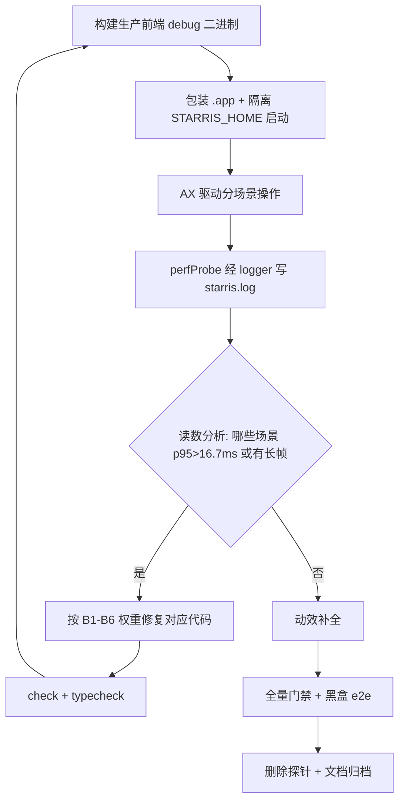
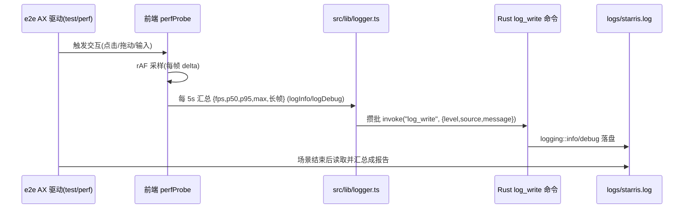

# 需求文档 · 渲染性能优化与交互动效补全

| 项 | 内容 |
|---|---|
| 日期 | 2026-10-27 |
| 关联调研 | `docs/产品功能调研/2026-10-27-渲染性能与动画库选型-001/调研报告.md`（瓶颈定位 B1-B6、GSAP 否决）；`docs/产品功能调研/2026-10-20-动画优化-001/002/`（动效守则） |
| 来源 | 用户目标：先跑真机定位所有位置性能并修复；检查所有交互（弹窗/按钮/拖动/下拉框/画板/文档输入/思维导图）并补合理动效；目标"操作视觉连贯丝滑，不要有任何帧不连贯" |
| 关联任务 | `docs/开发任务清单/2026-10-27-任务-001/` |

---

## 1. 背景

用户在真机使用中反馈：整体渲染达不到 60/120fps，动画过渡、拖动、弹窗不丝滑。2026-10-27 调研报告已通过代码审计定位六类候选瓶颈（B1 大面积实时 backdrop-filter、B2 全应用重渲染、B3 标签切换重挂载、B4 指针热路径 O(n) 布局读取、B5 侧栏折叠同帧重排、B6 打字期周期成本），并确认**不需要引入 GSAP**（能力重叠 + 许可证门禁不通过 + 不解决瓶颈）。审计同时确认：当前运行的调试实例是 `target/debug + Vite dev`，其表现不能作为性能结论；必须先在生产前端构建档位上拿到真机帧率基线。

## 2. 目标与验收标准

| # | 验收标准 | 验证方式 |
|---|---|---|
| A1 | 在生产前端构建档位（`tauri build --debug --no-bundle`，嵌入 dist）上采集真机帧率基线，覆盖全部交互场景，读数归档 | `test/perf` 脚本运行记录 + STARRIS_HOME/logs/starris.log 探针读数 |
| A2 | 经基线确认的瓶颈（B1-B6）逐项修复，每项有"修前/修后同构建同场景"对比读数 | 基线报告 vs 复测报告，同口径（同次数 ≥3、同场景、同构建档） |
| A3 | 主要交互场景 p95 帧间隔 ≤ 16.7ms（60fps 稳定），无可感知长帧（>100ms，首次冷加载除外）；空闲 rAF 达到平台实际上限（若显示器/WKWebView 封顶 60Hz，以实测上限为准并记录） | 探针读数 p95/p99/长帧计数 |
| A4 | 交互触点清单（弹窗、按钮、下拉框、信息浮窗、标签切换、文档输入、块拖动、图片缩放、画板操作/绘画、思维导图操作、Toast）逐一检查性能并补合理动效；动效全部走 `lib/motion.ts` 与 `tokens.css` 令牌，响应 `prefers-reduced-motion` | 触点检查表（任务目录内）+ 真机回归截图 |
| A5 | 质量门禁全绿：`npm run check`、`npm run typecheck`、`npm run build`、`node scripts/check-licenses.mjs`；`pnpm run test` 全量黑盒通过 | 命令输出归档 |
| A6 | 临时帧率探针删除且无残留（grep 验证）；`log_write` + `src/lib/logger.ts` 作为 AGENTS §10 日志链路保留 | grep 自检 |
| A7 | 不引入 GSAP 或其他第二动画引擎；不新增运行时依赖（日志/探针/修复全部用现有依赖实现） | `package.json` diff 为空（依赖区） |

## 3. 范围

**包含**：
- 前端渲染路径修复：弹窗/浮窗模糊层、渲染边界与 memo、标签切换挂载策略、指针热路径（块手柄/块拖拽/文件树拖拽/图片缩放）、侧栏折叠布局、打字期草稿与字数节流。
- 动效补全：上述交互触点按现有动效令牌补进出场/弹簧/微反馈。
- 测量基建：`log_write` Rust 命令 + `src/lib/logger.ts`（AGENTS §10 目标设计，永久保留）；临时帧率探针 `src/lib/perfProbe.ts`（任务结束删除）；`test/perf/run.mjs` 真机场景采集脚本。
- 必要时（仅当日志显示 IPC 是瓶颈）：Rust 侧命令线程属性调整。

**不包含（非目标）**：
- 不改变任何业务功能语义与数据 schema；不做云同步、不做原生 vibrancy 重写（除非模糊层证据确凿且用户同意改变视觉设计）。
- 不优化 Excalidraw / React Flow / Tiptap 内部实现（第三方内部渲染不可控），只优化我们的包裹层与调用方式。
- 不引入 GSAP、tw-animate-css 之外的新动画依赖（本轮两者都不引入）。

## 4. 用户故事与场景

1. 作为用户，我在长文档中移动鼠标和拖动块时，手柄跟手、不卡顿。
2. 作为用户，我打开/关闭设置等弹窗时，遮罩与面板过渡连贯，无掉帧。
3. 作为用户，我切换文档/画板/导图标签时，过渡连贯，无白屏久等。
4. 作为用户，我在文件树中拖动节点时，落点提示跟手。
5. 作为用户，我在画板绘画、导图拖节点时，操作跟手无顿挫。
6. 作为用户，我连续输入 200 字时，无周期性卡顿。
7. 作为用户，我折叠/展开侧栏时，无"跳一下"的感觉。

## 5. 业务规则与约束

1. **测量先行**：任何修复前必须有真机基线；修复后必须同口径复测；无读数的优化项不得标记完成（AGENTS §6.9）。
2. **构建档位**：性能读数只承认生产前端构建（`tauri build --debug --no-bundle` 或 release）；`target/debug + Vite dev` 档位读数仅作参考并标注。
3. **动效纪律**（沿用 2026-10-20 守则）：只动 `transform/opacity/filter(小面积)`；时长只用 `--dur-1/2/3`；缓动只用 `--ease/--ease-pop` 与 `lib/motion.ts` 预设；同屏并发动画 ≤12；正文编辑区内文字永不参与动画；全部响应 `prefers-reduced-motion`。
4. **模糊预算（新增）**：同一时刻可视区内实时 `backdrop-filter` 层 ≤1 层；模糊半径 ≤14px；禁止嵌套模糊；大面积面板优先不透明/静态渐变。视觉变更需截图对比并在改造清单记录。
5. **探针纪律**：`perfProbe.ts` 头部注明"临时诊断，任务完成后删除"；开销目标 <1ms/s；不记录用户内容，只记录数值。
6. **并发协作**：工作区存在未提交的思维导图改动；每次编辑前必须重读目标文件当前内容，只改必要片段，不回滚他人改动。
7. **许可证**：不引入任何新 npm 依赖；`scripts/check-licenses.mjs` 必须保持通过。

## 6. 交互流程图

### 6.1 测量-修复循环（工作流）

### 6.2 帧读数链路（序列）

### 6.3 图形适用性说明

架构图/数据流图/ERD/类图/生命周期/树/时间线/瀑布：本需求不改变数据模型、模块边界或对象生命周期，仅调整渲染实现与动效，上述图形不适用；架构与数据流现状见 `docs/开发/架构说明.md`。模块影响关系见《项目文件改造清单.md》。

## 7. 数据、性能与安全要求

1. 探针只输出数值统计（帧间隔、计数），不含文档内容、标题、路径。
2. 日志走统一通道，单行受 8192 字符截断保护；帧率汇总每 5s 一条，长帧事件即时一条（含阈值内聚合，避免刷屏）。
3. 修复不得以"绕过类型检查/吞错误"为代价；`log_write` 失败静默（不阻断 UI）。
4. 性能验收以 p95/p99 与长帧计数为准，不用单次"感觉"。

## 8. 未决问题与风险

| # | 问题/风险 | 处理 |
|---|---|---|
| R1 | WKWebView 在 ProMotion 上的实际上限未知 | P0 先测空闲 rAF；若封顶 60Hz，A3 的"60fps 稳定"判据不变，120 记录为平台上限 |
| R2 | 去除大面积模糊会改变视觉（磨砂感是现设计语言） | 先在真机 A/B（注入 CSS）确认权重；修复时用截图对比，优先"降半径/单层化/保留局部模糊"方案，大改前留对比截图供确认 |
| R3 | 工作区有未提交的思维导图改动 | 编辑前重读现场、只改必要片段；不合并、不还原他人改动 |
| R4 | Excalidraw/React Flow 内部开销不可控 | 只优化包裹层；若画板场景基线超标的根因在库内部，如实记录为"已知限制" |
| R5 | e2e 二进制路径与 dev 档二进制同路径（target/debug/starris-rust） | 性能档构建后，日常 `tauri dev` 会再次覆盖；每次采集前确认二进制为生产前端档（内嵌 dist） |
| R6 | 探针自身开销 | 目标 <1ms/s；复测口径与基线一致（探针都在场），保证对比公平 |
