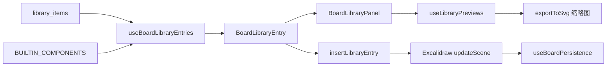
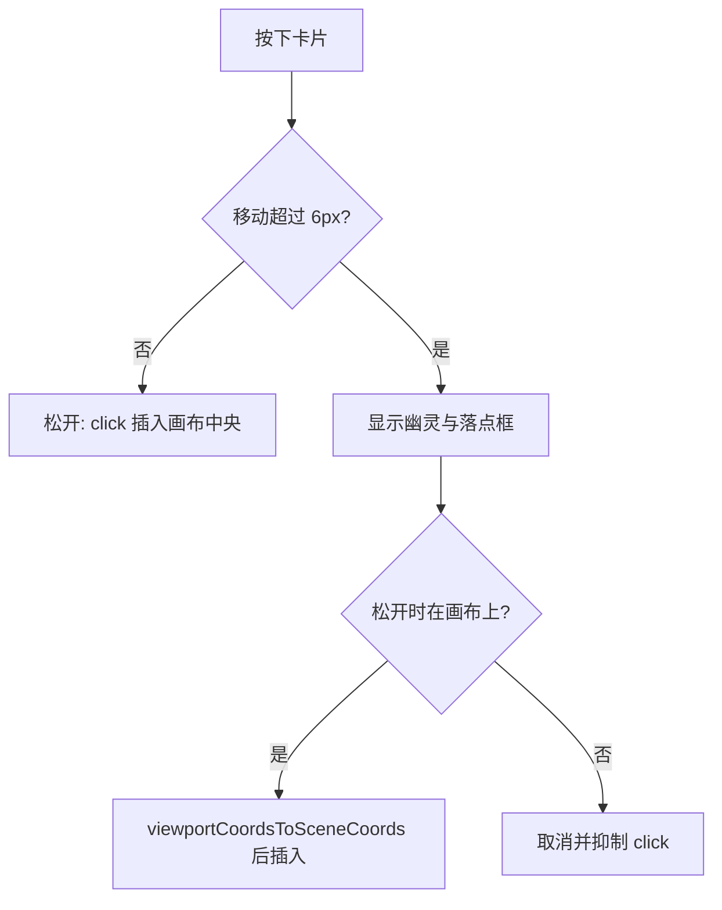
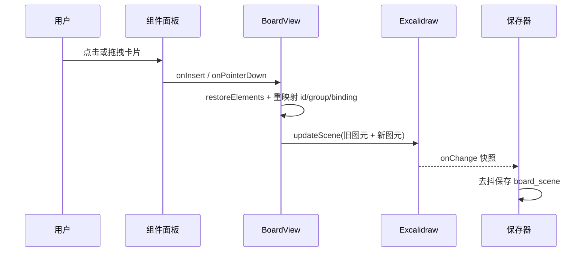
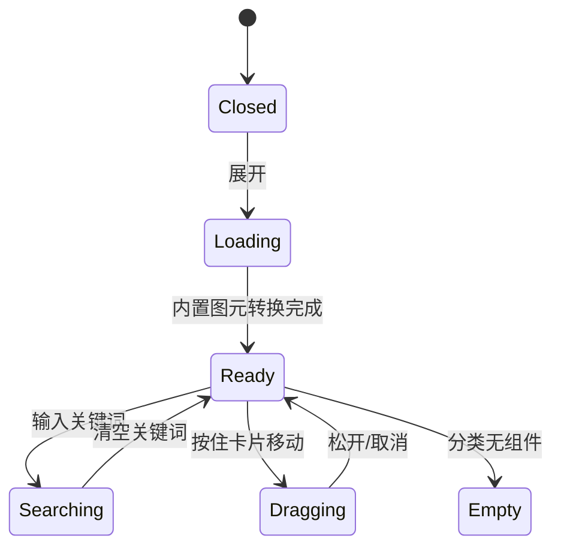
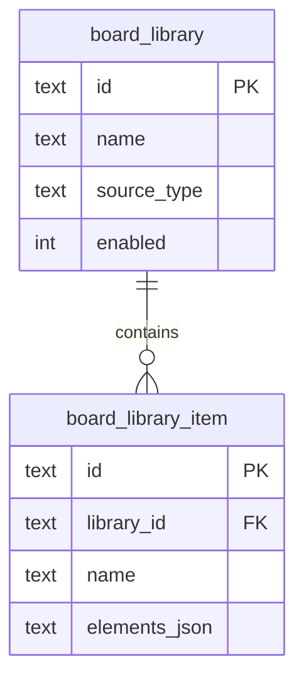
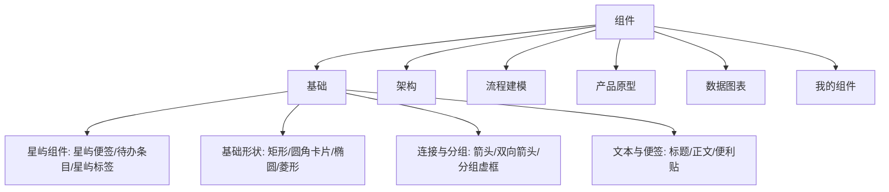

# 需求文档 · 画板组件库与附件收口

- 日期：2026-10-29
- 状态：开发完成；聚焦真机 4/4，全量 31/32（唯一失败为无关浮层 flake，待复跑）
- 关联任务：`docs/开发任务清单/2026-10-29-任务-006/`

## 1. 背景与目标

画板已有图片粘贴（Excalidraw 原生 image + 全局对象库），但页头的「插入附件」把任意文件变成文件卡片，另带选择器、sidecar 恢复与一整套测试；这部分并不承担画板的核心表达，用户明确要求删除。

组件库面板当前是单列列表：只有图标、名称和形状数，看不到组件长什么样，内置组件也没有分类。用户提供的参考图是「分类标签 + 分区标题 + 双列缩略图卡片 + 底部操作提示」。目标是把面板重做成可浏览、可预览、可拖拽的组件取用面板。

## 2. 范围

做：

- 删除画板附件的全部用户入口与模块代码：页头按钮、选择器、文件接入 hook、文件卡片图元、画板 sidecar 导出与导入恢复、相关单测/集成测试/e2e 步骤。
- 保留图片粘贴：图片仍经 `generateIdForFile` 进入全局对象库，`fileId` 即 `object_id`。
- 组件库面板改为六个标签：基础、架构、流程建模、产品原型、数据图表、我的组件。
- 内置 61 个组件，带分区标题、缩略图、名称；点击插入到画布中央，按住卡片拖到画布按落点插入。
- 「我的组件」展示已启用或导入的组件库；导入库排在最前，同一库内组件按库名分组。
- 保留搜索；搜索覆盖全部标签。
- 面板具备加载态、空态、拖拽提示与拖拽幽灵。

不做：

- 不做自定义组件的收藏、编辑、删除；组件库的导入/启停仍在「更多 → 组件库」。
- 不改图片粘贴、画布导出格式、画板自动保存协议。
- 不恢复旧版导出的文件卡片；历史画板里的卡片图元按普通矩形保留，后续编辑不受影响。

## 3. 用户故事

1. 作为画板用户，我打开右侧「组件」后能按分类找到流程图、架构图、原型控件和图表组件，看到它们的样子再决定插入。
2. 作为画板用户，我可以点一下卡片把组件放到画布中央，也可以直接拖到画布某个位置。
3. 作为导入了社区组件库的用户，我在「我的组件」里能找到它们，并按库名区分；在设置里启用的预设库同样出现在这里。
4. 作为画板用户，我粘贴图片仍能正常保存；画板页头不再出现与附件相关的入口。

## 4. 交互流程与状态

1. 画布右缘「组件」把手 → 展开面板，默认「基础」。
2. 切换标签只改当前分类；搜索框有内容时展示全部匹配项，清空后回到当前标签。
3. 卡片点击：立即插入到画布视口中心，面板保持展开，卡片显示短暂加载遮罩。
4. 卡片按住并移动超过 6px 进入拖拽：出现跟随指针的名称幽灵；指针进入画布时画布出现虚线落点框；松开指针按落点居中插入；拖到画布外松开则取消。
5. 拖拽结束后的 click 被抑制，不会重复插入。
6. 空态：无匹配关键词、分类没有组件、「我的组件」尚未导入时分别给出对应说明。
7. 加载态：内置组件转换为 Excalidraw 图元期间显示 8 个骨架卡片。

## 5. 图形

### 5.1 组件结构

### 5.2 点击与拖拽

### 5.3 插入时序

### 5.4 面板状态

### 5.5 数据关系

内置组件不落库，直接来自 `libraryCatalog.ts`；导入组件经 `library_items` 读取，新增 `libraryId / libraryName / librarySourceType` 三个只读字段。

组件树示例：

生命周期：

时间线与瀑布图不适用：本需求是单次 UI 交互改造，没有阶段排期或分层流量数据，故不绘制。

## 6. 数据与兼容性

- `LibraryItemDto` 增加 `libraryId`、`libraryName`、`librarySourceType`；`library_items` 查询多取三列，不改表结构。
- `BoardLibraryEntry`：`key / name / category / section / elements / source`；内置组件 `source = builtin`，导入组件 `source = library`。
- 画板保存仍是 `elements + appState`；附件删除不影响原有列。
- 删除画板目录的 `attachments.json` 导出；整库导出仍保留 `attach/` 图片目录。
- 历史 `attachments.json` 与 `boardFileCard` 不再被识别；旧画板的卡片矩形仍是普通图元，不会报错。
- 无数据库迁移；无新依赖。

## 7. 验收标准

1. 页头不再有「插入附件」，画板内不能打开附件选择器；图片粘贴仍可上传并保存。
2. 组件面板展示分类标签、分区标题、双列缩略图与名称；基础分类首屏可见「星屿便签」。
3. 切换「架构」等标签能看到对应组件；搜索可跨分类命中。
4. 点击卡片后画布元素增加，面板保持展开。
5. 拖拽卡片到画布后画布元素增加，落点在指针附近；拖到画布外不增加。
6. 「我的组件」显示导入库与已启用的预设库，导入库排在最前，不与内置分类重复。
7. e2e `40` 覆盖分类、点击插入、拖拽插入；`50` 无附件插入步骤；`70` 不再要求 `attachments.json`；`60` 组件库导入不受影响。
8. 门禁：tsc、biome、cargo fmt/clippy、后端测试、全量真机 e2e。

## 8. 风险

- 缩略图由 `exportToSvg` 逐条生成；条目较多时首次切换标签会有短暂延迟，已按可见标签生成并做进程内缓存。
- 社区 v1 组件库多数没有组件名，只能从文字或图形类型推导名称；可能不如手工命名准确。
- 旧导出的附件卡片不再恢复为附件；这是删除功能后的预期行为，已在范围中明确。
- 指针拖拽在系统级拖放（文件从 Finder 拖入）之外独立实现，不影响 Excalidraw 原生文件拖入。
