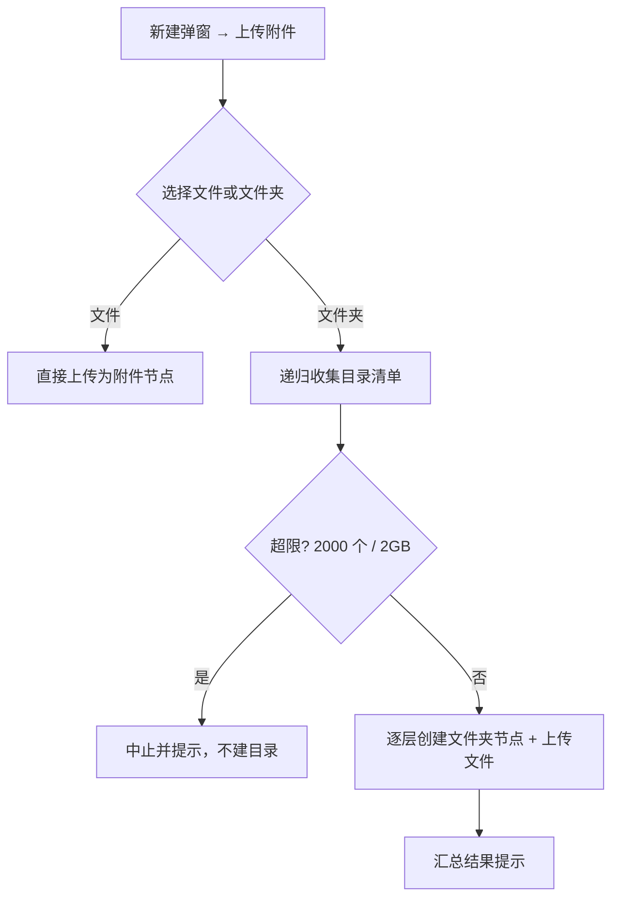
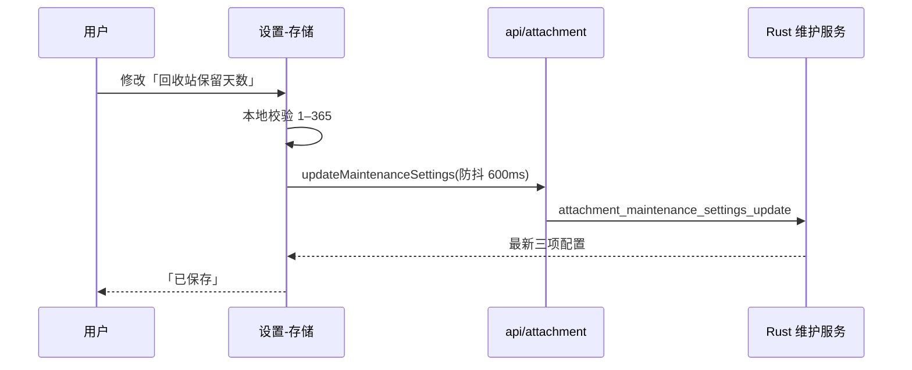

# 需求文档：界面收口（附件、知识库与存储设置）

- 日期：2026-10-29
- 关联任务：`docs/开发任务清单/2026-10-29-任务-001/`
- 上一轮：`docs/需求文档/2026-10-28-需求文档-界面收口与MCP人工确认.md`

## 1. 背景与目标

上一轮把附件从设置页挪回左侧树、去掉了程序内部的维护入口，真实使用后又暴露出八处「用户视角不成立」的地方：
附件页仍在暴露程序概念（完整性校验）、常用格式没法在应用里直接看、元信息里有一列对用户没意义的时间、
上传只能一个一个选文件、知识库管理列了一个用户不关心的条目数、保留时间改完还要再点一次保存、
清理说明里塞了只有开发者能读懂的技术名词。

目标：把这八处改成用户能直接理解和使用的形态，不改变数据模型与已有能力边界。

## 2. 范围

**做：**

1. 删除历史测试产生的遗留工作区目录（本地数据清理，不涉及代码）。
2. 去掉附件页的「校验完整性」按钮及「校验通过 / 校验失败」提示。
3. 附件预览支持：图片、纯文本（txt）、Markdown（md）、Word（docx）。
4. 附件信息表去掉「创建时间」一行。
5. 新建弹窗里的「上传附件」按钮保持不变，但允许选中文件夹：按目录层级创建文件夹节点并递归上传其中的文件，等同批量上传。
6. 知识库管理去掉「条目数」列。
7. 设置 → 存储的「保留时间」改成改完即生效，去掉「保存」按钮。
8. 「立即清理」说明去掉技术原理（hash、失效哈希索引等），只告诉用户不会删除正在使用的内容，其余统称「临时数据 / 过期数据」。

**不做：**

- 不新增附件类型、不改节点类型编号、不改附件存储与去重机制。
- 不新增「批量上传」独立入口或独立按钮（用户明确要求按钮不变）。
- 不改知识库的数据结构（只删一列展示）。
- 不改保留时间的取值范围与默认值（未使用 7 天 / 回收站 30 天 / 临时文件 24 小时）。
- 不做 xls/xlsx、pdf 等其余格式的预览（未在需求内）。

## 3. 术语

| 术语 | 含义 |
| --- | --- |
| 工作区 | 磁盘上一个目录，内含 `db/workspace.sqlite3` 与 `storage/`，由全局库 `workspaces` 表登记 |
| 附件节点 | 节点类型 6，一个节点对应一条 `attachment` 记录与一个内容对象 |
| 文件夹节点 | 节点类型 1，可包含子节点 |
| 保留时间 | 三类数据的回收阈值：未使用附件宽限期、回收站保留天数、临时文件保留小时数 |

## 4. 用户场景与业务规则

### 4.1 历史测试工作区清理（需求 1）

- 事实来源：全局库 `~/.starris/rust/db/starris.db` 的 `workspaces` 表只登记了 `2222333`（用户当前在用）。
- 磁盘上另有三个不再被任何版本使用的目录：`~/Downloads/11111`（Rust 版遗留，14 个测试节点）、`~/Downloads/1`、`~/Downloads/test`（旧 Electron 版遗留，`sync.db` 结构，现版本无法打开）。
- 规则：只删除上述三个测试遗留目录；`~/Downloads/2222333`（在用）与 `~/Documents/笔记文件夹`（旧版真实笔记，107 MB，含 lancedb 索引）**不得删除**。
- 状态变化：删除后应用的「工作区」列表不变（本来只登记一个）。

### 4.2 附件页去「校验完整性」（需求 2）

- 规则：附件节点页不再提供「校验完整性」按钮，也不再显示「校验通过 / 校验失败：…」。
- 理由：完整性是程序内部概念，用户看到「校验通过」只会困惑；对象损坏时的兜底由下载失败与日志承担。
- 不变：`verify_attachment` 命令本身保留（后续可用于内部诊断），只是不再有界面入口。

### 4.3 附件预览（需求 3）

| 类型 | 判定 | 预览方式 |
| --- | --- | --- |
| 图片 | MIME `image/*`（png/jpg/jpeg/gif/webp/svg/bmp 等） | 直接显示图片，保持比例，最大高度受限 |
| 纯文本 | MIME `text/plain` 或扩展名 `.txt` | 等宽字体显示全文，超长可滚动 |
| Markdown | MIME `text/markdown` 或扩展名 `.md` / `.markdown` | 渲染为只读排版（标题/段落/列表/代码块/引用），不是显示源码 |
| Word | 扩展名 `.docx` | 提取正文（段落文本、标题层级、列表项）后按只读排版显示；不做复杂排版还原 |

- 规则：仍然不支持的类型保持现有兜底文案「该类型暂不支持预览，可下载后查看。」
- 大小上限：文本类预览只读前 512 KB（超出在末尾提示「仅显示前 512 KB」），避免超大文件卡住界面；图片沿用现有加载方式。
- 读取失败（对象缺失、解码失败）显示明确错误文案，不回退成空白。
- 安全：预览内容一律按纯文本/受控排版渲染，不执行其中的 HTML/脚本；Markdown 渲染禁用原始 HTML 与链接跳转脚本执行。

### 4.4 附件信息表（需求 4）

- 规则：信息表保留 名称 / 大小 / 类型 / 更新时间 四行，删除「创建时间」。

### 4.5 选文件夹批量上传（需求 5）

- 入口：文件树工具栏的上传按钮（纯图标）。点它先弹一个小菜单：**选择附件 / 选择文件夹**，再进对应系统面板。
  - 新建弹窗只负责「文件夹 / 文档 / 画板 / 思维导图」四类建节点，不再包含附件入口（需求方明确：附件不是创建类型）。
  - 系统面板一次只能选文件或只能选文件夹：Tauri dialog 插件的 `directory` 是二选一，底层 rfd 在 macOS 把
    `canChooseFiles` / `canChooseDirectories` 写死互斥。自建 NSOpenPanel 试图同时置真，但在本应用里
    `runModal` 会阻塞主线程且面板不进 AX 树（2026-10-29 真机四次取证），因此回到两个官方面板 + 一次二选一。
- 规则：
  1. 选择「文件」时仍可多选文件；选择「文件夹」时整目录按层级导入。
  2. 选中文件夹时，在目标父节点下按目录层级创建文件夹节点：选中目录本身一层，内部每层子目录各一个节点。
  3. 目录中的文件按所在层级挂到对应文件夹节点下；隐藏文件（`.` 开头）与符号链接跳过。
  4. 同名冲突：同一父节点下已存在同名文件夹时复用该文件夹（不重复创建）；同名文件不覆盖，按「名称 (2).ext」自动改名。
  5. 数量与体积护栏：单次最多 2000 个文件、总大小不超过 2 GB，超出时中止并提示，不产生半成品目录树（先收集清单再写入）。
  6. 进度反馈：导入过程中显示「正在上传 x/y」，完成后汇总「已上传 N 个文件，M 个文件夹」；部分失败逐条提示但不回滚已成功的部分。
- 边界：空文件夹也创建对应节点；文件名含中文/空格正常处理；目录深度超过 32 层时截断并提示。

### 4.6 知识库管理（需求 6）

- 规则：知识库管理列表删除「条目数」列，其余列与操作不变。

### 4.7 保留时间即时生效（需求 7）

- 规则：三个输入框改动后自动保存并生效（停止输入约 600 ms 落库），删除「保存」按钮。
- 即时反馈：保存成功显示「已保存」并短暂停留；失败显示错误并**保留用户输入**，不清回旧值。
- 校验：未使用 1–365 天、回收站 1–365 天、临时文件 1–168 小时；越界时提示且不落库，输入框显示当前生效值。
- 一致性：下一轮清理使用新值；存储统计区的「最近维护」时间不因此变化（那是清理时间，不是配置时间）。

### 4.8 立即清理文案（需求 8）

- 规则：说明只保留用户能理解的一层意思 —— 会清理临时数据和过期数据，正在使用的内容不会删除；不出现「哈希」「索引」「引用」等技术名词。
- 清理行为不变。

## 5. 交互流程

## 6. 数据与迁移

- 无表结构变更：需求 2–8 全部是展示与入口调整。
- 需求 5 复用现有节点创建与附件写入路径，新增的是「先建文件夹节点再逐个上传」的编排。
- 需求 1 删除的是三个工作区目录，不触碰在用工作区与旧版真实笔记。

## 7. 验收标准

| # | 验收动作 | 期望 |
| --- | --- | --- |
| 1 | 检查磁盘 | 三个测试遗留目录不存在；`2222333` 与 `笔记文件夹` 完好 |
| 2 | 打开任意附件节点 | 页头只有「下载」，没有「校验完整性」；页面无「校验通过」 |
| 3 | 依次打开 png / txt / md / docx 附件 | 分别看到图片、文本、Markdown 排版、Word 正文；其它类型仍是原兜底文案 |
| 4 | 查看附件信息表 | 只有 名称/大小/类型/更新时间 |
| 5 | 新建 → 上传附件 → 选一个含子目录的文件夹 | 生成对应文件夹层级与文件节点，数量与磁盘一致；同名再传一次不会重复建目录 |
| 6 | 打开知识库管理 | 无「条目数」列 |
| 7 | 设置 → 存储 改任一保留天数 | 不点保存，直接重启应用后仍生效；无「保存」按钮 |
| 8 | 看「立即清理」说明 | 只有一句用户能读懂的话，无 hash/索引/引用等词 |

## 8. 风险与未决

- 需求 5 依赖系统文件面板能否同时选择文件与文件夹。若当前面板能力不支持，会在任务计划里写明落地方式（例如同一按钮打开两次面板或专用目录选择），并保证按钮外观不变。
- Word 预览只做正文提取，复杂版式（表格合并、图注、文本框）不作为验收项。
- 大文件夹上传耗时长，需保证 UI 不冻结（Rust 侧分批 + 前端进度）。
