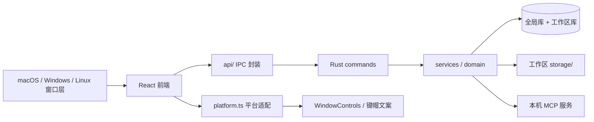
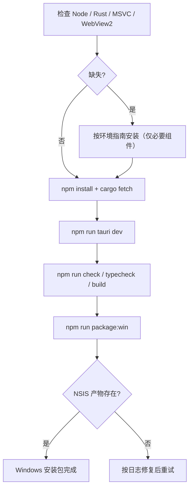
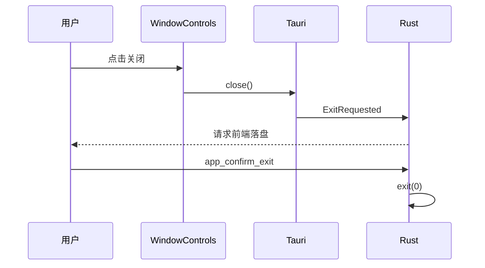
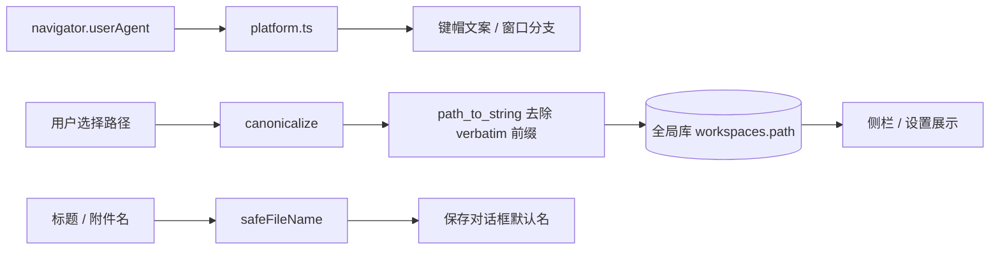
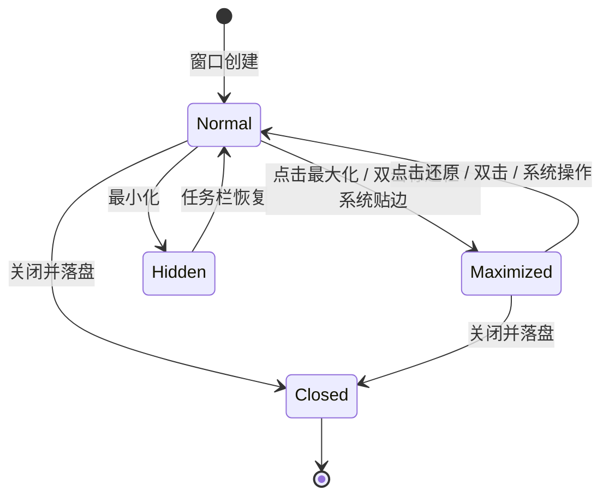
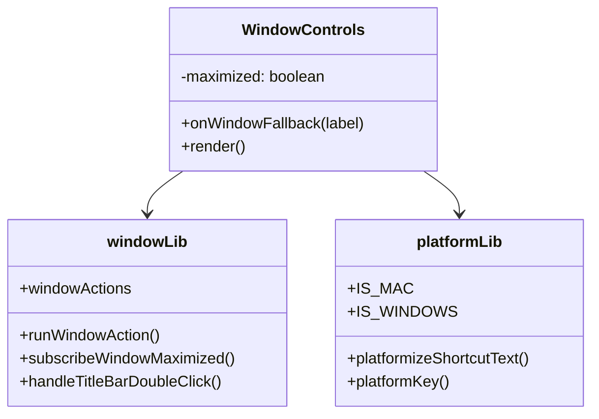
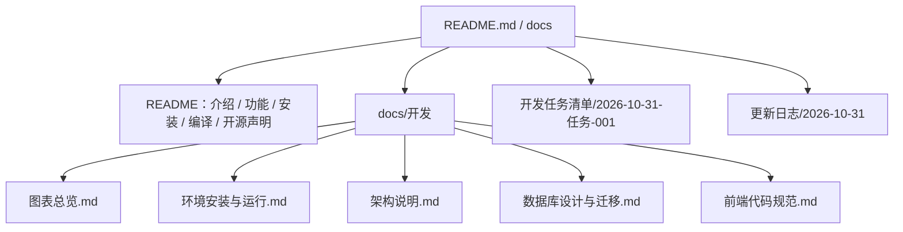
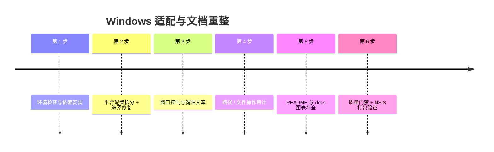

# 需求文档：Windows 平台适配与开源文档重整

- 日期：2026-10-31
- 关联任务：`docs/开发任务清单/2026-10-31-任务-001/`
- 状态：实现中

## 1. 背景与目标

星屿当前以 macOS 为主要验证平台：系统红绿灯、DMG、原生菜单、`⌘` 键帽与 `~` 路径假设都针对 macOS。Windows 用户无法按现有说明完成编译，窗口控制、快捷键文案与部分文件操作也未适配。

本需求包含四条主线：

1. 在 Windows（Windows 10/11 + WebView2 + MSVC）完成依赖安装、编译与安装包产出。
2. 为 Windows 设计并实现窗口控制（最小化 / 最大化还原 / 关闭）与整体 UI 适配。
3. 审计并修复工作空间、路径、文件读写、导入导出、附件、菜单、日志等平台差异。
4. 重写面向开源使用者的 README，并补全 docs 中过期或缺失的流程图、数据图、交互图。

术语：**平台**指 macOS / Windows / Linux；**自绘窗口控制**指无边框窗口内用 React 绘制的标题栏按钮；**verbatim 前缀**指 Windows `canonicalize` 返回的 `\\?\` 路径前缀。

角色：本地知识库用户（安装与日常使用）、贡献者（编译、测试、提交代码）、维护者（发布与文档维护）。

## 2. 范围

### 2.1 本期范围

- Windows 环境检查、依赖安装（npm / Rust / MSVC / WebView2）与编译验证。
- Tauri 配置按平台拆分；Windows 打包目标为 NSIS。
- 自绘窗口控制、拖拽区、最大化状态同步、平台快捷键文案。
- 路径、空目录判定、磁盘空间、保存文件名、菜单等平台差异修复。
- README 重写；新增图表总览、Windows 环境指南；更新架构、数据库与 UI 规范中过期内容。

### 2.2 不做

- 不改变现有业务数据模型与数据库版本（本次无迁移）。
- 不实现 Linux 发布级验收；不自建代码签名、自动更新与 CI 发布流水线。
- 不重做整体视觉风格；Windows 控制按钮沿用现有设计令牌与外观语言。
- 不删除或重写与本次无关的历史文档事实。

### 2.3 前置条件与假设

- Windows 10/11 x64，系统已安装或可安装 WebView2。
- 用户可安装 Visual Studio C++ 生成工具与 Windows SDK。
- 仓库继续使用 npm（受当前环境 pnpm 限制），迁移回 pnpm 不在本期。
- 现有 macOS 行为不得回退；未在 macOS 真机复验的部分必须在任务记录中标注。

## 3. 用户故事与业务规则

### 3.1 用户故事

- 作为 Windows 用户，我可以按 README 安装 MSVC/Node/Rust，执行 `npm run tauri dev` 启动应用，并打出 NSIS 安装包。
- 作为 Windows 用户，我看到右上角原生风格的最小化、最大化/还原、关闭按钮；双击标题栏可最大化；按钮 hover 反馈符合系统习惯。
- 作为 Windows 用户，界面中的快捷键显示为 `Ctrl/Alt/Shift`，而不是 `⌘/⌥/⇧`。
- 作为 Windows 用户，我的工作区路径、空目录选择、附件导出文件名、磁盘剩余空间都表现正常。
- 作为开源访客，我可以从 README 快速了解产品、功能、安装方式与源码编译步骤，不需要阅读内部架构。
- 作为贡献者，我可以从 docs 找到最新的架构、数据流、生命周期与平台差异图。

### 3.2 业务规则

1. 平台判定唯一入口为 `src/lib/platform.ts`；组件不得自行读取 userAgent 判断 macOS/Windows。
2. 窗口控制只在非 macOS 渲染；macOS 继续使用系统红绿灯。Windows/Linux 不挂原生菜单栏。
3. 快捷键展示：macOS 使用 `⌘/⌥/⇧`，其他平台使用 `Ctrl/Alt/Shift`；匹配仍使用逻辑 `Mod`。
4. 窗口最大化状态以 Tauri `isMaximized` 为准，并在 `resize` 后刷新；系统双击、贴边、快捷键改变尺寸均应同步图标。
5. 路径输出前去掉 Windows verbatim 前缀；UNC 路径还原为 `\\server\share`。
6. 空目录判定忽略 `.DS_Store`、`Thumbs.db`、`desktop.ini`（大小写不敏感）。
7. 附件磁盘可用空间：Unix 用 `statvfs`，Windows 用 `GetDiskFreeSpaceExW`。
8. 保存对话框默认文件名必须跨平台合法：替换非法字符、去掉结尾点/空格、避开设备保留名。
9. README 不介绍内部模块与原理，只包含：项目介绍、图标、支持功能、开源声明与致谢、安装、编译、运行。
10. 文档图表使用 Mermaid 文本图，跨模块图表以 `docs/开发/图表总览.md` 为准。

### 3.3 输入输出与状态

- 输入：平台 UA、Tauri 窗口状态、用户点击、工作区路径、导出文件名、docs 源文件。
- 输出：窗口控制 UI、平台化键帽文案、规范化路径字符串、合法默认文件名、README 与图表文档。
- 状态：窗口 `normal / maximized`；工作区 `无 / 恢复中 / 就绪 / 恢复失败`；构建 `未开始 / 编译中 / 成功 / 失败`。

### 3.4 边界与异常

- 浏览器 dev 无 Tauri 窗口：窗口按钮调用降级为 Toast，不崩溃。
- 窗口 resize 回调在窗口销毁时可能失败：忽略该次回调。
- 系统不支持圆角/阴影：窗口仍可操作，不阻塞。
- 非 MSVC 链接器（Git 自带 `link.exe`）出现在 PATH：编译失败时在环境指南中给出诊断。
- 旧版本已持久化的 `\\?\` 路径：新版本展示时还原；重新选择一次工作区即可写回普通路径。
- 图标资源缺失 `.ico`：Windows 打包失败，需保留 `icons/icon.ico`。

## 4. 交互流程与页面状态

### 4.1 窗口控制

- 常态：三枚 46×32 按钮贴右缘，最小化/最大化/关闭；hover 使用中性底，关闭按钮变 Win11 红。
- 最大化后：中间按钮切换为「还原」双框图标；再次点击恢复。
- 双击标题栏或侧栏顶部拖拽带：切换最大化；双击按钮或标签页不触发。
- 窗口失焦：按钮保留原样式（不使用系统灰态）。

### 4.2 快捷键展示

- 设置页、页头提示、空态、Toast 徽标、内置快捷键：统一显示当前平台键帽。
- 语言切换：中文与英文文案都经过平台化处理。
- 录制快捷键：仍按物理键位匹配，显示随平台变化。

### 4.3 工作区与文件

- 选择空文件夹：仅含系统噪音文件时仍允许创建。
- 保存/导出：默认文件名中的 Windows 非法字符被替换，用户仍可修改。
- 路径展示：侧栏/设置/错误提示均不出现 `\\?\` 前缀。

## 5. 图表

### 5.1 架构图

### 5.2 工作流程图

### 5.3 时序图

### 5.4 数据流图

### 5.5 生命周期图（窗口控制状态）

### 5.6 ERD

本期不新增表、不改迁移版本；沿用工作区库 v15。完整 ERD 见 [图表总览 §7](../开发/图表总览.md)。

### 5.7 类图 / 模块图

### 5.8 树状图（文档结构）

### 5.9 时间线

### 5.10 瀑布图

不适用：本期是跨平台适配与文档重整，不存在"需求 → 设计 → 开发 → 测试 → 运维"的单向阶段划分，故不绘制瀑布图。类图中已覆盖新增模块关系，ERD 明确沿用 v15，无新增数据实体。

## 6. 数据、性能与安全

- 数据：无新增表、无迁移；`workspaces.path` 继续存规范化绝对路径，但去掉 verbatim 前缀。
- 性能：新增的平台判定在模块加载时执行一次；窗口 resize 回调只做一次 `isMaximized` 查询；不引入轮询。
- 安全：路径校验与工作区删除规则不放宽；保存文件名清理只影响默认值，不改变后端校验；不在日志写用户路径全文。
- 依赖：新增 `windows-sys` 仅启用 `Win32_Storage_FileSystem`；`libc` 改为 Unix 目标专属；不引入 UI 组件库。

## 7. 验收标准

1. Windows 上 `cargo check --manifest-path src-tauri/Cargo.toml` 通过。
2. `npm run typecheck`、`npm run check`、`npm run build` 通过。
3. `npm run package:win` 在 `src-tauri/target/release/bundle/nsis/` 产出 `.exe`。
4. Windows 启动应用后可看到右上角三枚控制按钮；最小化、最大化/还原、关闭可用；最大化后图标切换。
5. 双击标题栏/侧栏拖拽带可最大化/还原；双击按钮不触发。
6. Windows 界面中不再出现裸 `⌘/⌥/⇧`（历史文档与代码注释除外）。
7. 新建工作区时，含 `Thumbs.db` 的文件夹仍被视为空；路径展示无 `\\?\`。
8. 附件统计在 Windows 显示磁盘可用空间。
9. 导出/保存对话框默认文件名不含 Windows 非法字符。
10. README 只包含项目介绍、图标、功能、开源声明与致谢、安装、编译、运行；无内部模块原理。
11. `docs/开发/图表总览.md` 覆盖架构、启动/切换/保存/退出、附件生命周期、ERD、导入导出、平台交互与质量门禁。
12. 任务目录三份记录与当天更新日志已更新，未验证项如实标注。

## 8. 未决问题与风险

- 未签名的 Windows 安装包会触发 SmartScreen；正式发布前需要代码签名（本期不做）。
- 无边框窗口在部分 Windows 10 版本可能没有系统圆角/阴影；功能不受影响，视觉与 Win11 略有差异。
- Windows 真机自动化（点击/输入）需要额外的 UI 自动化工具；本期以编译、静态检查、构建产物与手工冒烟为主，黑盒自动化如无法执行将在测试记录中标注。
- macOS 侧改动（配置拆分、菜单改为 Option）未在本机复验，需在 macOS 开发机回归红绿灯、DMG 与 Quit/Find 菜单。
- 依赖 `windows-sys` 与 `libc` 的目标拆分已在 Windows 验证；其他平台需在 CI 验证。
